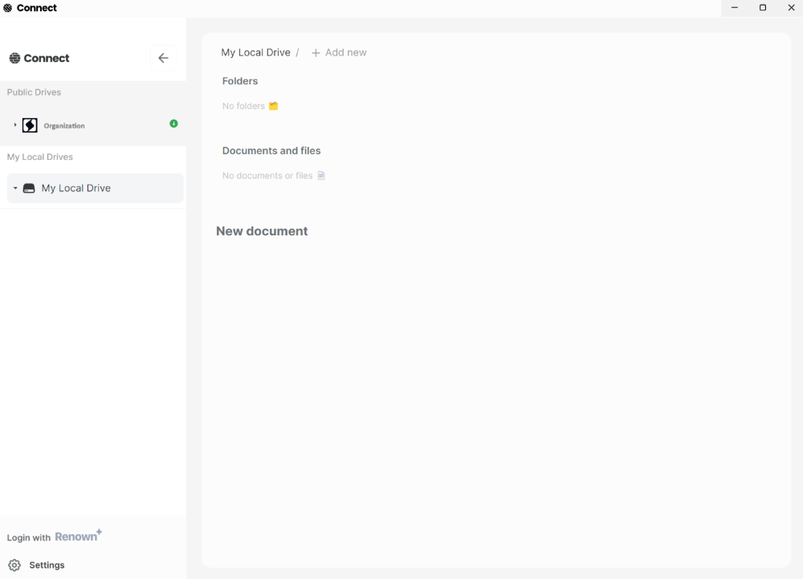

# Powerhouse Connect

Open-source desktop and web application for document model management.
Interact, create, edit and manage documents with ease.

- Connect functions as a private editor & contributor tool for contributors of open organisations. It allows teams to manage internal documents with full control over the data ownership. Connect is available as stand-alone desktop application or in the cloud.
- Connect offers a navigation menu for adding, synchronising and browsing document drives that are shared within an organisation or are private to the contributor.
- Connect allows contributors to edit and work on different 'document model types' selected or defined by the organisation.



## Prerequisites

You can follow these instructions to setup a dev environment:

- Install [**Node (LTS)**](https://nodejs.org/en/download/)
- Clone this repository
- Run `npm install` to install dependencies

**Starting Connect**

```bash
pnpm start # start desktop app
# OR
pnpm run dev # start web app
```

After initialized, you can access the web app at `http://localhost:5173`.

**Create a packaged version of the desktop app**

```bash
pnpm run make # Create package for the current platform
pnpm run make:mac # Create package for Mac OSX
pnpm run make:linux # Create package for Linux
pnpm run make:windows # Create package for Windows
```

**Test Connect production deployment**

You can test the production deployment of Connect by running it in a Docker container linked to your local packages.

```bash
pnpm run docker:build # Build the Docker image, only needs to run once
```

Build the Monorepo packages before starting a container

```bash
pnpm build:all # Build the packages, needs to run before running the Docker container
```

Run the Docker container from `apps/connect/`:

```bash
pnpm docker:run # Run the Docker container
```

Connect will be available at: `http://localhost:4000/develop/powerhouse/connect`

## Runtime configuration

Connect's runtime settings (renown URL, package registry, default drives, log level, etc.) live in `powerhouse.config.json` rather than environment variables. See [RUNTIME-CONFIG.md](./RUNTIME-CONFIG.md) for the full overview of how values are set, merged, and read by the SPA.

## Routes

Connect routes with [TanStack Router](https://tanstack.com/router) file routes. Its own routes live in `src/routes`: the root route (`__root.tsx`: global search params, titles, the not-found default), the pathless `_app` layout (`core/_app.tsx`: the sidebar) and the core routes inside it in `src/routes/core/_app` (`/`, `/d/$driveSlug/{-$nodeSlug}`, `/settings/*` and the 404 catch-all `$`). `src/routeTree.gen.ts` is generated from them (`pnpm exec tsr generate`, or `vite dev`) and committed.

For a task-by-task guide to customizing Connect from a project (pages, sidebar links, layouts, settings tabs, data, titles, navigation), see [CUSTOMIZING.md](./CUSTOMIZING.md).

### Adding routes to a deployment

A project built with `ph connect build` (or served by `ph connect studio`/`preview`, or `ph run connect`) adds routes by placing file routes in `hosts/connect/routes/`. A plain `ph build` reads the same folder.

```tsx
// hosts/connect/routes/hello.tsx
import { createFileRoute } from "@tanstack/react-router";

export const Route = createFileRoute("/hello")({
  // The router context carries the app's PH store.
  loader: ({ context }) => ({ driveCount: context.store.drives?.length ?? 0 }),
  component: Hello,
});
```

- The build mounts the routes folder under Connect's root route (global search params and titles included) and code-splits each route.
- The route tree is generated into `.ph/connect-routes.gen.ts`, which also registers the router type, so `Link` and `navigate` are typed with the project's routes. To type-check route files, the tsconfig includes `.ph/connect-routes.gen.ts` and maps `"@powerhousedao/connect/route-tree": ["./.ph/connect-routes.gen.ts"]` in `paths`; new projects are scaffolded with both, and older ones add them by hand (drop `.ph` from `exclude` too, or it filters the file out). Until a build generates the tree, the import falls back to Connect's core tree. `ph build` generates it before it runs tsc.
- A route whose full path equals a core route's (e.g. `index.tsx` for `/`) fails the build. Core routes cannot be overridden.
- The project needs `@tanstack/react-router` as a dependency, in the version Connect uses.
- Without a routes folder, no router plugin runs and Connect uses its prebuilt route tree.

### Layouts and the sidebar

Where a file sits decides whether its page has Connect's sidebar:

- `_app/<x>.tsx` renders inside Connect's `_app` layout, with the sidebar. Its id starts with `/_app`, e.g. `createFileRoute("/_app/reports")`; the URL is `/reports`.
- Any other file, e.g. `hello.tsx`, renders full-page, without the sidebar.
- Route groups, `(name)/`, only organise files.

A route adds itself to the sidebar with `staticData.nav`, and changes the sidebar for its page (and its children) with `staticData.sidebar`:

```tsx
// hosts/connect/routes/_app/reports.tsx
export const Route = createFileRoute("/_app/reports")({
  // Listed after the drives, by order; routes with path params are not listed.
  staticData: { nav: { label: "Reports", order: 10, icon: FileText } },
  component: Reports,
});

// hosts/connect/routes/_app/focus.tsx
export const Route = createFileRoute("/_app/focus")({
  // "hidden" drops the sidebar; "collapsed" keeps only its header and footer.
  staticData: { sidebar: "hidden" },
  component: Focus,
});
```

A project's `_app.tsx` replaces Connect's layout: Connect's core routes and the project's `_app/` routes then render inside it. `@powerhousedao/connect/layout` exports the parts to compose one: `AppLayout` (the default, with a `sidebar` prop), `ConnectSidebar` (with `extraItems` and `collapsed`), `SidebarDriveItems`, `SidebarNavItems`, `SidebarItem`, `useNavRoutes` and `useSidebarMode`.

```tsx
// hosts/connect/routes/_app.tsx
import { AppLayout, ConnectSidebar, SidebarItem } from "@powerhousedao/connect/layout";
import { createFileRoute } from "@tanstack/react-router";

export const Route = createFileRoute("/_app")({
  component: () => (
    <AppLayout
      sidebar={<ConnectSidebar extraItems={<SidebarItem title="Docs" href="https://docs.example" />} />}
    />
  ),
});
```

The prerendered loading shell in `index.html` always shows Connect's sidebar. With a replaced layout, or on a full-page route, the page swaps to its own layout once the app renders.

### Not found

- An unknown path matches the catch-all `core/_app/$.tsx`, so its 404 page renders inside the `_app` layout, with the sidebar. The page shows the requested path and a link home; the title is `Not found · <app>`. The URL stays as typed.
- A drive that is not listed once drive arrivals settle shows the same page, "Drive `<slug>` not found", in place of the content view. A deep-linked drive that is still arriving shows the pending view first.
- A missing document still redirects to its drive.
- A project route's own `notFoundComponent` handles its loader's `notFound()`; without one, Connect's 404 page shows in its place.

### Adding a settings tab

Settings is a page at `/settings`, with one child route per tab (`/settings/package-manager`, `/settings/about`, ...). Bare `/settings` redirects to the first tab. The tab list is built from the children of `/settings` that declare `staticData.settings`, so a project adds a tab with a file in `_app/settings/`:

```tsx
// hosts/connect/routes/_app/settings/reports.tsx
import { createFileRoute } from "@tanstack/react-router";
import { FileText } from "lucide-react";

export const Route = createFileRoute("/_app/settings/reports")({
  // label, order (Connect's tabs use 0-90), optional icon, destructive and enabled(context)
  staticData: { settings: { label: "Reports", order: 50, icon: FileText } },
  component: ReportsSettings,
});
```

- The page title becomes `Settings · Reports · <app>`; the tab needs no `head`.
- A tab whose `enabled(context)` returns false is not listed, and its URL redirects to the first tab.
- `_app/settings.tsx` itself belongs to Connect; a project file for it fails the build.
- Code opens settings with `store.navigation.open({ settings: "reports" })` (or `{ settings: true }` for the first tab), or links to it with `useLinkProps`. `showPHModal({ type: "settings" })` is deprecated and opens the page.

Embedding apps that do not build with Vite add code routes through `@powerhousedao/connect/router` instead: create them with `getParentRoute: () => connectRoutes().appRoute` (or `.rootRoute` for a full page) and pass them to `createConnectRouter({ routes })`, or call `addConnectRoutes`.

## Troubleshooting

- For a complete list of _Electron Forge_ options and requirements, visit the [official docs](https://github.com/electron-userland/electron-forge#usage).

- If you're experiencing troubles with node-gyp on Windows 11, follow [this guide](https://devkimchi.com/2021/11/26/troubleshooting-node-gyp-package-on-windows11/).

- If you're experiencing troubles with node-gyp on older versions, check out [this guide](https://spin.atomicobject.com/2019/03/27/node-gyp-windows/).

- To use yarn via Windows PowerShell, check [this guide](https://bobbyhadz.com/blog/yarn-cannot-be-loaded-running-scripts-disabled)

- For any other issues, reach out to our discord server [`#ask-powerhouse-team`](https://discord.com/channels/815917281728659516/883285185595047937) channel for help.
