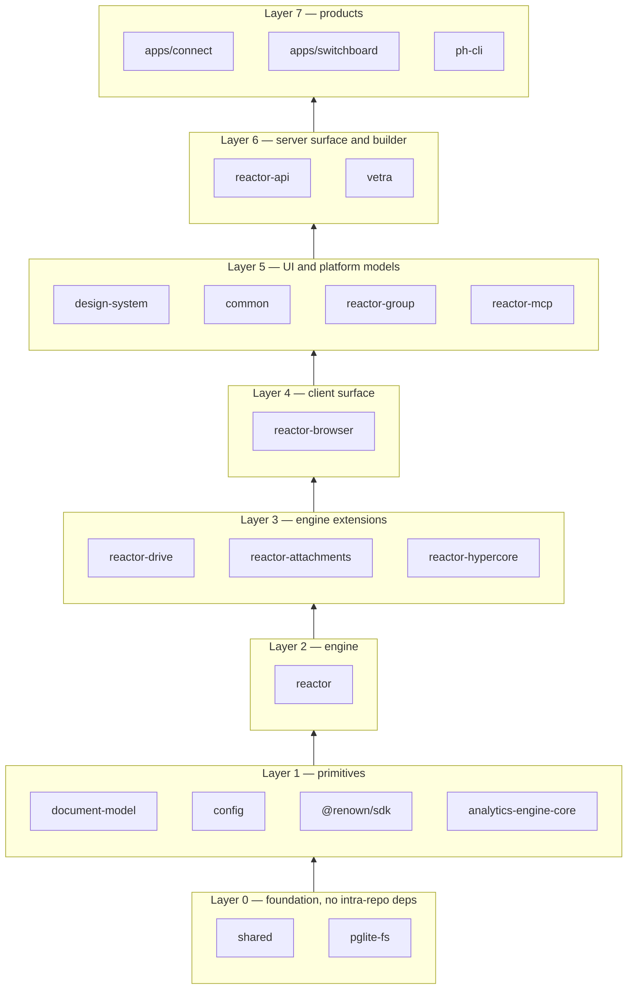
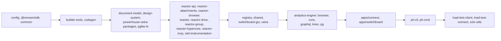
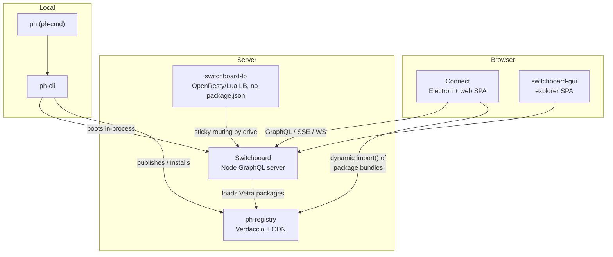
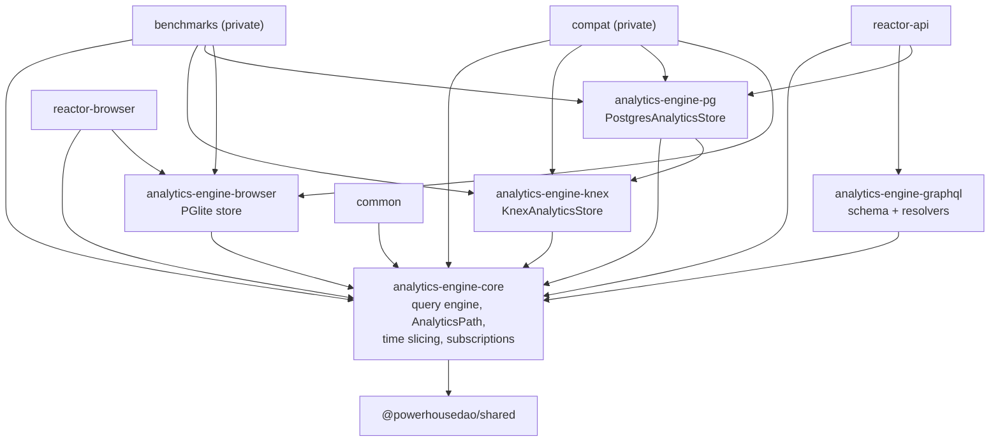
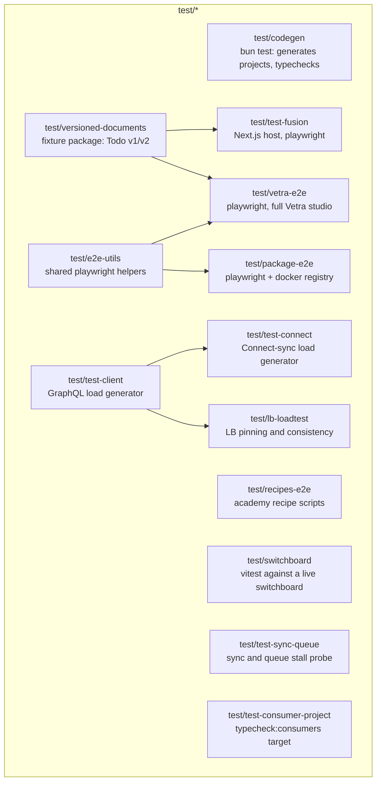

# Powerhouse monorepo — dependency map

Generated from every `package.json` in the workspace (`pnpm-workspace.yaml` globs:
`apps/*`, `clis/*`, `packages/*`, `packages/analytics-engine/*`, `test/*`, `scripts/*`).
51 workspace projects in total.

Only `workspace:*` edges are drawn — these are the intra-repo dependencies that
determine build order, TypeScript project references, and the blast radius of a change.

---

## 1. The 30-second version

The repo builds one product line in four bands:

| Band | Projects | What it is |
|---|---|---|
| **Foundation** | `@powerhousedao/shared`, `document-model`, `@powerhousedao/config`, `@powerhousedao/pglite-fs` | Types, constants, the event-sourced document primitive, config loading, a PGlite filesystem. No upward dependencies. |
| **Engine** | `@powerhousedao/reactor` plus `reactor-drive`, `reactor-attachments`, `reactor-hypercore`, `reactor-group`, `reactor-mcp`, `opentelemetry-instrumentation-reactor` | The document store: job queue, executor, operation store, read models, sync. |
| **Surfaces** | `reactor-api` (GraphQL/HTTP), `reactor-browser` (React hooks + client), `design-system`, `common`, `switchboard-gui` | How humans and machines reach the engine. |
| **Products and tooling** | `apps/connect`, `apps/switchboard`, `apps/academy`, `clis/ph-cli`, `clis/ph-cmd`, `packages/vetra`, `codegen`, `builder-tools`, `registry`, `renown` | The shipped apps, the builder platform, the CLIs, the package registry, identity. |

Plus a self-contained sub-repo, `packages/analytics-engine/*` (a time-series query
engine with pluggable stores), and a large `test/*` tree of e2e and load harnesses.

---

## 2. Full package graph (runtime `dependencies`)

```mermaid
graph TD
    classDef found fill:#1f4e5f,stroke:#0d2b35,color:#fff
    classDef engine fill:#4a3c8c,stroke:#2b2154,color:#fff
    classDef surface fill:#7a3b6e,stroke:#4a2342,color:#fff
    classDef product fill:#8c5a2b,stroke:#54361a,color:#fff
    classDef analytics fill:#2f6b3f,stroke:#1a3d24,color:#fff

    shared["@powerhousedao/shared"]:::found
    dm["document-model"]:::found
    config["@powerhousedao/config"]:::found
    pglitefs["@powerhousedao/pglite-fs"]:::found
    renown["@renown/sdk"]:::found

    reactor["@powerhousedao/reactor"]:::engine
    rdrive["reactor-drive"]:::engine
    ratt["reactor-attachments"]:::engine
    rhyper["reactor-hypercore"]:::engine
    rgroup["reactor-group"]:::engine
    rmcp["reactor-mcp"]:::engine
    otel["otel-instrumentation-reactor"]:::engine

    rapi["reactor-api"]:::surface
    rbrowser["reactor-browser"]:::surface
    ds["design-system"]:::surface
    common["@powerhousedao/common"]:::surface
    sbgui["switchboard-gui"]:::surface

    aecore["analytics-engine-core"]:::analytics
    aeknex["analytics-engine-knex"]:::analytics
    aepg["analytics-engine-pg"]:::analytics
    aebrowser["analytics-engine-browser"]:::analytics
    aegql["analytics-engine-graphql"]:::analytics

    codegen["@powerhousedao/codegen"]:::product
    builder["@powerhousedao/builder-tools"]:::product
    vetra["@powerhousedao/vetra"]:::product
    registry["@powerhousedao/registry"]:::product

    connect["apps/connect"]:::product
    switchboard["apps/switchboard"]:::product
    phcli["clis/ph-cli"]:::product
    phcmd["clis/ph-cmd"]:::product
    phvp["powerhouse-vetra-packages"]:::product

    dm --> shared
    config --> shared
    renown --> shared
    registry --> shared
    registry --> renown

    aecore --> shared
    aeknex --> aecore
    aepg --> aecore
    aepg --> aeknex
    aebrowser --> aecore
    aegql --> aecore

    reactor --> shared
    reactor --> dm

    rdrive --> reactor
    rdrive --> shared
    rdrive --> dm
    ratt --> reactor
    ratt --> shared
    rhyper --> shared
    otel -.peer.-> reactor

    rmcp --> reactor
    rmcp --> rdrive
    rmcp --> rgroup
    rmcp --> shared
    rmcp --> dm

    rbrowser --> reactor
    rbrowser --> ratt
    rbrowser --> rdrive
    rbrowser --> shared
    rbrowser --> dm
    rbrowser --> renown
    rbrowser --> aecore
    rbrowser --> aebrowser

    rgroup --> rbrowser
    rgroup --> shared
    rgroup --> dm

    rapi --> reactor
    rapi --> ratt
    rapi --> rdrive
    rapi --> rgroup
    rapi --> rmcp
    rapi --> config
    rapi --> pglitefs
    rapi --> shared
    rapi --> dm
    rapi --> renown
    rapi --> aecore
    rapi --> aegql
    rapi --> aepg

    ds --> rbrowser
    ds --> shared
    common --> shared
    common --> rbrowser
    common --> aecore
    sbgui --> ds

    codegen --> shared
    codegen --> dm
    builder --> config
    builder --> shared
    builder --> dm

    vetra --> codegen
    vetra --> config
    vetra --> ds
    vetra --> rbrowser
    vetra --> shared
    vetra --> dm

    connect --> config
    connect --> ds
    connect --> phvp
    connect --> reactor
    connect --> ratt
    connect --> rbrowser
    connect --> rmcp
    connect --> shared
    connect --> vetra
    connect --> renown
    connect --> dm

    switchboard --> config
    switchboard --> otel
    switchboard --> reactor
    switchboard --> rapi
    switchboard --> ratt
    switchboard --> rdrive
    switchboard --> rgroup
    switchboard --> pglitefs
    switchboard --> shared
    switchboard --> vetra
    switchboard --> renown
    switchboard --> dm

    phcli --> builder
    phcli --> codegen
    phcli --> common
    phcli --> config
    phcli --> reactor
    phcli --> shared
    phcli --> switchboard
    phcli --> vetra
    phcli --> renown
    phcli --> dm

    phcmd --> shared
```

> `powerhouse-vetra-packages` depends on `design-system`, `reactor-browser`,
> `reactor-drive`, `reactor-group`, `shared` and `document-model` as **devDependencies**
> only — it bundles them at build time rather than importing them at runtime, so
> those edges are left out of the graph above.

---

## 3. Layer view — the shape that actually matters

**Two edges worth memorising, because they surprise people:**

1. `reactor-group` → `reactor-browser`. `reactor-group` is a *document model
   package* (it ships the `ReactorGroup` model referenced by `{ group }` principals
   in the auth scope) but it also ships editor UI, so it depends on the browser
   hooks. Consequence: `reactor-api` → `reactor-group` → `reactor-browser`, i.e. the
   **server-side GraphQL package transitively pulls in the React client package.**
2. `ph-cli` → `apps/switchboard`. The CLI embeds the Switchboard server so that
   `ph switchboard` and `ph reactor` can boot a local backend. The CLI therefore sits
   *above* the app in build order, not beside it.

---

## 4. Build order

`pnpm build` in the root `package.json` hard-codes a `--filter` list in dependency
order. Condensed:

Notes:

- Most packages build with **tsdown**. `shared`, `document-model` and
  `powerhouse-vetra-packages` use hand-written `tsx` build scripts; `switchboard-gui`
  and `test/test-fusion` use Vite/Next directly; `apps/academy` uses Docusaurus.
- `ph-cli`, `ph-cmd` and `registry` have `postbuild` steps that **shell out to `bun`**,
  so `pnpm build` cannot complete without bun installed.
- TypeScript project references are kept in sync by `update-ts-references`
  (`pnpm check-ts-references` in CI, and on `postinstall`).
- Package `exports` maps carry a `source` condition pointing at the `.ts` entry.
  `tsconfig.options.json` sets `customConditions: ["source"]`, and the Vitest/Vite
  configs mirror it — which is why tests can run against workspace source without a
  prior `dist/` build.

---

## 5. Applications and what they wire together

- **Connect** is the editor and contributor app. It runs a reactor *in the browser*
  (PGlite-backed, optionally in a Web Worker: `apps/connect/src/reactor.worker.ts`)
  and syncs to a Switchboard.
- **Switchboard** is the server. It composes `reactor` and `reactor-api` into an
  Apollo Federation supergraph, with PostgreSQL or PGlite storage, plus OpenTelemetry,
  Sentry and Pyroscope wiring.
- **switchboard-lb** has no `package.json`; it is an OpenResty/Lua load balancer
  (`apps/switchboard-lb/lua`, `conf`, `observability`) fronting a Switchboard fleet.
- **ph-cmd** is the globally installed binary (`ph`); it resolves the project's local
  `ph-cli` and forwards to it.

---

## 6. Analytics engine sub-graph

This sub-tree was vendored in from a separate repository
(`powerhouse-inc/analytics-engine`) and keeps its own README and conventions.

---

## 7. Test and harness projects

None of these ship as product code; they exercise it.

Root scripts that drive them: `pnpm test:ci`, `test:codegen`, `test:e2e:vetra`,
`test:e2e:package`, `test:e2e:recipes`, `test:e2e:switchboard`, `test:reactor`,
`test:integration`, `test:browser`, `test:pg`, `test:integration:analytics`.

---

## 8. Reverse index — "if I change X, what breaks?"

| Change here | Rebuild and retest these |
|---|---|
| `shared` | **everything** — it is the one package allowed no intra-repo dependencies, and nearly everything depends on it |
| `document-model` | reactor, reactor-drive, reactor-browser, reactor-api, reactor-mcp, reactor-group, codegen, builder-tools, vetra, both apps, ph-cli, most of `test/*` |
| `reactor` | reactor-drive, reactor-attachments, reactor-browser, reactor-mcp, reactor-api, connect, switchboard, ph-cli, otel-instrumentation |
| `reactor-browser` | design-system, common, reactor-group (therefore reactor-api), vetra, connect, powerhouse-vetra-packages |
| `reactor-api` | switchboard, therefore ph-cli; `test/switchboard`, `test/test-sync-queue` |
| `design-system` | switchboard-gui, vetra, connect, powerhouse-vetra-packages |
| `config` | builder-tools, reactor-api, vetra, connect, switchboard, ph-cli |
| `@renown/sdk` | registry, reactor-browser, reactor-api, connect, switchboard, ph-cli |
| `analytics-engine-core` | knex, pg, browser, graphql, reactor-api, reactor-browser, common |
| `codegen` | vetra, ph-cli, ph-cmd (dev) |
| `vetra` | connect, switchboard, ph-cli |
| `apps/switchboard` | ph-cli, which embeds it |

---

## 9. Per-package documents

| Area | Files |
|---|---|
| Foundation | [shared](packages/shared.md) · [document-model](packages/document-model.md) · [config](packages/config.md) · [pglite-fs](packages/pglite-fs.md) |
| Engine | [reactor](packages/reactor.md) · [reactor-drive](packages/reactor-drive.md) · [reactor-attachments](packages/reactor-attachments.md) · [reactor-hypercore](packages/reactor-hypercore.md) · [reactor-group](packages/reactor-group.md) · [reactor-mcp](packages/reactor-mcp.md) · [otel-instrumentation](packages/opentelemetry-instrumentation-reactor.md) |
| Surfaces | [reactor-api](packages/reactor-api.md) · [reactor-browser](packages/reactor-browser.md) · [design-system](packages/design-system.md) · [common](packages/common.md) · [switchboard-gui](packages/switchboard-gui.md) |
| Builder | [vetra](packages/vetra.md) · [powerhouse-vetra-packages](packages/powerhouse-vetra-packages.md) · [codegen](packages/codegen.md) · [builder-tools](packages/builder-tools.md) |
| Platform | [registry](packages/registry.md) · [renown](packages/renown.md) |
| Analytics | [overview](packages/analytics-engine.md) · [core](packages/analytics-engine-core.md) · [knex](packages/analytics-engine-knex.md) · [pg](packages/analytics-engine-pg.md) · [browser](packages/analytics-engine-browser.md) · [graphql](packages/analytics-engine-graphql.md) |
| Apps | [connect](apps/connect.md) · [switchboard](apps/switchboard.md) · [switchboard-lb](apps/switchboard-lb.md) · [academy](apps/academy.md) |
| CLIs | [ph-cli](clis/ph-cli.md) · [ph-cmd](clis/ph-cmd.md) |
| Test harness | [index](test-harness/README.md) — 13 workspace projects plus [ph-lora](test-harness/ph-lora.md) |
| Tooling | [index](tooling/README.md) |

Start at [00-README.md](00-README.md) for the full table of contents, and
[02-conventions.md](02-conventions.md) for the build/test conventions these pages
assume.
