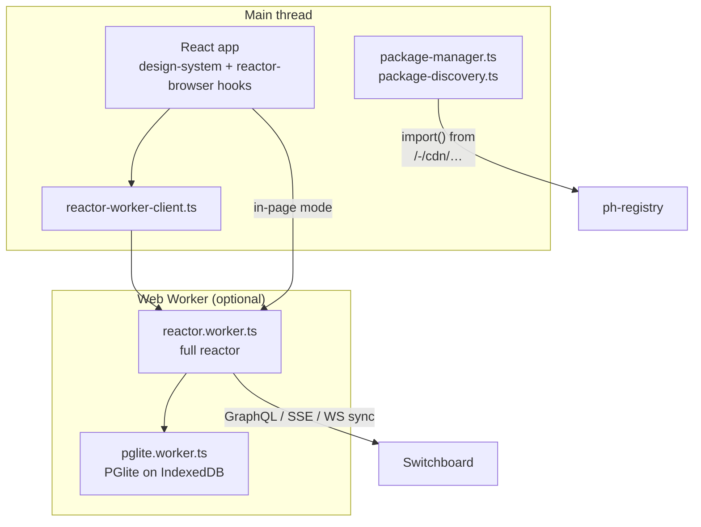
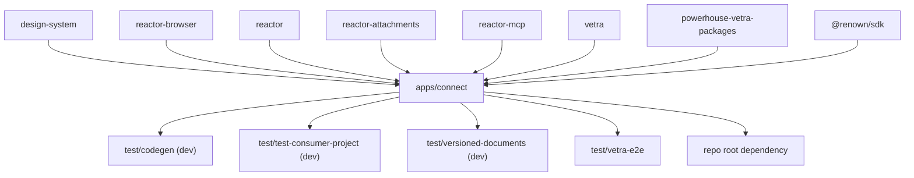

# `@powerhousedao/connect`

`apps/connect` · published · v6.2.3-dev.9

The editor application — desktop and web.

---

## Purpose

From its README:

> Open-source desktop and web application for document model management. Interact,
> create, edit and manage documents with ease.

- A private editor and contributor tool for contributors of open organisations,
  with full control over data ownership. Available as a standalone desktop app or in
  the cloud.
- A navigation menu for adding, synchronising and browsing document drives, shared
  or private.
- Editing across the document model types an organisation defines.

Architecturally it is the place where almost every other package meets: it runs a
**full reactor in the browser**, loads packages dynamically from the registry,
renders editors from the design system, and hosts Vetra Studio.

---

## Functionality



| Area | Files |
|---|---|
| **Reactor hosting** | `src/reactor.worker.ts`, `reactor-worker-client.ts`, `reactor-worker-name.ts`, `pglite.db.ts`, root `pglite.worker.ts` / `pglite.worker.legacy.ts`. The worker path uses `reactor-browser`'s `src/rpc/` to proxy the whole reactor API across a message channel |
| **Package loading** | `src/package-manager.ts`, `package-discovery.ts`, `no-registry-discovery.ts`, `ph-bundled-packages.d.ts`. Queries the registry's `/packages` endpoints and `import()`s bundles from its CDN |
| **Runtime config** | `src/runtime-config.ts`, `connect.config.ts`, `feature-flags.ts` — see below |
| **UI** | `src/components/` (app shell, router, sidebar, editors container, error boundary, banners: connection, migration, cookie, missing-model, package-install, service-worker-update), `src/pages/`, `src/context/`, `src/store/` |
| **Identity** | `renown-wallet-providers.tsx`, `renown-adapter-descriptors.ts` |
| **Telemetry** | `src/services/openpanel/` (client, events, processor) and `useOpenPanelAnalytics`; Sentry via `useInitSentry` |
| **AI** | `components/reactor-chat.tsx`, plus the bundled `reactor-mcp` |
| **Platform** | `src/i18n/`, `src/hmr.ts`, `src/globals.ts`, `src/utils/` (launch queue, PWA manifest/IDB, open-file planning) |

### Runtime configuration — the distinctive design

`RUNTIME-CONFIG.md` (and `CLAUDE.md`) document it. The short version:

> Connect reads **all** its runtime settings from a single `powerhouse.config.json`,
> fetched once at boot. **No environment variables in the SPA.**

The file exists twice: a hand-edited *source* in the project root, and a built
*dist* copy that Connect serves. Ways to set a value:

```
ph init                                    (scaffold defaults)
edit powerhouse.config.json by hand
ph connect config --<field> <value>
ph connect build --<field> <value>
ph install --registry <url>
PH_CONNECT_CONFIG_JSON env                 (deploy-time, via a Docker entrypoint)
```

Precedence: `defaults < source < CLI override`, plus deploy-time env.

**Adding a config field touches three packages and two generated files.** From
`CLAUDE.md`: the TS types/defaults and the two committed `*.schema.json` files must
stay in lockstep — rebuild `@powerhousedao/shared` and
`@powerhousedao/builder-tools`, then run `pnpm tsx scripts/emit-schemas.ts`. See
[shared](../packages/shared.md) and [builder-tools](../packages/builder-tools.md).

### Build and packaging

| Script | Does |
|---|---|
| `dev` | `vite dev` — web app on `:5173` |
| `build` | `tsdown` bundle + `tailwindcss` CSS |
| `start` | Desktop (Electron) app |
| `make`, `make:mac`, `make:linux`, `make:windows` | Packaged desktop builds |
| `docker:build`, `docker:run` | Production deployment test, with nginx config and `PH_CONNECT_BASE_PATH` |

Exports: `.`, `./main.js`, `./assets/*`, `./style.css` — it is published, so
downstream projects can embed it.

---

## Test infrastructure

Three layers.

### 1. Vitest (in-repo)

- `pnpm test` → `vitest --run`. Config: `@vitejs/plugin-react` + `vite-tsconfig-paths`.
- **`conditions: ["source", "import", "module", "browser", "default"]`** — the
  `source` export condition, matching `tsconfig.options.json`'s
  `customConditions: ["source"]`. This is what lets the suite resolve workspace
  packages (e.g. `reactor-browser`) from TypeScript source **without their `dist/`
  existing first**. The config says so explicitly.
- `include: ["test/**/*.test.{ts,tsx}", "src/**/*.test.{ts,tsx}"]`, `globals: true`.
- 20 test files:

| Group | Files |
|---|---|
| Drive auth | `components/drive-auth-gate.test.tsx`, `use-drive-auth-gate.test.ts`, `modal/modals/DriveAuthRequiredModal.test.tsx` |
| File opening | `modal/modals/OpenFileDocumentsModal.test.tsx`, `utils/open-file-plan.test.ts`, `utils/open-file-uploads.test.ts`, `utils/launch-queue.test.ts` |
| Telemetry | `components/openpanel.test.tsx`, `openpanel-traits.test.ts`, `hooks/useOpenPanelAnalytics.test.ts`, `services/openpanel/{client,events,processor}.test.ts` |
| PWA | `utils/pwa-idb.test.ts`, `utils/pwa-manifest-link.test.ts` |
| Config & reactor wiring | `test/runtime-config.test.ts`, `test/utils/default-drives.test.ts`, `reactor-namespace.test.ts`, `reactor-worker-flag.test.ts`, `signer.test.ts` |

Note `reactor-worker-flag.test.ts` — the in-page-vs-worker decision is tested
explicitly, because both modes must work.

### 2. Cypress

`cypress.config.ts`, `cypress/e2e/navigation.cy.ts` plus `fixtures/` and `support/`.
`pnpm cy:open`. Not wired into the root CI scripts — run it deliberately.

### 3. External harnesses

| Harness | What it proves |
|---|---|
| `test/vetra-e2e` (`pnpm test:e2e:vetra`) | Playwright against the real Connect-hosted Vetra Studio, 13 suites; `test:e2e:vetra:worker` reruns them with `PH_REACTOR_WORKER=1` |
| `test/package-e2e` (`pnpm test:e2e:package`) | Generate → publish → install → run, with Connect loading the package from a Dockerised registry |
| `test/test-consumer-project` | `pnpm typecheck:consumers` — Connect is a devDependency of a simulated consumer project |
| `test/codegen` | Generated projects typecheck against Connect's published surface |

---

## How it is used

Depends on: `config`, `design-system`, `powerhouse-vetra-packages`, `reactor`,
`reactor-attachments`, `reactor-browser`, `reactor-mcp`, `shared`, `vetra`,
`@renown/sdk`, `document-model` — eleven workspace packages.



It is a **leaf** in production terms — nothing in the workspace depends on it at
runtime except the test harnesses and the repo root's own `dependencies` entry. It
is the top of the stack.

### Its counterpart

`apps/switchboard` is the server side. Connect syncs to it over the GraphQL/SSE/WS
channels defined in `reactor-api`, and
`packages/reactor-api/test/connect-switchboard-sync.test.ts` and
`connect-switchboard-reshuffle-convergence.test.ts` cover the pairing from the
server's side.
