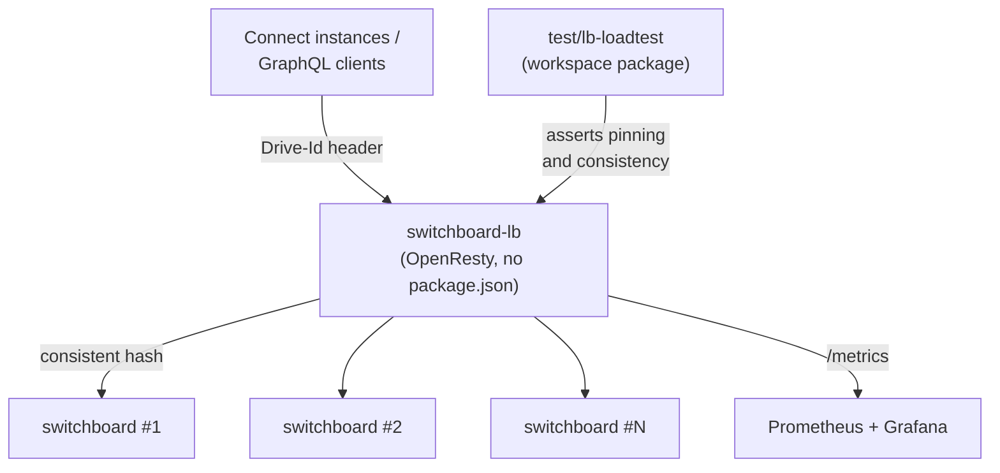

# `apps/switchboard-lb`

**Not a workspace package.** There is no `package.json`, so it does not appear in
`pnpm-workspace.yaml`, the dependency graph, `pnpm build` or `pnpm test:ci`. It is an
OpenResty (nginx + Lua) load balancer, built and run with Docker.

---

## Purpose

Route requests to a fleet of Switchboard instances such that **a given drive always
reaches the same instance**.

Switchboard is stateful per drive: the reactor serialises jobs per document, holds a
write cache, and runs a sync manager. Spreading one drive's traffic across instances
would fight all three. This LB pins a drive to a backend.

### Goals (from `ARCHITECTURE.md`)

1. **Correctness first.** A drive is always routed to the same instance for the
   lifetime of the pinning. The receiving Switchboard validates ownership and returns
   a structured **wrong-shard error** if a request landed on the wrong instance — so
   routing is *advisory*, not load-bearing for correctness.
2. **Header-driven routing.** Clients declare the owning drive via a `Drive-Id`
   request header; the LB hashes it and forwards. No body inspection on the hot path.
3. **Low, predictable tail latency** — LB-added latency in the low hundreds of
   microseconds.
4. **Operable** — structured logs, Prometheus metrics, graceful reload of the backend
   list without dropping connections.
5. **Small surface area** — a stock binary plus a few hundred lines of config, rather
   than a bespoke network daemon.

### Explicit non-goals (initially)

TLS termination (assume a TLS-terminating edge in front), HTTP/2 and HTTP/3 to the
client, authn/authz (headers forwarded untouched; Switchboard stays the policy
decision point), rate limiting, WAF, caching, dynamic service discovery (backends
come from a config file, reloaded on `SIGHUP`), and rebalancing existing documents
(pinning is sticky once established).

---

## Why OpenResty

`ARCHITECTURE.md` records the evaluation:

| Approach | Verdict |
|---|---|
| Custom C daemon | Rejected for MVP — large surface, long timeline, and the interesting problems are language-independent |
| Plain nginx | Rejected — `hash $var consistent` can hash URL params or headers but **cannot read a JSON request body**, so the path-scoped route would work and `POST /graphql` would not |
| HAProxy + Lua | Viable, but a less mature Lua ecosystem for this shape |
| **OpenResty** | **Chosen** |

What it buys: first-class body access via `ngx.req.read_body()`, mature `cjson`,
native `hash $var consistent` (rendezvous-style consistent hashing) in the upstream
block, `rewrite_by_lua` / `access_by_lua` running at exactly the phase where a
routing variable can be set *before* upstream selection, `ngx.timer.every` +
cosockets + `lua_shared_dict` for a custom probe loop, and `nginx-lua-prometheus`
for metrics without a sidecar.

The accepted tradeoff: Lua on the hot path. For GQL-sized payloads (sub-MB),
`cjson.decode` costs tens of microseconds, dominated by the network round trip — an
assumption gated by load tests.

```
clients ──HTTP──▶ switchboard-lb ──HTTP──▶ switchboard #1
                   (OpenResty)   ──HTTP──▶ switchboard #2
                                 ──HTTP──▶ switchboard #N
```

---

## Layout

| Path | Contents |
|---|---|
| `lua/route.lua` | The routing decision — reads `Drive-Id` (or body) and sets the hash variable |
| `lua/healthcheck.lua` | Custom active probing. §5.2 of the architecture doc explains why pinning forced a bespoke probe loop rather than `lua-resty-upstream-healthcheck` |
| `lua/metrics.lua` | Prometheus metrics |
| `conf/nginx.conf`, `routes.conf`, `upstreams.conf`, `log_format.conf`, `metrics.conf` | nginx configuration |
| `Dockerfile`, `docker-compose.yml`, `docker-compose.real.yml` | Images and stacks |
| `scripts/reload.sh`, `scripts/test.sh` | Graceful reload; test runner |
| `observability/prometheus.yml`, `observability/grafana/` | Prometheus scrape config and a pre-provisioned `switchboard-lb` Grafana dashboard |
| `test/` | See below |
| `ARCHITECTURE.md` | The design spec |

---

## Test infrastructure

Three layers, **none of them Vitest**.

### 1. Lua unit tests — busted

`test/spec/route_spec.lua`, `metrics_spec.lua`, `spec_helper.lua`.

Run inside the dev container (`scripts/test.sh`):

```sh
docker compose run --rm --entrypoint sh lb -c \
  'cd /usr/local/openresty/nginx/test && LUA_PATH="./?.lua;./?/init.lua;../lua/?.lua;;" busted --pattern=_spec spec/'
```

The `LUA_PATH` dance is so specs can `require("spec.spec_helper")` while still
reaching `../lua/route.lua` and `../lua/metrics.lua`.

### 2. Integration baseline

`test/integration/baseline.js` plus `BASELINE.md` — the latency baseline that gates
the "low hundreds of microseconds" goal. `test/fixtures/stub-1.conf` … `stub-3.conf`
are stub backends so routing can be tested without real Switchboards.

### 3. `test/lb-loadtest` — the real-backend harness

A workspace package (`@powerhousedao/lb-loadtest`, private), documented in
[the test-harness index](../test-harness/README.md). Its README is precise about
what it is:

> Drives a configurable mix of `createDocument` / `mutateDocument` /
> `document(identifier:)` calls through the LB at a target rate and concurrency for
> a fixed duration, asserts per-doc backend pinning + write/read consistency on
> every response, aggregates failures by category, and reports `PASS` / `FAIL`.
>
> This is **not** a throughput benchmark — it is a **load-shaped correctness test**.
> Failures are bucketed and counted, not bailed on.

Prerequisite stack:

```bash
docker compose -f apps/switchboard-lb/docker-compose.yml \
               -f apps/switchboard-lb/docker-compose.real.yml \
               --profile observability up --build
```

That builds **three** Switchboard backends (each with its own PGlite volume) behind
the LB, plus Prometheus (scraping `lb:9090` every 5 s) and Grafana with the
pre-provisioned dashboard for watching a run live. The harness drives
`http://127.0.0.1:8080/graphql` and is run with `pnpm --filter=@powerhousedao/lb-loadtest verify`.

---

## How it relates to the rest of the repo



| Relationship | Detail |
|---|---|
| `apps/switchboard` | The thing being balanced. It also implements the other half of the contract — the **wrong-shard error** that makes routing advisory |
| `test/lb-loadtest` | The only workspace package that targets it; depends on `@powerhousedao/load-test-client` and `document-model` |
| Everything else | No dependency at all — it is invisible to `pnpm build`, `tsc --build` and `pnpm test:ci` |

Because it is outside the pnpm workspace, changes here are **not** covered by the
normal CI test run. Run `scripts/test.sh` and, for anything touching pinning,
`test/lb-loadtest` against the real stack.
