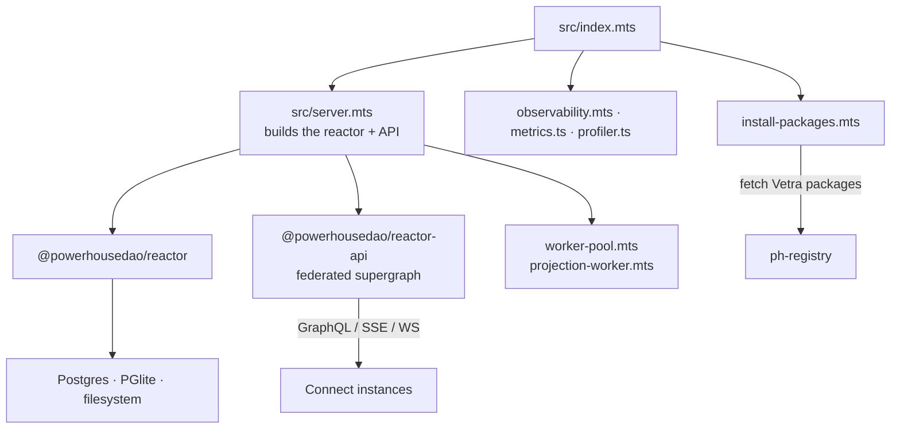
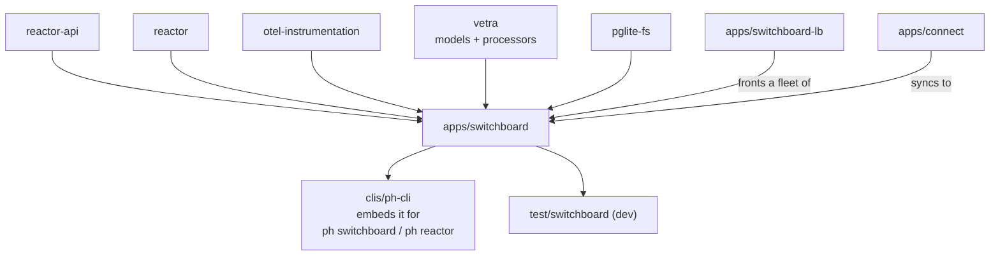

# `@powerhousedao/switchboard`

`apps/switchboard` · published · v6.2.3-dev.9 · binary: `switchboard`

The server.

---

## Purpose

From its README:

> A powerful document-driven server that provides a unified API for managing and
> serving document models, drives, and reactors in the Powerhouse ecosystem.

It is the process that hosts a reactor, exposes it through `reactor-api`'s federated
GraphQL supergraph, serves the explorer UI, stores operations in Postgres (or
PGlite), runs processors, and syncs with every Connect instance pointed at it.

Advertised features: document model and drive management over GraphQL, reactor
integration, filesystem/PostgreSQL/Redis storage, Docker-ready deployment,
configurable guest/user/admin authentication, HTTPS with custom certificates,
Pyroscope profiling, Sentry error tracking, and *"unified OpenTelemetry tracing +
metrics bootstrap, with optional Sentry APM bridging (same trace IDs in Tempo and
Sentry)"*.

---

## Functionality



| File | Role |
|---|---|
| `src/index.mts` | Process entry (the `switchboard` binary) |
| `src/server.mts` | Wires reactor + `reactor-api` + routes |
| `src/config.ts`, `feature-flags.ts`, `reactor-feature-flags.mts`, `builder-defaults.mts` | Configuration and flags |
| `src/pglite-dialect.ts`, `pglite-migration.ts`, `pglite-version.ts` | The PGlite storage path (with `@powerhousedao/pglite-fs` underneath) |
| `src/migrate.mts` | `pnpm migrate` / `migrate:status` |
| `src/worker-pool.mts` | The reactor's worker-pool executor |
| `src/projection-worker.mts` | The hybrid projection worker (see `docs/plans/2026-09-08-hybrid-projection-worker.md`) |
| `src/attachments/`, `src/attachment-reference-read-model.mts` | Server side of `reactor-attachments` |
| `src/observability.mts`, `metrics.ts`, `profiler.ts` | OpenTelemetry + Pyroscope + Sentry |
| `src/renown.ts` | Server identity |
| `src/install-packages.mts` | Fetches and registers Vetra packages at boot (`pnpm install-packages`) |
| `src/redact-webhook-path.ts` | Redacts webhook secrets from logs |
| `src/utils.mts`, `types.ts` | Supporting |

Exports: `.`, `./server`, `./utils` — it is published as a library too, which is how
`ph-cli` embeds it.

### Auth

`Auth.md` is a full tutorial. The model in brief:

- **DIDs** derived from Ethereum addresses, with W3C Verifiable Credentials and
  challenge-response proof of wallet ownership (via `@renown/sdk`).
- **Supreme admins** — a global `ADMINS` list whose addresses bypass all permission
  checks.
- **Per-document permissions** — READ / WRITE / ADMIN grants, ownership and group
  membership, enforced per document.
- Grants can be changed at runtime through the GraphQL API.

That sits alongside the reactor's own **auth scope** (`docs/specs/auth-scope.md`),
which is enforced inside the operation pipeline. Two layers: Switchboard gates the
request, the reactor gates the operation.

### Running it

```bash
pnpm --filter @powerhousedao/switchboard build
pnpm --filter @powerhousedao/switchboard dev     # concurrently: root tsc --watch + nodemon
pnpm --filter @powerhousedao/switchboard start   # node dist/index.mjs
```

`start:profile` and `start:profile:bun` add `--cpu-prof`. Docker Compose files at
the repo root cover the channels: `docker-compose.yml` (`latest`),
`.dev.yml` (`dev`), `.test.yml` (`rc`), `.staging.yml` (`staging`), and
`.pglite.yml` (no Postgres service). Host ports: Connect 3000, Switchboard 4000,
Postgres 5444 (localhost only).

---

## Test infrastructure

### Vitest config — note the isolation settings

```ts
{ pool: "forks", environment: "node", isolate: true, maxWorkers: 1,
  include: ["test/**/*.test.ts"] }
```

`maxWorkers: 1` with forked, isolated processes. These suites boot databases and
worker pools; running them concurrently would have them fight over ports and files.
Expect the suite to be slow by design.

### Suites — 14 test files

| File | Covers |
|---|---|
| `test/pglite-dialect.test.ts`, `pglite-version.test.ts` | The PGlite storage path |
| `test/worker-pool.test.ts` | The reactor worker pool as the server configures it |
| `test/projection-worker.test.ts` | The hybrid projection worker |
| `test/metrics.test.ts` | Metric wiring |
| `test/reactor-feature-flags.test.ts` | Flag resolution |
| `test/redact-webhook-path.test.ts` | Log redaction |
| `test/attachment-reference-read-model.test.ts` | Attachment reference tracking |
| `test/attachments/` (6 files) | `auth`, `routes`, `routes-integration`, `download-target`, `service-config`, `index` |

### External harnesses

| Harness | Root script | What it does |
|---|---|---|
| `test/switchboard` | `pnpm test:e2e:switchboard` | Vitest against a **running** Switchboard: `remote-controller`, `remote-drive`, `graphql-reactor-client`, `subscriptions`, `renown-self-auth`, `explorer-prefill`. Has a `global-setup.ts` |
| `test/test-sync-queue` | — | A manual sync-poller / queue-stall diagnostic CLI |
| `test/test-client` | `scenario-*` scripts | GraphQL load generation against `:4001/graphql` |
| `test/test-connect` | `pnpm test:integration` (part) | Simulates Connect sync under load |
| `test/lb-loadtest` | `pnpm verify` | Pinning and consistency against a real LB-fronted backend |
| `packages/reactor-api` | `pnpm test:integration` | `hub-spoke-catchup.integration.test.ts`, gated on `RUN_HUB_SPOKE_INTEGRATION=1` |

So the app's own suite covers its wiring, and the behaviour it wires up is tested in
`reactor` and `reactor-api`, with live-server verification in `test/*`.

---

## How it is used

Depends on: `config`, `opentelemetry-instrumentation-reactor`, `reactor`,
`reactor-api`, `reactor-attachments`, `reactor-drive`, `reactor-group`, `pglite-fs`,
`shared`, `vetra`, `@renown/sdk`, `document-model`.



**The edge to remember: `ph-cli` depends on `apps/switchboard`.** The CLI embeds the
server so `ph reactor` and `ph switchboard` can boot a real backend locally. That
puts the app *below* the CLI in build order — unusual, and the reason `apps/*` is
built before `clis/*` in the root `pnpm build` filter list.

`apps/switchboard-lb` is the OpenResty/Lua load balancer that fronts a fleet of
these; see [switchboard-lb](switchboard-lb.md).
