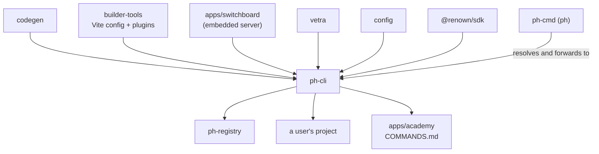

# `@powerhousedao/ph-cli`

`clis/ph-cli` · published · v6.2.3-dev.9 · binary: `ph-cli`

---

## Purpose

The working CLI. It generates code, installs packages, boots services, and manages a
Powerhouse project.

Users do not usually invoke it directly — they type `ph`, which is
[`ph-cmd`](ph-cmd.md), a launcher that resolves the *project's* `ph-cli` and forwards
to it. `ph-cli` is where the commands actually live.

---

## Functionality

### Commands (`src/commands/`)

| Group | Commands |
|---|---|
| **Generate** | `generate`, `generate-all`, `generate-document-model`, `generate-editor`, `generate-processor`, `generate-subgraph`, `generate-app`, `generate-migration-file` |
| **Project** | `init`, `build`, `migrate`, `inspect`, `list` |
| **Packages** | `install`, `uninstall`, `publish`, `unpublish` |
| **Services** | `connect`, `switchboard`, `service`, `vetra` |
| **Identity** | `login`, `logout`, `access-token`, `registry-login` |
| **Meta** | `ph-cli`, `ph-cli-commands`, `ph-cli-help` |

`src/services/` holds the implementations: `generate-*.ts`, `build.ts`,
`connect-build.ts`, `connect-config.ts`, `connect-preview.ts`, `connect-studio.ts`,
`switchboard.ts`, `switchboard-migrate.ts`, `switchboard-reset.ts`, `vetra.ts`,
`init.ts`, `inspect.ts`, `migrate.ts`, `auth.ts`, `registry-auth.ts`.

`src/utils/` holds the fiddly parts: `resolve-connect-dirs.ts`,
`resolve-switchboard-port.ts`, `parse-default-drives.ts`,
`connect-config-validation.ts`, `cli-connect-override.ts`,
`validate-remote-drive.ts`, `vetra-runtime.ts`, `configure-vetra-github-url.ts`,
`db-error-hint.ts`.

### Service management

`powerhouse-services.config.json` declares the long-running apps:

```json
{ "apps": [ { "name": "reactor", "script": "ph reactor" },
            { "name": "connect", "script": "ph connect" } ] }
```

`scripts/` also ships `setup.sh`, `setup-environment` / `setup-environment.ps1`,
`manage-environment`, and the `service-startup.sh` / `service-unstartup.sh` that
`vetra`, `powerhouse-vetra-packages` and `test/versioned-documents` call from their
own package scripts.

### Generated documentation

`postbuild` runs `bun generate-docs && bun copy-scripts`:

- `scripts/generate-commands-docs.ts` regenerates **`COMMANDS.md`** (and
  `COMMANDS-LEGACY.md`) from the command definitions.
- `copyfiles scripts/* dist/` ships the shell scripts alongside the bundle.

`COMMANDS.md` is the input to `apps/academy`'s
`scripts/generate-combined-cli-docs.ts`. Change a command → rebuild the CLI →
regenerate the academy docs.

**Bun is required** for `postbuild`, so `pnpm build` cannot complete without it.

---

## Test infrastructure

- **Runner:** Vitest, `vitest --run`. Note there is no `test` script in
  `package.json` — but there *is* a `vitest.config.ts`, and the package participates
  via the root `vitest.config.ts` `projects` glob (`clis/*/vitest.config.ts`).
- **Scale:** 13 test files in `test/`.

| File | Covers |
|---|---|
| `install.test.ts`, `publish.test.ts`, `list.test.ts`, `registry.test.ts` | Package lifecycle against a registry |
| `connect-build.test.ts`, `connect-config.test.ts`, `connect-config-validation.test.ts`, `cli-connect-override.test.ts` | The Connect build and its runtime-config flags — the CLI half of the `powerhouse.config.json` precedence ladder in `apps/connect/RUNTIME-CONFIG.md` |
| `build-name-guard.test.ts` | Build naming constraints |
| `update-config-file.test.ts` | Config mutation |
| `switchboard-reset.test.ts` | The reset path |
| `vetra-runtime.test.ts` | Vetra runtime resolution |
| `comma-separated.test.ts` | Argument parsing |

### Where the real coverage is

This CLI is the entry point for three heavy e2e harnesses:

| Harness | Root script | What it proves |
|---|---|---|
| `test/codegen` | `pnpm test:codegen` | 18 bun-test suites that run `ph generate`, then typecheck and build the output |
| `test/package-e2e` | `pnpm test:e2e:package` | `ph init` → `ph generate` → `ph publish` → `ph install` → run, with a Dockerised registry and Playwright |
| `test/vetra-e2e` | `pnpm test:e2e:vetra` | Playwright through the full Vetra studio, driven by `ph vetra` |
| `test/recipes-e2e` | `pnpm test:e2e:recipes` | Executes the CLI recipes the academy documents |

Plus `.github/workflows/test-package-managers.yml`, which exercises the CLI under
npm, yarn and pnpm.

---

## How it is used

Depends on: `builder-tools`, `codegen`, `common`, `config`, `reactor`, `shared`,
**`@powerhousedao/switchboard`**, `vetra`, `@renown/sdk`, `document-model`.



**The edge worth remembering: `ph-cli` → `apps/switchboard`.** The CLI *embeds* the
Switchboard server so `ph switchboard` and `ph reactor` boot a real backend in
process. That is why the root `pnpm build` filter list builds `apps/*` **before**
`clis/*`.

| Relationship | Detail |
|---|---|
| `ph-cmd` | The user-facing `ph` binary; finds the project's `ph-cli` and forwards |
| `codegen` | Every `generate` subcommand delegates to it |
| `builder-tools` | `ph build`, `ph connect build`, `ph connect preview` use its Vite config and plugins |
| `vetra` | `ph vetra` boots the studio; the same codegen path runs reactively there |
| `registry` | `install` / `publish` / `unpublish` / `registry-login` talk to it over the npm protocol |
| `test/*` | Depended on as a devDependency by `package-e2e`, `vetra-e2e`, `test-consumer-project`, `versioned-documents`, and as a runtime dep by `test/codegen` |
