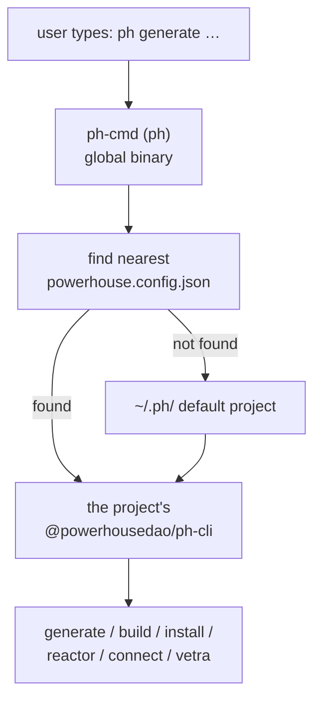

# `ph-cmd`

`clis/ph-cmd` · published (unscoped) · v6.2.3-dev.9 · binary: **`ph`**

The binary users actually install.

---

## Purpose

*"An intelligent wrapper around `ph-cli`, providing seamless command forwarding and
context-aware execution."*

The problem it solves: `ph-cli` must run **against a specific project**, at the
version that project pins. If `ph-cli` were installed globally, every project would
share one version. So `ph-cmd` is the thin global binary; it finds the right project
and the right `ph-cli`, and forwards.

```bash
npm install -g ph-cmd --legacy-peer-deps
```

---

## Functionality

### Project context detection

From the README, the CLI determines context by:

1. Looking for `powerhouse.config.json` in the current directory.
2. If not found, searching **up the directory tree** for the nearest one.
3. Using that project's package manager (npm, yarn or pnpm) to execute commands in
   the correct context.

On install it creates a **default project** in `~/.ph/` as the fallback context when
no project is found — customisable via `ph setup-globals`.

### Commands (`src/commands/`)

| Command | Purpose |
|---|---|
| `ph` | The forwarding path — anything not handled locally goes to `ph-cli` |
| `init` | Create a new project |
| `update`, `update-packages` | Update project dependencies |
| `use`, `use-local` | Switch the environment: `dev`, `prod`, `latest`, `local`. `use-local` points at a local checkout |
| `self-update` | Update `ph-cmd` itself |
| `setup-globals` | Configure the `~/.ph/` fallback project |

`src/ph-cli.ts` and `src/run.ts` are the resolution and forwarding machinery;
`src/utils/` holds version checking, caching and notification.

A `legacy/` directory (`commands/`, `utils/`) holds the pre-rewrite implementations,
matching `COMMANDS-LEGACY.md`.

### Multi-package-manager support

Advertised and tested: npm, yarn and pnpm. The environment switching
(`use dev` / `prod` / `latest` / `local`) is what lets a developer move a project
between published channels and a local checkout — directly tied to the repo's
branching strategy (`dev` on main, `staging` on release branches, `latest`/`prod`
for production).

### Generated documentation

`postbuild` runs `bun generate-docs` → `scripts/generate-commands-docs.ts` →
`COMMANDS.md` / `COMMANDS-LEGACY.md`. **Bun is required to build.** Those files feed
`apps/academy`'s combined CLI docs.

---

## Test infrastructure

- **Runner:** Vitest, `vitest --run` (plus `test:watch`). It **is** in the root
  `pnpm test:ci` filter list.
- **Scale:** 6 test files, in `__tests__/` directories beside the code — a
  convention used only here and in `vetra/processors/codegen/`.

| File | Covers |
|---|---|
| `src/commands/__tests__/update-packages.test.ts` | Dependency updating |
| `src/utils/__tests__/self-update-detect.test.ts` | Detecting that a self-update is needed |
| `src/utils/__tests__/self-update-run.test.ts` | Performing it |
| `src/utils/__tests__/version-check.test.ts` | Version comparison |
| `src/utils/__tests__/version-check-cache.test.ts` | Caching the check, so it does not hit the network every invocation |
| `src/utils/__tests__/version-check-notify.test.ts` | The upgrade notice |

Note what is covered: **self-update and version checking**, not the forwarding.
That is the right emphasis — this is a launcher whose main risk is getting version
resolution wrong, and a broken self-update is the one failure a user cannot recover
from with the tool itself.

`docs/superpowers/evidence/1958-self-update/` holds captured evidence for that work
(`01-notice-registry-fetch.txt`, `02-self-update-success.txt`,
`03-self-update-failure.txt`).

### Beyond the package

- `.github/workflows/test-package-managers.yml` — exercises it under npm, yarn and
  pnpm.
- `test/package-e2e` and `test/vetra-e2e` drive real projects through the `ph`
  binary.

---

## How it is used

Depends on: `@powerhousedao/shared` (runtime), `@powerhousedao/codegen` (dev).

It is the **thinnest** dependency footprint of any user-facing package in the repo —
deliberately, because it must install globally and start fast.



| Relationship | Detail |
|---|---|
| `ph-cli` | Not a `workspace:*` dependency — resolved **at runtime** from the target project's `node_modules`. That indirection is the entire point |
| `shared` | Shares the CLI vocabulary: `shared/clis/` holds argument parsing, `project-ports.ts`, `project-env.ts`, `command-names.ts`, telemetry — so both CLIs agree without depending on each other |
| `codegen` | devDependency only |
| `apps/academy` | Consumes its generated `COMMANDS.md` |

### The division of labour with `ph-cli`

| | `ph-cmd` (`ph`) | `ph-cli` |
|---|---|---|
| Installed | globally | per project |
| Knows about | projects, environments, package managers, its own version | document models, editors, reactors, registries |
| Workspace deps | 1 | 10 |
| Fails if | version resolution or self-update breaks | generation or a service boot breaks |
