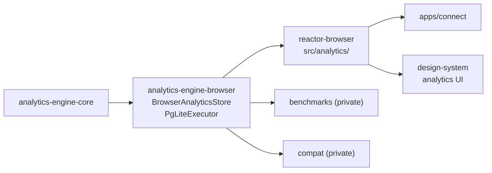

# `@powerhousedao/analytics-engine-browser`

`packages/analytics-engine/browser` · published · v6.2.3-dev.9

---

## Purpose

`IAnalyticsStore` implemented over [PGlite](https://pglite.dev/) — Postgres compiled
to WASM — so the analytics query engine runs **in the browser**, against data held
locally.

This is what makes Connect's analytics local-first: the same `AnalyticsQuery` that a
Switchboard answers from PostgreSQL can be answered in the page with no server round
trip.

---

## Functionality

Two source files plus a test-utils entry.

### `src/BrowserAnalyticsStore.ts`

`BrowserAnalyticsStore implements IAnalyticsStore`. Takes a `PGlite` **or** a
`PGliteWorker` instance — so it works on the main thread or inside a Web Worker,
which matters because Connect can run its whole reactor in a worker.

Like the Knex store it uses `luxon` for dates, `change-case` for dimension naming,
and `AnalyticsSubscriptionManager` from `core` for live queries, and it declares its
own `AnalyticsSeriesRecord` with dynamic `dim_*` columns.

Note the type difference from the Knex store: `start` and `end` are
`Date | string` here, versus `Date | null` there. PGlite returns different shapes
than node-postgres does, and reconciling that is part of what this store does.

### `src/PgLiteExecutor.ts`

`PGLiteQueryExecutor` and `parseRawResults` — executing SQL against PGlite and
normalising raw results into the record shape.

### `test-utils.ts` (exported as `./test-utils`)

```ts
export async function createFsPglite(databaseName: string) {
  const { IdbFs, PGlite } = await import("@electric-sql/pglite");
  return await PGlite.create({ fs: new IdbFs(databaseName), relaxedDurability: true });
}
```

An **IndexedDB-backed** PGlite, exported publicly so consumers' tests can build one
the same way. `relaxedDurability: true` trades crash durability for speed — fine for
a browser cache.

### Important: this is not built on `knex`

Its only workspace dependency is `analytics-engine-core`. It is a second,
independent implementation of `IAnalyticsStore`, not a Knex dialect. That is exactly
why `analytics-engine/compat` exists.

---

## Test infrastructure

- **Runner:** Vitest, `vitest --run ./**/*.test.ts`, with `test/vitest.setup.ts`.
- **Root script:** `pnpm test:integration:analytics` — the name is accurate; these
  are integration tests, not unit tests.
- **Excluded from `pnpm test:ci`.** Unlike `core`, `knex` and `graphql`, this
  package is not in the default filter list.
- **Scale:** 3 test files plus `test/utils.ts`.

| File | Covers |
|---|---|
| `test/BrowserAnalyticsStore.test.ts` | The store surface |
| `test/Integration.test.ts` | Full query paths through `AnalyticsQueryEngine` |
| `test/Persistence.test.ts` | IndexedDB persistence — data surviving a close/reopen |

### The checked-in data dumps

`dump-small.sql` and `dump-huge.sql` sit at the package root — SQL fixtures for
loading a realistic dataset into PGlite. `backup/index.d.ts` is a stray declaration
file.

### Cross-store verification

`analytics-engine/compat/test/` is the harness that matters most for this package:
it runs the same queries against the Postgres store and this one and compares the
answers. Its README describes the setup — start the `pg` Docker container, load
~200k records per the benchmarks instructions, then `pnpm test`.

---

## How it is used

Depends on: `@powerhousedao/analytics-engine-core`.



| Consumer | How |
|---|---|
| `reactor-browser` | The only production consumer. `src/analytics/` constructs the store over the page's PGlite instance; `packages/reactor-browser/test/analytics.test.tsx` covers the integration |
| `apps/connect` | Transitively, through `reactor-browser` — analytics views in the drive UI |
| `benchmarks`, `compat` | Private harnesses |

### The PGlite family in this repo

Three separate uses of PGlite, easy to confuse:

| Where | Filesystem | Purpose |
|---|---|---|
| `analytics-engine-browser` | `IdbFs` (IndexedDB) | Analytics rows in the page |
| `reactor-browser` / `apps/connect` | IndexedDB, optionally in a worker | The reactor's own operation store in the browser |
| `pglite-fs` + `apps/switchboard` | `AtomicNodeFs` (disk snapshots) | Server-side Postgres without a Postgres server |
