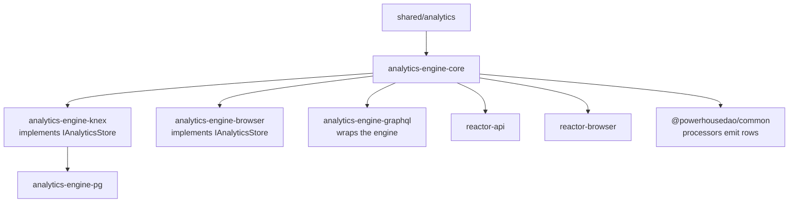

# `@powerhousedao/analytics-engine-core`

`packages/analytics-engine/core` · published · v6.2.3-dev.9

---

## Purpose

The query engine and the vocabulary every other analytics module implements or
consumes.

Package description: *"time-series query engine for document drive metrics and usage
data."*

From the sub-tree README: *"the module found in the `core/` directory is the primary
interface for interacting with the engine, and also contains query and aggregation
components."*

---

## Functionality

Thirteen source files, and the file names are the API.

### The engine

| File | Role |
|---|---|
| `AnalyticsQueryEngine.ts` | The engine. Takes an `AnalyticsQuery` (or `CompoundAnalyticsQuery`) and an `IAnalyticsStore`, returns `AnalyticsSeries` results. Handles compound operators and multi-currency conversion |
| `AnalyticsQuery.ts` | The query types: `AnalyticsQuery`, `AnalyticsSeriesQuery`, `CompoundAnalyticsQuery`, `CompoundOperator`, `MultiCurrencyConversion`, `AnalyticsSeries` |
| `AnalyticsQueryResult.ts` | Result shapes |

### The vocabulary

| File | Role |
|---|---|
| `AnalyticsPath.ts` | Hierarchical dimension paths — the core addressing primitive. A row's dimensions are paths, and queries match on path prefixes |
| `AnalyticsPeriod.ts` | Period granularity (day, week, month, …) |
| `AnalyticsTimeSlicer.ts` | Slices a time range into periods |
| `AnalyticsDiscretizer.ts` | Buckets rows into those slices — `GroupedPeriodResults`, `GroupedPeriodResult` |

### The contracts

| File | Role |
|---|---|
| `IAnalyticsStore.ts` | **The interface `knex`, `pg` and `browser` implement.** The whole pluggability of the sub-tree rests here |
| `IAnalyticsCache.ts` | Optional caching layer |
| `AnalyticsProfiler.ts` | `IAnalyticsProfiler` and `PassthroughAnalyticsProfiler` — instrumentation hooks, off by default |
| `AnalyticsSubscriptionManager.ts` | Live-query subscriptions — how a client is notified when matching rows arrive |
| `types.ts`, `util.ts` | Supporting |

Note that `AnalyticsPath` and `AnalyticsPeriod` also have counterparts in
`@powerhousedao/shared/analytics`. `shared` holds the types that must be reachable
without depending on this package; `core` holds the implementations.

---

## Test infrastructure

- **Runner:** Vitest, `vitest --run`. There is a `test/vitest.setup.ts`.
- **Scale:** 2 test files — thin for a package this central.

| File | Covers |
|---|---|
| `test/AnalyticsTimeSlicer.spec.ts` | Time-range slicing. Note the `.spec.ts` suffix — the analytics sub-tree uses both `.spec.ts` and `.test.ts`, unlike the rest of the repo |
| `test/Subscriptions.test.ts` | `AnalyticsSubscriptionManager` |

The query engine itself, `AnalyticsPath`, and the discretizer have no direct unit
tests here. They are covered indirectly:

- `packages/analytics-engine/pg/test/Integration.test.ts` and
  `browser/test/Integration.test.ts` run real queries end to end through the engine.
- `packages/analytics-engine/compat/test/` compares the two stores' answers to the
  *same* engine queries — which is the strongest test the engine has.
- `packages/analytics-engine/benchmarks/` runs it against ~200k real records.

It **is** in the root `pnpm test:ci` filter list, so its two suites run on every CI
pass.

---

## How it is used

Depends on: `@powerhousedao/shared`.

| Consumer | How |
|---|---|
| `analytics-engine-knex` / `pg` / `browser` | Implement `IAnalyticsStore` against it |
| `analytics-engine-graphql` | `AnalyticsModel` wraps an engine instance; resolvers call `queryEngine.query(filter)` |
| `reactor-api` | Composes the analytics subgraph; constructs the engine over a Postgres store |
| `reactor-browser` | `src/analytics/` runs the same engine over PGlite in the page |
| `@powerhousedao/common` | Its drive/document analytics processors produce rows in the dimensional shape `AnalyticsPath` defines |

### Where to start reading

`IAnalyticsStore.ts` first — it is short and it tells you what a store must do.
Then `AnalyticsQuery.ts` for what a caller can ask, and `AnalyticsQueryEngine.ts`
for how the two meet.
