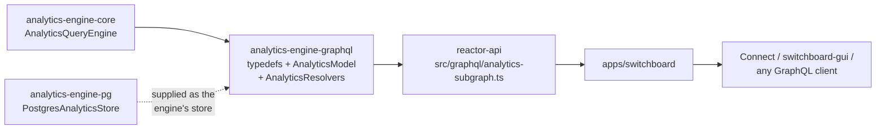

# `@powerhousedao/analytics-engine-graphql`

`packages/analytics-engine/graphql` · published · v6.2.3-dev.9

---

## Purpose

The GraphQL face of the analytics engine: a schema, a model that adapts GraphQL
filter arguments into `AnalyticsQuery` objects, and the resolvers that run them.

It is what `reactor-api` composes into the federated supergraph as the analytics
subgraph, so a Switchboard client can ask for drive metrics in the same GraphQL
request as anything else.

---

## Functionality

Three source files.

### `src/schema.ts` — the SDL

Exported as `typedefs`. The shape:

```graphql
type AnalyticsQuery {
  series(filter: AnalyticsFilter): [AnalyticsPeriod]
  multiCurrencySeries(filter: MultiCurrencyConversions): [AnalyticsPeriod]
  metrics: [String]
  dimensions: [Dimension]
  currencies: [String]
}

type AnalyticsPeriod { period: String, start: DateTime, end: DateTime, rows: [AnalyticsSeries] }
type AnalyticsSeries { dimensions: [AnalyticsSeriesDimension], metric: String, unit: String, value: Float, sum: Float }
type AnalyticsSeriesDimension { name: String, path: String, label: String, description: String, icon: String }
type Dimension { name: String, values: [Value] }
```

Two query entry points — plain `series` and `multiCurrencySeries` (currency
conversion applied across metrics) — plus three introspection fields (`metrics`,
`dimensions`, `currencies`) that let a UI build a query picker without knowing the
dataset in advance.

### `src/AnalyticsModel.ts` — the adapter

```ts
export type queryFilter = {
  start?: string; end?: string; granularity?: string;
  metrics: string[];
  dimensions: [Record<string, string>];
  currency?: string;
};
```

`AnalyticsModel` wraps an `AnalyticsQueryEngine` and converts GraphQL-shaped filters
into engine types — string dates into `luxon` `DateTime`, string granularity into
`AnalyticsGranularity`, dimension maps into `AnalyticsPath`. It also exposes a
`queryLogger` hook.

`MultiCurrencyFilter` extends the base filter with a `conversions` array of
`{ metric, sourceCurrency }`.

### `src/AnalyticsResolvers.ts`

Resolvers that pull the model off the GraphQL context
(`dataSources.db.Analytics`), call `queryEngine.query(filter)`, and reshape the
result — notably flattening each row's `dimensions` object into the
`[{ name, path, icon, … }]` list the schema declares.

Note the resolver file is written loosely typed (`any` throughout) — it predates the
repo's stricter conventions.

---

## Test infrastructure

**There are no test files.** The package has a `vitest.config.ts` and a
`test/vitest.setup.ts`, and the script

```json
"test": "vitest --run ./**/*.test.ts"
```

currently matches nothing. It **is** in the root `pnpm test:ci` filter list, so it
runs and passes vacuously — the same situation as `analytics-engine-knex`.

Where the behaviour is actually exercised:

| Harness | How |
|---|---|
| `packages/reactor-api` | Composes this schema into the supergraph. `create-schema-dedupe.test.ts` and `create-schema-scalars.test.ts` cover schema composition; `graphql-manager.test.ts` covers subgraph registration |
| `packages/analytics-engine/compat/src/` | A script that deep-compares raw results from two GraphQL endpoints (e.g. dev vs prod) — the closest thing to a resolver-level check |
| `apps/switchboard` e2e | `test/switchboard` queries a live server |

If you change the schema, the thing most likely to catch a mistake is
`reactor-api`'s schema-composition suite, not anything in this package.

---

## How it is used

Depends on: `@powerhousedao/analytics-engine-core`.



`reactor-api` is the **only** consumer. It:

1. constructs a `PostgresAnalyticsStore` (from `analytics-engine-pg`),
2. builds an `AnalyticsQueryEngine` (from `analytics-engine-core`) over it,
3. wraps that in an `AnalyticsModel` (from here),
4. mounts `typedefs` + `AnalyticsResolvers` as the analytics subgraph in the
   federated supergraph.

The browser equivalent does **not** go through this package: `reactor-browser`'s
`src/analytics/` calls the engine directly over `BrowserAnalyticsStore`, with no
GraphQL layer in between.
