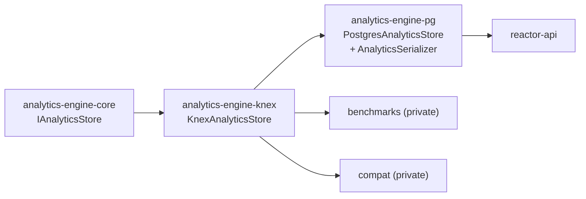

# `@powerhousedao/analytics-engine-knex`

`packages/analytics-engine/knex` · published · v6.2.3-dev.9

---

## Purpose

The SQL implementation of `IAnalyticsStore`, written against
[Knex](https://knexjs.org/) so it is not bound to one SQL dialect.

It is the shared base that `@powerhousedao/analytics-engine-pg` builds on. Nothing
consumes it directly in application code — it is an implementation layer.

---

## Functionality

Two source files.

### `src/KnexAnalyticsStore.ts`

`KnexAnalyticsStore implements IAnalyticsStore`. The interesting declaration is the
row type:

```ts
export type AnalyticsSeriesRecord = {
  id: number;
  source: string;
  start: Date;
  end: Date | null;
  metric: string;
  value: number;
  unit: string | null;
  fn: string;
  params: Record<string, any> | null;
  [dimension: `dim_${string}`]: string;   // dimensions are dynamic columns
  dimensionMetadata?: Record<string, string>;
};
```

Dimensions are stored as **dynamically named `dim_*` columns**, and `AnalyticsPath`
values are matched against them. That single design choice is what the `pg` and
`browser` stores both inherit, and it is why a cross-store compatibility harness
(`analytics-engine/compat`) is worth having.

It also declares `IQuery` and `IKnexQueryExecutor`. The comment on `IQuery` explains
the indirection:

> Using an interface here, so that a null implementation can be used in production,
> without the added overhead of calling `toString()`.

i.e. query stringification is only paid for when logging is on.

Uses `luxon` for date handling and `change-case` (`pascalCase`) for dimension
naming, and wires `AnalyticsSubscriptionManager` from `core` for live queries.

### `src/KnexQueryExecutor.ts`

`KnexQueryExecutor implements IKnexQueryExecutor`. Optional `queryLogger`,
`resultsLogger` and `IAnalyticsProfiler`; increments an index per query so logs
correlate request and result. Pushes a `"Knex"` frame onto the profiler when one is
supplied.

---

## Test infrastructure

**There are no test files in this package**, despite a `test` script and a
`vitest.config.ts`:

```json
"test": "vitest --run ./**/*.test.ts"
```

That command currently matches nothing. The package **is** in the root
`pnpm test:ci` filter list, so it runs on every CI pass and passes vacuously.

Where it is actually covered:

| Harness | How |
|---|---|
| `analytics-engine/pg/test/AnalyticsStore.test.ts` and `Integration.test.ts` | `PostgresAnalyticsStore` extends this store, so these exercise almost all of its SQL generation — against a real Postgres on port 5555 |
| `analytics-engine/compat/test/` | Compares Postgres-store answers against browser-store answers for the same queries |
| `analytics-engine/benchmarks/` | Runs it against ~200k records |

So the meaningful coverage lives one level up, in `pg`. If you change SQL generation
here, run `pnpm test:pg` (with the Docker Postgres up) — `pnpm test:ci` will not
catch you.

---

## How it is used

Depends on: `@powerhousedao/analytics-engine-core`.



| Consumer | How |
|---|---|
| `analytics-engine-pg` | The only production consumer. Adds Postgres specifics and `AnalyticsSerializer` on top |
| `benchmarks`, `compat` | Both private harnesses depend on it directly |

Note what is **not** here: `analytics-engine-browser` does *not* build on `knex`. It
implements `IAnalyticsStore` independently over PGlite (`PgLiteExecutor`). The two
SQL paths are separate implementations of the same interface, which is precisely why
the `compat` harness compares them.
