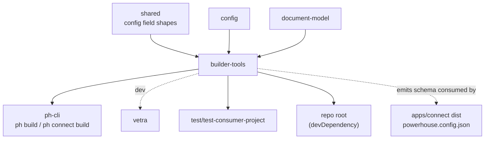
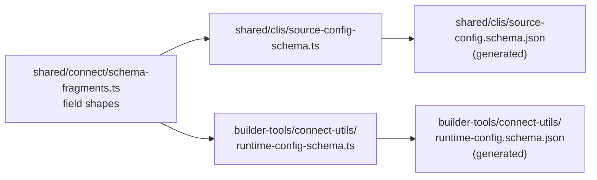

# `@powerhousedao/builder-tools`

`packages/builder-tools` · published · v6.2.3-dev.9

---

## Purpose

The build toolchain for Powerhouse projects: the Vite configuration, the Vite
plugins, and the runtime-config schema that a built Connect bundle carries.

Package description: *"Vite config, TypeScript setup, and dev-server utilities for
document model editors and drive-apps."*

Where `codegen` writes a project's *source*, `builder-tools` decides how that source
becomes a bundle — and how a bundle is configured at deploy time rather than build
time.

---

## Functionality

Single export (`.` → `index.mts` → `connect-utils/index.js`).

### Vite configuration

| File | Role |
|---|---|
| `connect-utils/vite-config.ts` | The shared Vite config a Powerhouse project (or Connect itself) builds with |
| `connect-utils/externalize-vendor.ts` | Keeps vendor deps external so packages can share one React instance |
| `connect-utils/helpers.ts`, `constants.ts`, `types.ts` | Supporting |

### Vite plugins (`connect-utils/vite-plugins/`)

| Plugin | What it does |
|---|---|
| `build-hash.ts` | Stamps a build hash into the bundle |
| `dynamic-base.ts` | Lets one build serve from any base path, resolved at runtime rather than baked in |
| `ph-config.ts` | Injects/loads the runtime `powerhouse.config.json` |
| `ph-bundled-packages.ts` | Wires statically bundled Vetra packages |
| `theme-boot.ts` | Applies the theme before first paint, to avoid a flash |
| `favicon.ts`, `pwa-icons.ts` | Icon generation |
| `pwa.ts`, `pwa-overrides.ts`, `pwa-packages.ts` | PWA manifest and service-worker integration |
| `react-self-host.ts`, `dev-external-react.ts` | React hosting strategy in prod vs dev |

Plus `connect-utils/service-worker/service-worker.ts`.

### The runtime config schema — the part to know

`connect-utils/runtime-config-schema.ts` is the **source of truth** for the JSON
Schema of Connect's `dist` `powerhouse.config.json`. It imports field shapes from
`@powerhousedao/shared`.

The committed `connect-utils/runtime-config.schema.json` is **generated — never
hand-edit it** (`packages/builder-tools/CLAUDE.md` says so explicitly).

Workflow after changing a config field:

1. Change the field shape in `@powerhousedao/shared`
   (`connect/schema-fragments.ts`, `clis/types.ts`).
2. Rebuild `builder-tools`.
3. Run `pnpm tsx scripts/emit-schemas.ts` from the repo root.

Full instructions: `apps/connect/RUNTIME-CONFIG.md` → "Adding or changing a config
field". Note that the *same* generation step also emits
`packages/shared/clis/source-config.schema.json`.

Why it matters: it is what lets one Connect build be deployed to many environments,
reconfigured by dropping a JSON file next to it.

---

## Test infrastructure

- **Runner:** Vitest, `vitest --run`.
- **Config:** `include: ["connect-utils/**/*.test.ts"]`, `globals: true`. Tests are
  colocated with the plugins.
- **Scale:** 8 test files.

| File | Covers |
|---|---|
| `connect-utils/runtime-config-schema.test.ts` | That the generated schema matches the source of truth — the guard against a hand-edited `runtime-config.schema.json` drifting |
| `vite-plugins/build-hash.test.ts` | Build hash stamping |
| `vite-plugins/dynamic-base.test.ts` | Runtime base-path rewriting |
| `vite-plugins/ph-config.test.ts` | Runtime config injection |
| `vite-plugins/theme-boot.test.ts` | Pre-paint theme application |
| `vite-plugins/pwa.test.ts`, `pwa-overrides.test.ts` | Manifest and override merging |
| `vite-plugins/pwa.e2e.test.ts` | An end-to-end PWA build check inside the Vitest run |

The `pwa.e2e.test.ts` naming is worth noting — it is an e2e test that runs under the
normal `pnpm test`, not in the Playwright harnesses.

Beyond this package, the plugins are exercised every time `apps/connect` builds, and
by `test/package-e2e`, which builds a generated project end to end.

---

## How it is used

Depends on: `@powerhousedao/config`, `@powerhousedao/shared`, `document-model`.

| Consumer | How |
|---|---|
| `clis/ph-cli` | `ph build`, `ph connect build`, `ph connect preview` and the dev server all use the shared Vite config and plugins |
| `packages/vetra` | devDependency — Vetra Studio builds with it |
| `test/test-consumer-project` | A runtime dependency, because a real consumer project builds with it |
| Repo root | Listed in the root `devDependencies`, so root-level scripts (including `scripts/emit-schemas.ts`) can reach it |

### The generated-artefact triangle

Both JSON files are outputs of `pnpm tsx scripts/emit-schemas.ts`. Editing either by
hand is the mistake both `CLAUDE.md` files warn about.
