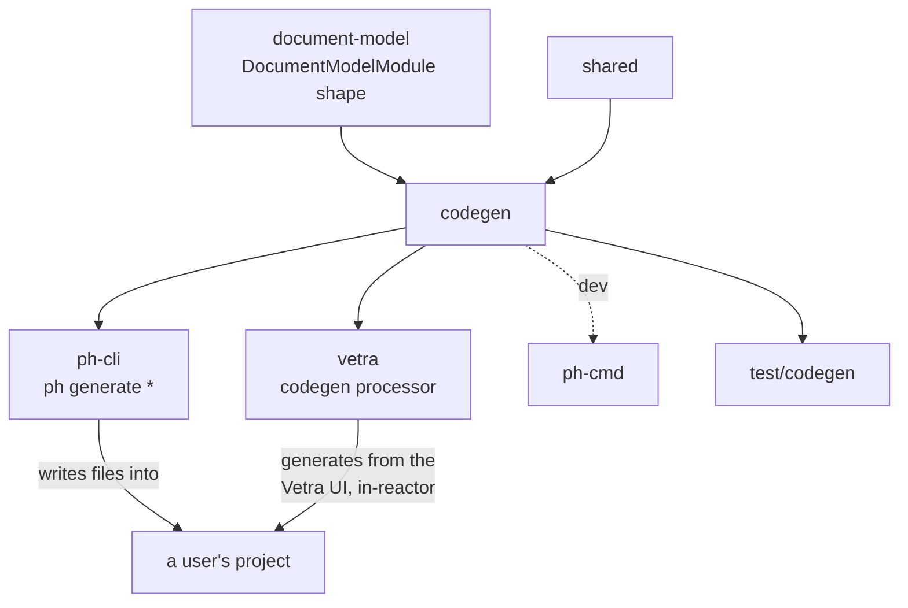

# `@powerhousedao/codegen`

`packages/codegen` · published · v6.2.3-dev.9

---

## Purpose

The code generator behind every `ph generate` command. Given a document model's
GraphQL schema, it emits TypeScript types, action creators, reducer scaffolding,
editor components, processors, subgraphs — and, for a new project, the entire
boilerplate.

Package description: *"generates TypeScript types, reducers, and editor scaffolding
from GraphQL document model schemas."*

This package is why a user never hand-writes a reducer signature or an action
creator: the GraphQL schema is the source of truth and everything else is derived.

---

## Functionality

Four export sub-paths: `.`, `./templates`, `./file-builders`, `./name-builders`,
`./utils`.

### `src/codegen/` — the driver

| File | Role |
|---|---|
| `generate.ts` | The entry point every `ph generate *` command calls |
| `graphql.ts` | Schema loading and GraphQL → TypeScript type mapping |
| `kysely.ts` | Generates relational read-model table types |
| `migrate.ts` | Document-model version migration scaffolding |
| `features.ts` | Feature flags controlling what gets generated |
| `utils.ts`, `types.ts`, `get-version.ts` | Supporting |

A `.hygen` directory is copied into `dist/` by the `copy-hygen` script — legacy
[Hygen](https://www.hygen.io/) templates kept alongside the newer builders.

### `src/file-builders/` — one builder per artefact

`document-model/`, `document-editor.ts`, `editor-common.ts`, `app.ts`,
`processors/`, `subgraphs.ts`, `manifest.ts`, `index-files.ts`,
`project-index.ts`, `clis/`, and `boilerplate/`.

`boilerplate/` is the new-project generator, and its file list shows exactly what a
scaffolded Powerhouse project contains:

```
package.json.ts        tsconfig.json.ts       powerhouse.config.json.ts
powerhouse.manifest.json.ts                   pnpm-workspace.ts
vitest.config.ts.ts    oxlintrc.json.ts       gitignore.ts    npmrc.ts
index.html.ts          main.tsx.ts            style.css.ts
document-models/       editors/               subgraphs/      reactor.ts
docker/                github/                LICENSE.ts      README.md.ts
AGENTS.md.ts  CLAUDE.md.ts  claude/  cursor/  gemini/  mcp.json.ts
```

Note the last row: generated projects ship **AI-assistant configuration** —
`CLAUDE.md`, `AGENTS.md`, `.claude/`, `.cursor/`, Gemini config and an `mcp.json`
that points at `reactor-mcp`. Agent-first tooling is baked into the scaffold, which
is consistent with Vetra's "agent-first builder platform" description.

There are also `.legacy` variants (`package.json.legacy.ts`,
`index.html.legacy.ts`) for the older project layout.

### `src/templates/`

`document-model/` (`actions.ts`, `hooks.ts`, `gen/`, `tests/`), `document-editor/`,
`app/` (`components`, `config.ts`, `editor.ts`), `processors/`, `subgraphs/`,
`boilerplate/`, `cli-docs/`.

Note `templates/document-model/tests/` — generated document models come **with a
test suite**, which is why every model package in the repo (`reactor-group`,
`vetra`, `test/versioned-documents`) has `document-models/<name>/v1/tests/`.

### `src/name-builders/`, `src/ts-morph-generator/`, `src/create-lib/`

Name derivation (`get-action-names.ts`, `get-variable-names.ts`), AST-level
generation via **ts-morph** (`core/`, `utilities/`) for modifying existing files
rather than writing new ones, and library scaffolding.

---

## Test infrastructure

This package's own suite is **minimal**, and deliberately so — the real testing
happens by generating projects and compiling them.

### In-package

- No `test` script in `package.json`. A `vitest.config.ts` exists, but the package
  is not in the root `pnpm test:ci` filter list.
- 4 test files, colocated:

| File | Covers |
|---|---|
| `src/file-builders/boilerplate/package.json.test.ts` | The generated `package.json` shape |
| `src/file-builders/boilerplate/project-ports.test.ts` | Port assignment in generated config |
| `src/templates/document-model/tests/document-model.test.ts` | Shipped as part of the generated output, and run here too |
| `src/templates/document-model/tests/module.test.ts` | Same |

The last two are doing double duty: they are template files that land in a user's
project *and* run in place.

### The real harness: `test/codegen`

`pnpm test:codegen` → `pnpm --filter=test-codegen run test`, which runs
**`bun test --timeout 1000000 --preload ./setup.ts ./tests/*.test.ts`**.

That harness (18 test files) generates whole projects with `ph generate`, then
typechecks and builds them. It depends on `codegen`, `ph-cli`, `common`, `config`,
`connect`, `design-system`, `reactor`, `reactor-api`, `reactor-browser`, `shared`
and `document-model` — i.e. it can only pass if the generated code compiles against
the real published surface of all of them.

CI runs it separately: `.github/workflows/codegen-tests.yml`.

Additional end-to-end coverage: `test/package-e2e` (generate → publish → install →
run), `test/vetra-e2e` (generate through the Vetra UI), and
`test/test-consumer-project` (`pnpm typecheck:consumers`).

---

## How it is used

Depends on: `@powerhousedao/shared`, `document-model`.



| Consumer | How |
|---|---|
| `clis/ph-cli` | Every `generate` subcommand (`generate-document-model`, `generate-editor`, `generate-processor`, `generate-subgraph`, `generate-app`, `generate-migration-file`, `generate-all`) calls into it |
| `packages/vetra` | `processors/codegen/` runs codegen **as a reactor processor** — editing a document model document in the Vetra UI regenerates code on disk. This is the agent-first loop |
| `clis/ph-cmd` | devDependency only |

### Why the two callers matter

`ph-cli` is the imperative path: a developer types `ph generate document-model`.
Vetra is the reactive path: a document model *document* changes in a reactor, a
processor observes the operation, and codegen runs. Both go through this package, so
a change in generated output shows up in both flows at once.
