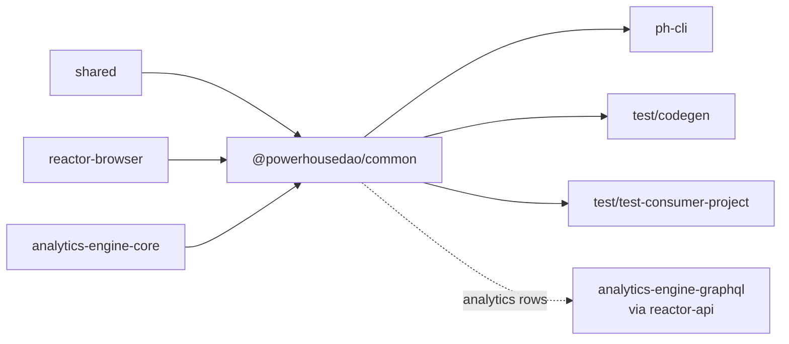

# `@powerhousedao/common`

`packages/common` · published · v6.2.3-dev.9

---

## Purpose

A small grab-bag of things that Connect and Vetra Studio both need and that do not
belong in `shared` (because they *do* depend on other workspace packages).

Package description: *"base document model and drive UI components required for
Connect and Vetra Studio."*

In practice the package today is two things: a handful of utilities, and the
**drive analytics processors**.

---

## Functionality

The root entry is three lines:

```ts
// packages/common/index.ts
export type * from "./types.js";
export * from "./utils/index.js";
export type { ProcessorApp } from "@powerhousedao/shared/processors";
```

| Export | Contents |
|---|---|
| `.` | `types.ts`, `utils/` (`mock.ts` — document/drive test fixtures; `vetra-gql.ts` — GraphQL documents for talking to a Vetra reactor), plus the `ProcessorApp` type re-exported from `shared` |
| `./utils` | The same utilities, directly |
| `./analytics` | `drive-analytics.ts` → `drive-analytics/` |

### The drive analytics processors

`drive-analytics/` is the substantial part, with its own README. Two processors
implementing `IProcessor`, consuming `InternalTransmitterUpdate` strands:

| Processor | Analyses |
|---|---|
| `DriveAnalyticsProcessor` | Document Drive operations — file creation, updates, moves, deletions |
| `DocumentAnalyticsProcessor` | Individual document operations and modifications |

Both convert operations into **time-series analytics rows** with dimensional
information (drive, branch, scope, user), which is why the package depends on
`analytics-engine-core`. They are what makes the analytics subgraph in `reactor-api`
have anything to query.

`useDriveAnalytics.ts` and `useDocumentAnalytics.ts` are the React-side counterparts.

---

## Test infrastructure

**There is none in this package.** No `vitest.config.ts`, no `test` script, zero
test files. Its scripts are `build` (tsdown), `tsc`, `lint`, and `dev`
(`ph-cli dev --config-file ./powerhouse.config.json`).

Where the behaviour is covered instead:

- **Processor contracts** — `packages/reactor/test/processors/` covers the
  `IProcessor` machinery these implement.
- **Analytics storage and querying** — `packages/analytics-engine/core/test/` and
  the `pg` / `browser` store suites.
- **End-to-end** — `test/codegen` depends on this package and typechecks generated
  projects against it; `apps/connect` exercises the hooks in its own suites.

This is a gap worth knowing about: the drive analytics processors, which decide the
shape of every analytics row the platform produces, have no direct unit tests.

---

## How it is used

Depends on: `@powerhousedao/shared`, `@powerhousedao/reactor-browser`,
`@powerhousedao/analytics-engine-core`.



| Consumer | How |
|---|---|
| `clis/ph-cli` | A runtime dependency — the CLI registers the drive analytics processors when it boots a local reactor |
| `test/codegen` | Generated projects import it, so it is part of the "does a generated project compile" contract |
| `test/test-consumer-project` | Same, as the `typecheck:consumers` target |

It is a comparatively thin package, and the direction of travel is visible in its
own description: it was meant to hold base document models and drive UI, and most of
that has since moved to `powerhouse-vetra-packages` and `design-system`. What
remains is the analytics processors plus fixtures.
