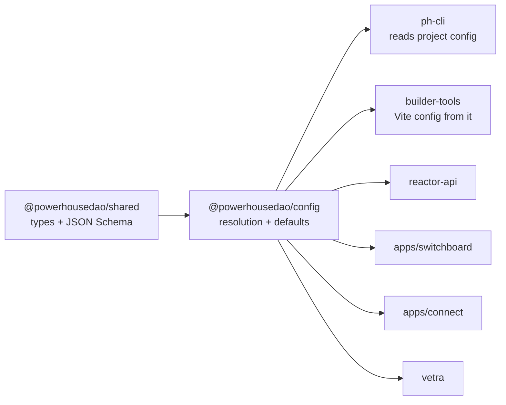

# `@powerhousedao/config`

`packages/config` · published · v6.2.3-dev.9

---

## Purpose

Resolves and types `powerhouse.config.json` — the per-project file that tells every
Powerhouse tool where the document models live, which packages to load, what ports
to bind, and which storage backend to use. It is the bridge between a user's project
directory and the services (`ph reactor`, `ph connect`, Switchboard, Connect) that
run against it.

---

## Functionality

A small package: four source files, two export sub-paths.

| File | Role |
|---|---|
| `src/index.ts` | Re-exports `packages.js` and `powerhouse.js` |
| `src/powerhouse.ts` | `LogLevels` / `LogLevel` / `isLogLevel`; re-exports the `PowerhouseConfig`, `PowerhousePackage`, `PHPackageProvider`, `Manifest`, `DocumentModelModule`, `Publisher` types from `shared`; `DEFAULT_CONFIG` and `DEFAULT_REGISTRY_URL` from `shared/clis`; `VetraProcessorConfigType`; and `resolveRegistryConfig()` |
| `src/packages.ts` | `PH_PACKAGES` — the built-in package list (currently `@sky-ph/atlas`) |
| `src/node.ts` | Node-only entry, exported as `./node` |

Note the division of labour: the config **types and defaults are defined in
`@powerhousedao/shared`**; this package re-exports them and adds the resolution
logic. That keeps `shared` dependency-free while giving consumers a single
`@powerhousedao/config` import.

`resolveRegistryConfig(config, env)` is the notable piece of behaviour — it works
out the effective registry URL and the list of registry-provided package names from
the config plus environment overrides.

### The config file itself

From the package README, an example:

```json
{
  "documentModelsDir": "./document-models",
  "editorsDir": "./editors",
  "logLevel": "verbose",
  "studio": { "port": 3000 },
  "reactor": { "port": 4001 },
  "packages": []
}
```

Documented `reactor` options include `port`, `storage.type` (`memory`, `filesystem`,
`browser`, `postgres`), `storage.postgresUrl`, and `storage.filesystemPath`.

---

## Test infrastructure

**There is none in this package.** No `vitest.config.ts`, no `test` script, zero
test files. Its scripts are `build` (tsdown), `tsc` and `lint` only.

Where the behaviour is actually covered:

- Schema shape and defaults are tested in `@powerhousedao/shared`:
  `clis/source-config-schema.test.ts`, `clis/project-ports.test.ts`,
  `clis/project-env.test.ts`, and the `connect/config-loader.test.ts` group.
- End-to-end config resolution is exercised by `test/vetra-e2e` and
  `test/package-e2e`, which generate real projects with real
  `powerhouse.config.json` files and run the CLIs against them.

If you change resolution logic here, the tests that will catch you live in `shared`
and in the e2e harnesses — not next to the code.

---

## How it is used

Depends on: `@powerhousedao/shared`.

Depended on by: `builder-tools`, `reactor-api`, `vetra`, `apps/connect`,
`apps/switchboard`, `clis/ph-cli`, plus `test/codegen` and
`test/test-consumer-project` (dev).



- **`ph-cli`** loads the nearest `powerhouse.config.json` to decide where to
  generate, which reactor port to bind, and which packages to install.
- **`builder-tools`** derives the Vite build configuration from it.
- **`apps/switchboard`** and **`apps/connect`** read it at boot to configure storage
  and package loading.
- The related but separate artefact is Connect's *runtime* `powerhouse.config.json`
  in its `dist/`, whose JSON Schema is generated in `builder-tools` — see
  `apps/connect/RUNTIME-CONFIG.md`.
