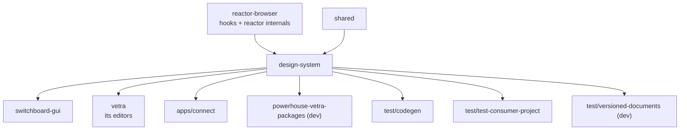

# `@powerhousedao/design-system`

`packages/design-system` · published · v6.2.3-dev.9

---

## Purpose

The shared React component library. Three layers in one package:

1. **`ui/`** — primitive, GraphQL-scalar-aware form components (the building blocks
   an editor is made of).
2. **`connect/`** — application-level components specific to Connect and Studio:
   drive explorer chrome, editor toolbars, inspectors, login.
3. **`powerhouse/`** — the older base layer (modals, sidebar, hooks) still in use.

Package description: *"Powerhouse document-engineering design system — GraphQL scalar
UI components for building consistent Powerhouse editors."*

---

## Functionality

### `src/ui/components` — primitives

`button`, `checkbox`, `command`, `input`, `text-input`, `text-field`, `enum-field`,
`radio-group-field`, `select-field`, `id-autocomplete`, `search-autocomplete`,
`json-viewer`, `popover`, `tooltip`, `sidebar`, `character-counter`, and the form
scaffolding (`form`, `form-group`, `form-label`, `form-description`,
`form-message`, `with-field-validation`, `value-transformer`).

The GraphQL-scalar angle: a document model's schema declares field types, and these
components are the rendering counterpart, so a generated editor looks consistent
without hand-styling.

### `src/connect/components` — application chrome

Drive/file UI (`file-item`, `folder-item`, `breadcrumbs`, `drop-zone`,
`upload-file-item`, `upload-file-list`, `node-input`, `home-screen`, `sidebar`,
`search-bar`, `tabs`, `toast`, `modal`, `dropdown-menu`), editor chrome
(`document-toolbar`, `editor-action-buttons`, `editor-undo-redo-buttons`,
`revision-history`, `document-timeline`, `document-state-viewer`,
`default-editor-loader`), identity (`renown-login`, `account-popover`, `ens-avatar`,
`consent-banner`, `drive-auth-gate`), and a full **inspector suite**:
`db-explorer`, `debug-inspector`, `integrity-inspector`, `processors-inspector`,
`queue-inspector`, `remotes-inspector`, `worker-inspector`, `object-inspector-modal`.

Those inspectors are direct windows onto reactor internals — queue depth, sync
remotes, worker pool, document integrity — which is why this package depends on
`reactor-browser`.

### Supporting

`src/services/viem.ts` (ENS/wallet display), `src/utils/`, `scripts/create-icon-components.ts`
(generates icon components from SVG assets), `style.css` + `theme.css` compiled to
`dist/style.css` by Tailwind.

Exports: `.`, `./*`, `./ui`, `./ui/lib`, `./ui/*`, `./connect`, `./connect/toast`,
`./style.css`, `./theme.css`.

### Font requirement

The README is explicit: the design system uses **Inter**, and consumers must load it
— preferably via `<link>` tags with `preconnect` rather than a CSS `@import`.

---

## Test infrastructure

Three distinct mechanisms.

### 1. Vitest

- `pnpm test` → `vitest run --exclude "src/scalars/**"`.
- `environment: "happy-dom"`, `globals: true`, `setupFiles: ["./setupTests.js"]`
  (which imports `@testing-library/jest-dom`).
- 54 test files, colocated with components rather than in a `test/` tree.
- Note the `--exclude "src/scalars/**"`: a leftover exclusion — there is no
  `src/scalars` directory today, the scalar components having moved under `src/ui`.

### 2. Snapshot testing

Many components carry a `__snapshots__/` directory: `button`, `character-counter`,
`command`, `enum-field`, `form-description`, `form-group`, `form-label`,
`form-message`, `id-autocomplete`, `input`, `popover`, `radio-group-field`,
`select-field`, `modal` (both `ui`- and `connect`-level), `search-bar`, `sidebar`.
Rendered output is pinned, so a styling change shows up as a snapshot diff.

### 3. Storybook + Chromatic

- **93 `*.stories.tsx` files** — the real coverage surface for visual behaviour.
- `pnpm storybook` (dev, port 6006), `pnpm build:storybook` (static build).
- `pnpm chromatic` publishes to Chromatic for visual regression review.
- The root `pnpm build:storybook` and `simulate-ci-workflow` both build Storybook,
  so a broken story fails CI.
- `src/ui/components/storybook-arg-types.tsx`, `decorators.tsx` and `testing.tsx`
  are the shared story/test harness.

---

## How it is used

Depends on: `@powerhousedao/reactor-browser`, `@powerhousedao/shared`. Dev:
`@powerhousedao/config`.

| Consumer | How |
|---|---|
| `apps/connect` | The whole application shell — sidebar, drive explorer, toolbars, inspectors, login |
| `packages/vetra` | Its five editors (app, document, processor, subgraph, vetra-package) are built from these components |
| `switchboard-gui` | Its only workspace dependency |
| `powerhouse-vetra-packages` | Bundles it for the document-model editor and generic drive explorer |
| Generated user packages | `ph generate editor` scaffolds against these components — which is why the scalar/form layer is the stable contract |

### The dependency direction worth noting

`design-system` → `reactor-browser`, not the other way round. UI components reach
into reactor state (the inspectors especially). If you need a component that does
*not* need reactor access, put it in `src/ui/`, which stays closest to
presentation-only.
