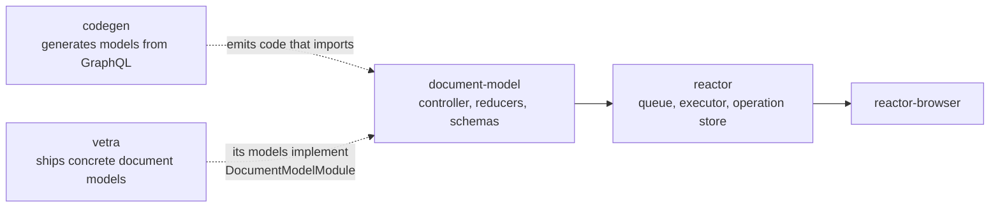

# `document-model`

`packages/document-model` · published (unscoped name) · v6.2.3-dev.9

---

## Purpose

The event-sourced document primitive the whole platform is built on. A `PHDocument`
is a header plus scoped state, mutated only through typed **Actions** that reduce to
immutable **Operations**. Everything the reactor stores, syncs and replays is a
document in this sense.

The package's own description: *"foundational data structure for local-first,
event-sourced documents with typed operations, reducers, and GraphQL schema
validation."*

---

## Functionality

The entry point is small and mostly a re-export:

```ts
// packages/document-model/index.ts
export * from "@powerhousedao/shared/document-model";
export * from "./src/controller.js";
export * from "./src/logger-types.js";
export * from "./src/logger.js";
export * from "./src/module.js";
export * from "./src/state.js";
```

So the **vocabulary** (actions, operations, headers, auth, crypto, document schema,
reducer types) lives in `@powerhousedao/shared/document-model`, and this package adds
the **behaviour** on top:

| File | Role |
|---|---|
| `src/controller.ts` | The document controller — applies actions, manages operation history |
| `src/state.ts` | State handling and scope management |
| `src/module.ts` | The `DocumentModelModule` contract: how a document model registers its reducers, schema and actions |
| `src/logger.ts`, `src/logger-types.ts` | The logging abstraction used across the reactor stack |
| `schemas/document`, `schemas/document-model` | GraphQL schemas for the base document and for the meta document-model document |

### Export sub-paths

| Export | Points at | Use |
|---|---|---|
| `.` and `./core` | `index.ts` | Normal consumption |
| `./mock` | `mock.ts` | Test fixtures — mock documents and actions |
| `./test` | `test/index.ts` | Shared test helpers exported for other packages' suites |
| `./node` | `node.mts` | Node-only entry (separate `node` export condition) |

The `./test` export matters: other packages' suites import document fixtures from
here rather than re-rolling them.

---

## Test infrastructure

- **Runner:** Vitest, `vitest --run` (plus `test:watch`). The config is a
  `defineProject` with just `globals: true` — it participates in the root
  `vitest.config.ts` `projects` array.
- **Scale:** 108 test files. This is one of the most heavily tested packages in the
  repo, and for good reason — it encodes the operation-history algebra everything
  else assumes.
- **Layout:**

| Directory | What it pins down |
|---|---|
| `test/document/` | Document lifecycle: `crypto`, `auth-persistence`, `document-scope-on-create`, `event-vs-command`, `local`, `operation-id`, `undo-redo` and `undo-redo-v2`, `unsupported-version-error`, `versioned-replay`, `utils` |
| `test/document-helpers/` | The operation-history algebra, one file per helper: `addUndo`, `attachBranch`, `checkCleanedOperationsIntegrity`, `conflictResolution`, `filterDuplicatedOperations`, `garbageCollect`, `groupOperationsByScope`, `headerRevision`, `merge`, `nextSkipNumber`, `prepareOperations`, `removeExistingOperations`, `reshuffleByTimestamp`, `reshuffleByTimestampAndIndex`, `skipHeaderOperations`, `sortOperations`, `split` |
| `test/document-model/` | The auth scope: `auth-actions`, `auth-carveout`, `auth-conditions`, `auth-decide`, `auth-groups`, `auth-validation`, plus `replay` |
| `test/helpers.ts`, `test/types.ts` | Shared fixtures, also re-exported publicly via the `./test` entry |

The `document-helpers` directory is the place to look when reasoning about sync
conflict behaviour: `reshuffleByTimestamp*`, `merge`, `filterDuplicatedOperations`
and `nextSkipNumber` are the primitives the reactor's sync path composes.

- **Build:** `tsx ./build.ts` (a hand-written script, like `shared`).

---

## How it is used

Depends on: `@powerhousedao/shared` only.

Depended on by: `reactor`, `reactor-drive`, `reactor-browser`, `reactor-api`,
`reactor-mcp`, `reactor-group`, `reactor-hypercore` (peer), `codegen`,
`builder-tools`, `vetra`, `apps/connect`, `apps/switchboard`, `ph-cli`, and most of
`test/*`.

### Interaction pattern



- **`codegen` generates against it.** Every `ph generate document-model` run emits
  TypeScript that imports `DocumentModelModule`, action creators and reducer shapes
  from here.
- **`reactor` consumes it.** The executor reduces actions into operations using the
  reducers a `DocumentModelModule` registers; the write cache and read models assume
  the operation/scope/branch layout defined here.
- **The auth scope is defined here, enforced elsewhere.** `test/document-model/auth-*`
  covers the rules; `packages/reactor/src/decision/` evaluates them at runtime, and
  `reactor-group` supplies the `{ group }` principal resolution.
- Careful: `packages/shared/vitest.config.ts` aliases the bare `document-model`
  specifier back to `shared`'s own copy to avoid a circular project reference. The
  dependency goes **one way**: `document-model` → `shared`, never the reverse.
