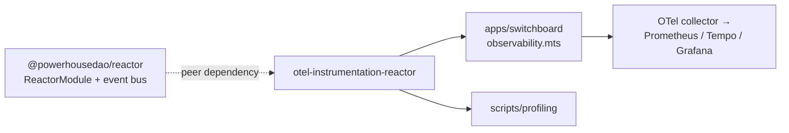

# `@powerhousedao/opentelemetry-instrumentation-reactor`

`packages/opentelemetry-instrumentation-reactor` · published · v6.2.3-dev.9

---

## Purpose

OpenTelemetry **metrics** instrumentation for `@powerhousedao/reactor`.

It inspects a `ReactorModule`'s dependencies and subscribes to the reactor's event
bus, registering counters, histograms and observable gauges for the job queue,
executor, read-model indexing and sync subsystems.

Deliberately narrow in scope. From its README:

> This package only creates OTel instruments on the global meter. It does not
> configure exporters or collector endpoints — that is the responsibility of the
> host application.

---

## Functionality

Four source files:

| File | Role |
|---|---|
| `src/instrumentation.ts` | `ReactorInstrumentation` — the class you construct with a `ReactorModule` |
| `src/metrics.ts` | The instrument definitions |
| `src/event-loop-instrumentation.ts` | Node event-loop lag/utilisation metrics |
| `src/index.ts` | Public exports |

Usage is two calls:

```ts
import { ReactorInstrumentation } from "@powerhousedao/opentelemetry-instrumentation-reactor";

// `module` is the ReactorModule returned by ReactorBuilder
const instrumentation = new ReactorInstrumentation(module);
instrumentation.start();   // subscribe to the event bus, register gauge callbacks
// ...
instrumentation.stop();    // remove subscriptions, clear internal state
```

Metrics are recorded on the `@powerhousedao/reactor` meter via the global
`@opentelemetry/api` `metrics.getMeter()`. The host must configure a `MeterProvider`
with an exporter (the README shows an OTLP-over-HTTP `NodeSDK` example).

### The metric taxonomy

`docs/taxonomy.md` is the reference. Summary:

| Namespace | Instruments |
|---|---|
| `reactor.queue.*` | `jobs.enqueued`, `jobs.dequeued`, `jobs.completed`, `jobs.failed` (counters); `depth`, `executing` (observable gauges) |
| `reactor.executor.*` | `job.duration` (histogram, attr `job.success`), `active_jobs` (gauge), `total_processed` (counter), `operations_generated` (counter) |
| `reactor.job.*` | `total.duration` — full lifecycle, `PENDING` → `READ_READY`/`FAILED` |
| `reactor.readmodel.*` | `index.duration` — `WRITE_READY` → `READ_READY` |
| `reactor.eventbus.*` | `events.emitted`, attributed by `event.type` |
| `reactor.sync.*` | `remotes` (gauge), `dead_letters.added` (counter, attr `remote.name`) |

Units follow OTel semantic conventions / UCUM: `ms` for durations, curly-brace
annotations (`{job}`, `{operation}`, `{event}`, `{remote}`) for dimensionless counts.

The taxonomy doc also lists the reactor event types that are tracked and which
metric each one feeds — worth reading before adding an instrument, because the
mapping is what keeps the gauges consistent with reactor state.

---

## Test infrastructure

**There is none.** No `vitest.config.ts`, no `test` script, zero test files. The
package's scripts are `build` (tsdown), `tsc` and `lint`.

How its behaviour is actually validated:

- **Type-level:** it compiles against the reactor's `ReactorModule` and event-bus
  types; a change to either breaks the build.
- **In situ:** `apps/switchboard` wires it in `src/observability.mts` and
  `src/metrics.ts`, and the running stack is observed via the Grafana/Tempo setup
  referenced from the Switchboard README.
- **Benchmarks:** `packages/reactor/bench/observability/` and
  `apps/switchboard-lb/observability/` exercise the emitted metrics under load.

If you add an instrument, there is no unit test to update — update `docs/taxonomy.md`
instead, which is the de-facto contract.

---

## How it is used



- **The only workspace dependency is a `peerDependency` on
  `@powerhousedao/reactor`.** The host supplies the reactor instance; this package
  never constructs one.
- **`apps/switchboard`** is the production consumer. Its README describes a
  "unified OpenTelemetry tracing + metrics bootstrap, with optional Sentry APM
  bridging (same trace IDs in Tempo and Sentry)" — this package supplies the metrics
  half.
- **`scripts/profiling`** uses it together with `pglite-fs` and `reactor` for local
  profiling runs.
- `apps/connect` does **not** use it — browser-side reactors are not instrumented
  this way.
