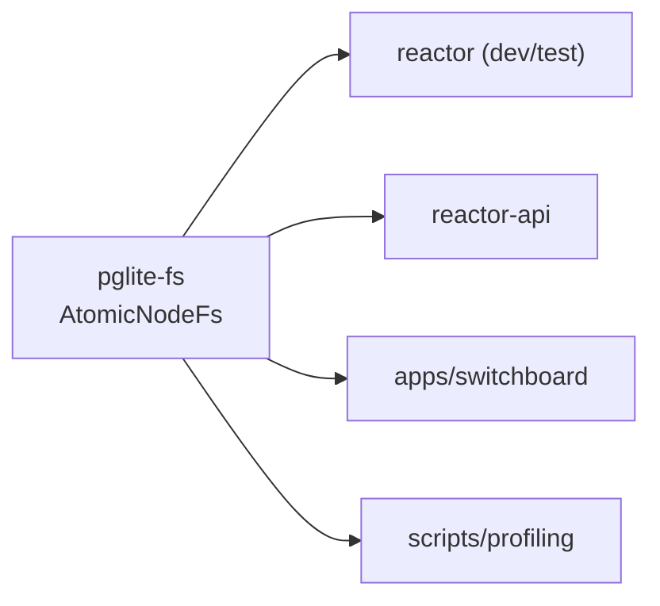

# `@powerhousedao/pglite-fs`

`packages/pglite-fs` · published · v6.2.3-dev.9

---

## Purpose

A crash-safe filesystem backend for [PGlite](https://pglite.dev/) (Postgres compiled
to WASM), used when the reactor stack runs Postgres in-process instead of against a
real server.

The problem it solves: PGlite's stock Node filesystem writes the data directory
straight to disk, so a `SIGKILL` mid-write can leave a torn WAL and an unbootable
data directory. `AtomicNodeFs` keeps the working data directory in Emscripten MEMFS
and atomically swaps a **single-file on-disk snapshot** on sync. A kill mid-write
leaves the previous snapshot intact, so the next startup loads cleanly.

Like `@powerhousedao/shared`, it has **zero workspace dependencies**.

---

## Functionality

One class, ~390 lines, exported from a two-line `index.ts`:

```ts
export { AtomicNodeFs, type AtomicNodeFsLogger } from "./src/index.js";
```

`AtomicNodeFs extends MemoryFS` from `@electric-sql/pglite`.

| Detail | Value |
|---|---|
| Data dir it mirrors | `/tmp/pglite/base` (PGlite 0.3.x MEMFS layout; not exported as a constant upstream, so it is hardcoded) |
| Snapshot file | `snapshot.bin`, written via `snapshot.bin.tmp` then renamed |
| Format | magic bytes `PGLA` + format version `1`, entries typed dir (`0`) or file (`1`) |

### The `flushIntervalMs` option

The interesting knob. PGlite calls `syncToFs` after *every* non-transactional query
— including each `BEGIN` / `INSERT` / `COMMIT` that Kysely emits. A synchronous
full-tree snapshot per call caps write throughput at one query per snapshot.

`flushIntervalMs` coalesces syncs into a trailing-edge disk write at most that often.
It trades worst-case crash loss of up to `flushIntervalMs` of writes for sustained
throughput. `closeFs` always drains pending writes durably before returning.
Default is `0`, which preserves the original per-call synchronous behaviour.

The source is candid about the scope: full-tree snapshots are fine at dev volume but
will not scale to production write rates.

---

## Test infrastructure

- **Runner:** Vitest, `vitest --run`, `include: ["test/**/*.test.ts"]`, `globals: true`.
- **Two test files**, but they are doing unusually heavy work:

| File | What it covers |
|---|---|
| `test/atomic-node-fs.test.ts` | Snapshot round-trips, close/reopen cycles, the deferred-flush path |
| `test/crash-recovery.test.ts` | Spawns `test/crash-child.mts` as a **real child process**, `SIGKILL`s it mid-write, then reopens the snapshot and asserts it is intact |

`test/crash-child.mts` is the child-process harness — a separate entry point rather
than a test file, because you cannot SIGKILL your own test runner.

### Timeout

`testTimeout: 120_000`. The config comment gives the measurements: PGlite WASM init
and close cycles routinely exceed 5 s on slow CI runners, and the close/reopen and
SIGKILL-recovery tests measured **~36 s on the Windows runner** against ~7 s on
Ubuntu. This is the canonical example of a timeout the repo raises on purpose — the
same rationale is cited in the Vitest configs of `reactor`, `reactor-api` and
`reactor-browser`.

---

## How it is used

Depends on: nothing in the workspace.

Depended on by:

| Consumer | How |
|---|---|
| `@powerhousedao/reactor` | **devDependency** — used in tests that need a durable PGlite between runs |
| `@powerhousedao/reactor-api` | runtime dependency |
| `apps/switchboard` | runtime dependency — PGlite is a supported storage backend alongside real Postgres |
| `scripts/profiling` | runtime dependency |



Practical notes:

- Anywhere you see `hookTimeout` / `testTimeout` raised to 30 s or more in another
  package's Vitest config, PGlite cold boot is usually the reason, and this package
  is the thing being booted.
- `apps/switchboard` picks PGlite via `src/pglite-dialect.ts`,
  `src/pglite-migration.ts` and `src/pglite-version.ts`; `docker-compose.pglite.yml`
  at the repo root runs the stack in that mode.
- Connect's browser-side PGlite is a *different* path — it uses IndexedDB-backed
  PGlite in `apps/connect/pglite.worker.ts`, not this filesystem.
