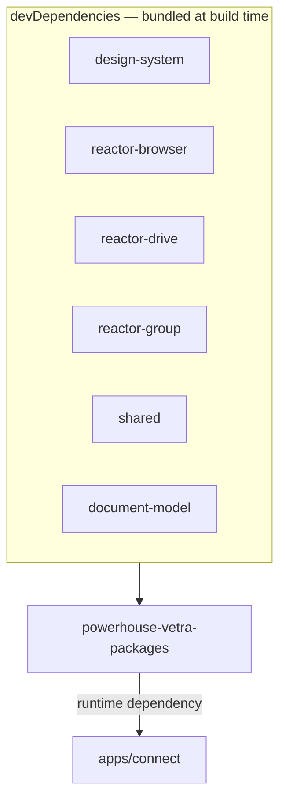

# `@powerhousedao/powerhouse-vetra-packages`

`packages/powerhouse-vetra-packages` · published · v6.2.3-dev.9

---

## Purpose

The **base Vetra package** that every Connect instance loads: the `document-model`
document type and its editor, plus a generic drive explorer.

Its manifest names itself "Common". Where `@powerhousedao/vetra` is the builder
platform, this package supplies the baseline UI that makes an empty Connect usable —
you can open a drive and you can edit a document model, before any user package is
installed.

---

## Functionality

### Document models (`document-models/`)

`document-model/` — the **meta model**: the document type whose instances *are*
document models. Editing one of these is how you define a new document type.

`document-models.ts` and `index.ts` are the registry.

### Editors (`editors/`)

| Editor | What it is |
|---|---|
| `document-model-editor/` | The big one. `editor.tsx`, `components/`, `context/`, `hooks/`, `schemas/`, `constants/`, `utils/`, `types/` — a full GraphQL-schema editing UI for defining document models |
| `generic-drive-explorer/` | The fallback drive UI — `editor.tsx`, `components/`, `config.ts`. What you see in a drive that has no custom app |

### Manifest

Declares five document models (`powerhouse/package`, `document-editor`,
`subgraph-module`, `processor`, `app`), five editors, and one app
(`vetra-drive-app`). Note the overlap with `@powerhousedao/vetra`'s manifest — the
two packages register related ids, and the subgraph id differs
(`powerhouse/subgraph-module` here vs `powerhouse/subgraph` in `vetra`). Worth
checking which is authoritative before adding a sixth.

Exports: `.`, `./document-models`, `./document-models/*`, `./editors`, `./editors/*`,
`./subgraphs`, `./processors`, `./manifest`, `./style.css`, `./package.json`.

### The build — dual-target, hand-rolled

`build.ts` is not a plain `tsdown` invocation:

```ts
await build({ ...browserBuildConfig, outDir: join("dist", "browser") });
await build({ ...nodeBuildConfig,    outDir: join("dist", "node") });
execSync("tsc --build");   // dts into dist/types
```

It emits **two bundles** (browser and node) from shared build configs in
`@powerhousedao/shared/build-config`, then emits declarations with `tsc --build`.

The comment on the `tsc --build` call is instructive: `--build` is required so the
project references' `.tsbuild` outputs are emitted first — otherwise tsc reports
TS6305 for every cross-package import and the cascade hides real type errors.

### Why all its workspace deps are dev-only

`design-system`, `reactor-browser`, `reactor-drive`, `reactor-group`, `shared` and
`document-model` are all **devDependencies**. The package is *bundled*: those
dependencies are compiled in at build time rather than resolved at runtime. That is
what lets Connect load it as a self-contained package bundle from the registry CDN.

---

## Test infrastructure

- **Runner:** Vitest, `vitest --run` (plus `test:watch`).
- **Include:** `editors/**/*.test.ts`, `document-models/**/*.test.ts`. Excludes
  `**/helpers.test.ts`.
- **Scale:** 10 test files:

| Location | Covers |
|---|---|
| `document-models/document-model/test/` | The meta model |
| `editors/document-model-editor/utils/` | Editor utilities |
| `editors/generic-drive-explorer/utils/` | Explorer utilities |

### Two resolution workarounds worth understanding

The Vitest config carries both, with comments:

1. **`conditions: ["source", "import", "module", "default"]`** (on both `resolve`
   and `ssr.resolve`) — use the `source` export condition so workspace packages
   resolve via TypeScript source rather than requiring `dist/` to exist first. This
   is the repo-wide convention set by `tsconfig.options.json`'s
   `customConditions: ["source"]`.

2. **`server.deps.inline: ["document-model"]`** — `document-model`'s `./test` export
   exists *only* as TypeScript source (its build emits no `dist/test`), so Node
   resolution fails when the package is externalised. Inlining forces Vite to
   resolve it via the `source` condition above.

If you hit "cannot resolve `document-model/test`" in another package's suite, this
is the pattern to copy.

---

## How it is used



`apps/connect` is the **only** workspace package that depends on it, and it does so
as a runtime dependency. Connect loads it as the baseline package so that a fresh
instance has a drive explorer and a document-model editor without installing
anything.

It is in the root `pnpm build` filter list early (before the reactor family) and in
`pnpm test:ci`. `simulate-ci-workflow` also builds it separately via
`pnpm --filter=@powerhousedao/versioned-documents --no-bail run build`'s neighbours
— check the root `package.json` for the exact ordering if a build-order problem
appears.

### Distinguishing it from `@powerhousedao/vetra`

| | `powerhouse-vetra-packages` | `vetra` |
|---|---|---|
| Ships | the meta document-model type + generic drive explorer | the five builder models, five editors, the Vetra drive app, and the codegen processor |
| Runs codegen | no | yes, via a reactor processor |
| Loaded by | Connect, always | Connect and Switchboard, as the builder platform |
| Workspace deps | dev only (bundled) | runtime |
