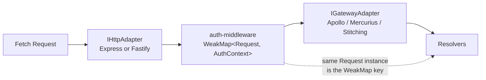
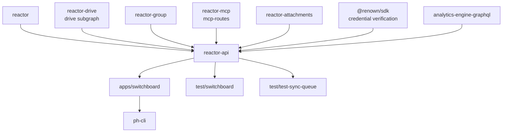

# `@powerhousedao/reactor-api`

`packages/reactor-api` · published · v6.2.3-dev.9

The server-side surface of the reactor: GraphQL, HTTP, auth, package loading.
174 test files.

---

## Purpose

Turns a reactor instance into a network service.

Package description: *"GraphQL API layer for the Powerhouse reactor — auto-generated
subgraphs per document model plus the core reactor subgraph for drive and document
management."*

Quick start from its README:

```ts
import { startAPI } from "@powerhousedao/reactor-api";

const api = await startAPI(reactor, {
  port: 3000,
  dbPath: "./data",
  auth: { enabled: true, admins: ["0x…"], users: ["0x…"], guests: ["0x…"] },
});
```

---

## Architecture — the two adapter interfaces

`ARCHITECTURE.md` documents the central design decision: GraphQL and HTTP are split
into two independent interfaces, with authentication threaded between them using the
Fetch API `Request` object as a shared key. The point is swappability — you can
change HTTP framework or GraphQL engine without touching application logic.



### `IHttpAdapter` — transport

`setupMiddleware(config)`, `mount(path, handler, opts?)`, `getRoute(path, handler)`,
`mountRawMiddleware(middleware)`, `listen(port, tls?)`, and a read-only `handle`
escape hatch. `listen` supports three TLS modes: `true` (devcert),
`{ keyPath, certPath }`, or `{ cert, key }` in memory.

### `IGatewayAdapter<TContext>` — GraphQL execution

`start(httpServer)`, `createHandler(schema, contextFactory)`,
`createSupergraphHandler(getSubgraphs, httpServer, contextFactory)`,
`updateSupergraph()` (re-composes federation SDL and hot-reloads the running
gateway), `attachWebSocket(wsServer, schema, contextFactory)`, `stop()`.

### `FetchHandler` — the boundary

```ts
type FetchHandler = (request: Request) => Promise<Response>;
```

The gateway *produces* these; the HTTP adapter *consumes* them via `mount()`.
**No Express types cross this boundary.**

### Auth threading

An `AuthContext` (`{ user?, admins, auth_enabled }`) is stored in a `WeakMap` keyed
on the `Request`. Because the same `Request` instance travels from
`IHttpAdapter.mount()` to `IGatewayAdapter.createHandler()`, the lookup always finds
the context set during authentication — without mutating shared state or threading
extra arguments. See `src/graphql/gateway/auth-middleware.ts` and
`src/services/auth.service.ts`.

---

## Functionality

| Area | Files |
|---|---|
| **Gateway adapters** | `src/graphql/gateway/`: `adapter-gateway-apollo.ts`, `adapter-gateway-mercurius.ts`, `adapter-gateway-stitching.ts`, `adapter-http-express.ts`, `adapter-http-fastify.ts`, `factory.ts`, `auth-middleware.ts`, `require-auth-middleware.ts`, `drive-middleware.ts`, `drive-ownership-cache.ts`, `path-normalize.ts` |
| **Subgraphs** | `graphql/reactor/` (the core reactor subgraph: schema, resolvers, `operations.graphql`, generated `gen/`, `pubsub.ts`, `requester.ts`, `validation.ts`, `adapters.ts`), `graphql/auth/`, `graphql/packages/`, `graphql/system/` (env, version), `document-model-subgraph.ts`, `analytics-subgraph.ts`, `base-subgraph.ts` |
| **Orchestration** | `graphql/graphql-manager.ts`, `graphql/websocket.ts`, `graphql/sse.ts`, `graphql/playground.ts`, `server.ts` |
| **HTTP** | `src/http/`: `route-service.ts`, `namespace.ts`, `node-response.ts`, `webhook-service.ts`, `webhook-store.ts`, `webhook-verify.ts` |
| **Package loading** | `src/packages/`: `package-manager.ts`, `http-loader.ts`, `import-loader.ts`, `import-resolver.ts`, `vite-loader.mts`, `https-hooks.mts` — how Vetra packages are fetched (from the registry CDN or disk) and registered at runtime |
| **Services** | `src/services/`: `auth.service.ts`, `authorization.service.ts`, `document-permission.service.ts`, `attachment-access.service.ts`, `mcp-request-authorizer.ts`, `renown-config.ts`, `renown-credential-verifier.ts`, `canonical-document-id.ts`, `get-parent-ids.ts`, `package-management.service.ts`, `package-storage.ts` |
| **Migrations** | `src/migrations/`: `001_create_document_permissions`, `002_add_document_protection`, `003_remove_group_tables` |
| **Attachments** | `src/attachment-backend.ts` — mounts the upload/download routes |

Exports: `.`, `./vite`, `./https-hooks`, `./test`.

`pnpm codegen` regenerates `src/graphql/reactor/gen/*.ts` from the GraphQL documents
(graphql-codegen, then prettier, then eslint --fix).

---

## Test infrastructure

- **Runner:** Vitest, `vitest --run`.
- **Scale:** 174 test files.
- **Timeouts:** `testTimeout` and `hookTimeout` both `30_000` — same PGlite cold-boot
  rationale as `packages/reactor` and `pglite-fs`.
- **Custom Vite plugin:** `graphql-path-resolver` in the Vitest config inlines
  `.graphql` files as string modules so schemas can be imported directly in tests.
- **`graphql-ws` alias:** resolved explicitly to `.mjs` and added to the dep
  optimizer, because the package's dual-format layout otherwise breaks under Vitest.

### The integration opt-in

`hub-spoke-catchup.integration.test.ts` is **excluded by default**. The config reads
`process.env.RUN_HUB_SPOKE_INTEGRATION`, and the dedicated script enables it:

```
pnpm test:integration → cross-env RUN_HUB_SPOKE_INTEGRATION=1 vitest --run test/hub-spoke-catchup.integration.test.ts
```

The root `pnpm test:integration` runs this alongside the `load-test-connect`
integration run.

### Contract tests — the notable pattern

`test/gateway/` and `test/http/` use **shared contract modules** so every adapter is
held to the same behaviour:

| Contract file | Applied to |
|---|---|
| `test/gateway/gateway-adapter-contract.ts` | `adapter-gateway-apollo.test.ts`, `adapter-gateway-mercurius.test.ts`, `adapter-gateway-stitching.test.ts` |
| `test/gateway/http-adapter-contract.ts` | `adapter-http-express.test.ts`, `adapter-http-fastify.test.ts` |
| `test/http/route-scope-contract.ts` | `route-scope-express.test.ts`, `route-scope-fastify.test.ts` |

This is what makes the swappability claim in `ARCHITECTURE.md` real rather than
aspirational — a new adapter must pass the same suite.

Also under `test/gateway/`: `auth-middleware`, `require-auth-middleware`,
`path-normalize`, `gateway-resilience`, `gateway-keepalive-reset`,
`ws-auth-close-code`.

### Test groups in `test/`

| Theme | Files |
|---|---|
| Auth & permissions | `auth.service`, `auth.service.resolve-identity`, `auth-chain`, `auth-resolvers-canmanage`, `authorization.service`, `authorization-coverage`, `document-permission.service`, `permissions-integration`, `document-model-subgraph-permissions`, `reactor-subgraph-permissions`, `assert-require-authenticated-caller`, `assert-skip-credential-verification`, `mcp-request-authorizer`, `renown-credential-verifier`, `resolve-renown-config` |
| Sync | `connect-switchboard-sync`, `connect-switchboard-reshuffle-convergence`, `fault-injection-sync`, `sync-serving-policy.integration`, `pollSyncEnvelopes`, `poll-envelope-ordering`, `poll-malformed-operation.schema`, `push-backfill`, `collect-held-sync-operations`, `malformed-stored-operation`, `hub-spoke-catchup.integration` |
| Schema & resolvers | `create-schema-dedupe`, `create-schema-scalars`, `execute-resolvers`, `reactor-resolvers`, `reactor-adapters`, `reactor-client`, `reactor-evaluate-actions`, `action-input-coercion`, `graphql-errors.unit`, `graphql-manager`, `job-info-result.schema`, `document-drive-subgraph` |
| Drives | `drive-middleware`, `drive-ownership-cache`, `drive-info-endpoint`, `drive-info-authorization.e2e` |
| Packages | `package-management-service`, `package-manager-teardown`, `package-manager-versions`, `package-loader-helpers` |
| Transport | `subscriptions`, `subscriptions-sse`, `router`, `explorer-route`, `playground`, `webhooks`, `webhook-store.integration` |
| Attachments | `attachment-access`, `attachment-backend` |
| Misc | `db-client-sharing`, `vite-logger` |

### Supporting scripts

`pnpm dev` (`src/dev.ts`), `capture-hub-dump` and `convert-hub-dump` under
`scripts/` — tooling for capturing a real hub's state to replay in the hub-spoke
tests. `test/data/` and `test/fixtures/` hold the captures.

---

## How it is used

Depends on: `reactor`, `reactor-attachments`, `reactor-drive`, `reactor-group`,
`reactor-mcp`, `config`, `pglite-fs`, `shared`, `document-model`, `@renown/sdk`,
`analytics-engine-core`, `analytics-engine-graphql`, `analytics-engine-pg`. Thirteen
workspace dependencies — the most of any package.



- **`apps/switchboard` is the production host.** It supplies the reactor, storage,
  observability and process lifecycle; this package supplies the API.
- **`ph-cli` gets it transitively** through `apps/switchboard`, which is how
  `ph reactor` / `ph switchboard` serve a local GraphQL endpoint.
- **`reactor-browser` talks to it over the wire** — its `graphql-client/` and
  `remote-controller/` speak the schemas defined here. The
  `connect-switchboard-sync` tests in this package cover that pairing from the
  server side.
- **Subgraph composition:** each registered document model gets an auto-generated
  subgraph (`document-model-subgraph.ts`); `reactor-drive`, `reactor-group`,
  analytics and the core reactor subgraph are composed alongside them into one
  federated supergraph, hot-reloadable via `updateSupergraph()`.
