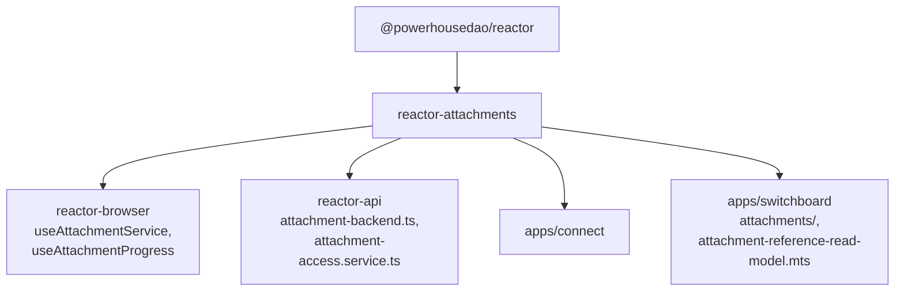

# `@powerhousedao/reactor-attachments`

`packages/reactor-attachments` · published · v6.2.3-dev.9

---

## Purpose

Content-addressed binary storage for documents, designed to get large files **out
of the action/operation pipeline**.

Package description: *"decouples large binaries from the action pipeline using
opaque refs."*

The problem it replaces (documented in `packages/reactor/docs/attachments.md`):
attachments used to be inlined as base64 `data` fields on every action and
operation. That meant operations carried full binary payloads through the job queue,
sync channels and GraphQL transport; the operation store bloated; sync bandwidth
suffered; and there was no way to upload independently of submitting an action.

---

## Functionality

### The three-step flow

1. **Reserve** — the client requests an attachment slot and gets an upload handle
   (`IAttachmentUpload`).
2. **Upload** — the client streams bytes through the handle and receives an
   `AttachmentRef`.
3. **Use** — the client puts the ref in a domain action input (e.g. `ATTACH_INVOICE`).

### Three design principles

| Principle | Meaning |
|---|---|
| **Content-addressed** | Identity is the hash of the data. Identical files dedupe. |
| **Transport-agnostic** | `IAttachmentTransport` is pluggable, exactly as `IChannel` / `IChannelFactory` is for operation sync. The core interface never exposes URLs, headers or any transport detail. |
| **Refs are values** | An `AttachmentRef` is a protocol-prefixed string, `attachment://v<version>:<hash>`. Schemas declare attachment fields with the `AttachmentRef` scalar; reducers store the ref like any other field. **No special core actions, no attachment set on the document.** |

### Layout

| Directory | Contents |
|---|---|
| `src/attachment-service.ts`, `attachment-builder.ts` | `AttachmentService` and its builder — the main entry |
| `src/ref.ts` | `parseRef` / `createRef` — the `attachment://` grammar |
| `src/storage/` | `kysely/` (`KyselyAttachmentStore`, `KyselyReservationStore`), `fs/`, `s3/`, `migrations/` (`ATTACHMENT_SCHEMA`, `runAttachmentMigrations`) |
| `src/direct/` | `DirectAttachmentUpload(+Factory)`, `FilesystemAttachmentBackend` — the local path |
| `src/switchboard/` | The remote path: `SwitchboardAttachmentTransport`, `RemoteAttachmentStore`, `RemoteReservationStore`, `RemoteAttachmentUpload(+Factory)`, `createRemoteAttachmentService`, `createFetchUploadTransport`, `createXhrUploadTransport`, `build-auth-headers.ts` |
| `src/reference-index/` | `AttachmentSchemaCompiler` — walks document-model GraphQL schemas to find `AttachmentRef` fields |
| `src/read-models/attachment-reference/` | `AttachmentReferenceReadModel`, `KyselyAttachmentReferenceStore` — tracks which documents reference which attachments (for GC and integrity) |
| `src/null-attachment-transport.ts` | No-op transport for environments without attachments |
| `src/progress.ts`, `concurrency.ts`, `errors.ts`, `targets.ts` | Upload progress reporting, concurrency limiting, the typed error set (`HashMismatch`, `SizeMismatch`, `UploadTooLarge`, `AttachmentPending`, `ReservationNotFound`, …), and download/upload target parsing |

Exports: `.` (everything above) and `./client` (the browser-side subset).

---

## Test infrastructure

- **Runner:** Vitest, `vitest --run`.
- **Scale:** 36 test files, organised by subsystem:

| Directory | Covers |
|---|---|
| `test/attachment-service/` | The service itself — reserve/upload/resolve |
| `test/direct/` | Direct upload and the filesystem backend |
| `test/storage/attachment-store/`, `test/storage/reservation-store/` | Store contracts |
| `test/storage/fs/`, `test/storage/s3/` | The two concrete backends |
| `test/switchboard/` | The remote transport path |
| `test/reference-index/` | Schema compilation — finding `AttachmentRef` fields |
| `test/read-models/attachment-reference/` | The reference read model |

### S3 compatibility check

`pnpm verify:s3-compatibility` runs `scripts/verify-s3-compatibility.ts` — a
separate script (not a Vitest suite) that exercises the S3 backend against a real
or emulated S3 endpoint. It is not part of `pnpm test`; run it deliberately when
changing `src/storage/s3/`.

---

## How it is used

Depends on: `@powerhousedao/reactor`, `@powerhousedao/shared`.

| Consumer | How |
|---|---|
| `reactor-api` | `src/attachment-backend.ts` mounts the HTTP upload/download routes; `src/services/attachment-access.service.ts` gates them |
| `apps/switchboard` | Hosts the server side — `src/attachments/` and `src/attachment-reference-read-model.mts`; it is the thing `SwitchboardAttachmentTransport` talks to |
| `reactor-browser` | `hooks/attachment-service.ts` and `hooks/attachment-progress.ts` expose upload with progress to editors |
| `apps/connect` | Uses the browser client to upload from the editor UI |

### Where to read first

`packages/reactor/docs/attachments.md` is the design document (note: it lives in the
`reactor` package, not here), with `attachments-hash-first.md` alongside it covering
the hash-first upload variant.
