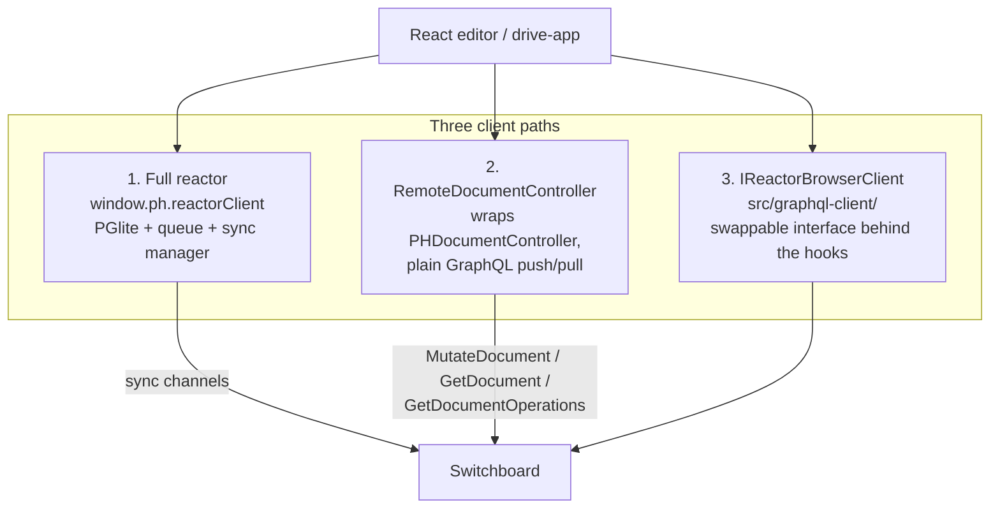
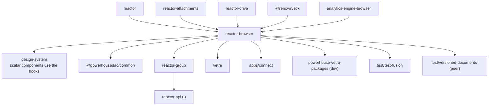

# `@powerhousedao/reactor-browser`

`packages/reactor-browser` · published · v6.2.3-dev.9

The client-side surface. 187 test files, and the only package in the repo whose test
suite drives a **real Chromium**.

---

## Purpose

Everything a React app needs to work with documents: hooks, clients, worker RPC,
identity, analytics and the registry.

Package description: *"Browser-side Powerhouse reactor — React hooks and
`IReactorClient` for building editors and drive-apps inside Connect, Switchboard, or
Vetra Studio."*

---

## Three ways to reach a reactor

This is the thing to understand first. The package ships **three** client paths, and
ADR 0002 (`docs/adr/0002-reactor-browser-client-interface.md`) exists because the
first two shared almost no code.



| Path | Weight | Used by |
|---|---|---|
| **Full reactor** — `src/reactor.ts`, hooks over `IReactorClient` | Heavy: PGlite, job queue, sync manager, document indexer. Local-first. | Connect, Vetra Studio |
| **`RemoteDocumentController`** — `src/remote-controller/` | Light: no reactor boot; type-safe chainable action methods, batch and streaming modes, reject/rebase/custom conflict strategies, signing | Plain webapps talking to a remote Switchboard; `vetra.to` |
| **`IReactorBrowserClient`** — `src/graphql-client/` | The ADR 0002 outcome: one swappable interface behind the hooks | The convergence path; the MVP shipped, with batch signing, local-first writes and point-in-time reads deferred |

Each of the latter two has its own `README.md` in-tree.

---

## Functionality

### Hooks (`src/hooks/`, ~40 files)

The package's public README is a generated index of them. Grouped:

| Group | Hooks |
|---|---|
| Documents | `document-by-id`, `document-of-type`, `document-types`, `document-operations`, `document-cache`, `document-model-modules`, `document-version-status`, `dispatch` |
| Drives & nodes | `drives`, `drive-by-id`, `child-nodes`, `folder-by-id`, `parent-folder`, `node-by-id`, `node-path`, `node-actions`, `items-in-selected-drive`, `items-in-selected-folder` |
| Selection | selected document / drive / folder / node / timeline item |
| Editors & packages | `editor-modules`, `allowed-document-model-modules`, `package-discovery`, Vetra packages |
| Interaction | `file-drag-and-drop`, `node-drag-and-drop`, `modals`, `loading`, `download-document`, `download-folder` |
| Platform | `reactor`, `renown`, `connect`, `connection-state`, `features`, `config/`, `graphql-reactor-client`, `init-graphql-reactor-client`, `attachment-service`, `attachment-progress`, `add-ph-event-handlers`, `make-ph-event-functions` |

### `src/rpc/` — the worker boundary

The largest single subsystem (25 files), and the reason Connect can run a reactor in
a Web Worker. It proxies the whole reactor API across a message channel:
`reactor-host.ts` / `host-server.ts` / `host-reply.ts` on the worker side;
`client-proxy.ts`, `event-bus-proxy.ts`, `live-query-proxy.ts`,
`relational-db-proxy.ts`, `sync-manager-proxy.ts`, `admin-client.ts`,
`inspector-proxy.ts` on the main-thread side; plus `protocol.ts`,
`message-router.ts`, `rpc-correlator.ts`, `transport.ts`, `op-channel.ts`,
`paging.ts`, `subscription.ts`, `forwarded-events.ts`, `worker-package-loader.ts`.

### Other subsystems

| Directory | Role |
|---|---|
| `src/graphql/`, `src/graphql-client/` | Generated GraphQL operations (`pnpm codegen`) and the `IReactorBrowserClient` implementation |
| `src/relational/` | Relational read models in the browser (hooks + utils; own README) |
| `src/registry/` | Registry client — fetches package manifests and bundles (own README) |
| `src/renown/` | Wallet-based sign-in surface, built on `@renown/sdk` |
| `src/analytics/` | Analytics queries against `analytics-engine-browser` |
| `src/ai/` | AI agent integration and settings store |
| `src/pglite/` | Browser PGlite setup |
| `src/global/` | `window.ph` globals |
| `src/storage/`, `src/context/`, `src/actions/`, `src/document-cache.ts`, `src/errors.ts` | Supporting pieces |

Exports: `.`, `./ai`, `./graphql-client`, `./analytics`, `./base-document-models`,
`./graphql`, `./relational`, `./renown`, `./rpc`.

---

## Test infrastructure

The most unusual setup in the repo. **Two Vitest projects in one config.**

### Project `browser`

- `include: ["test/**/*.test.ts", "test/**/*.test.tsx"]`, excluding `*.node.test.ts`
  and `test/__screenshots__/`.
- `environment: "happy-dom"` **plus** a real browser: `@vitest/browser-playwright`
  with `browser: { enabled: true, headless: true, instances: [{ browser: "chromium" }] }`.
- `@vitejs/plugin-react`; `optimizeDeps.exclude: ["@electric-sql/pglite"]`;
  `define: { "process.env": {} }`.

### Project `node`

- `include: ["test/**/*.node.test.ts"]`, `environment: "node"`.

So the `.node.test.ts` suffix is meaningful: it opts a file out of the browser
runner. Examples: `add-drive.node.test.ts`, `dispatch.node.test.ts`,
`drive-info.node.test.ts`, `fetch-document-operations.node.test.ts`,
`vetra-package-registry.node.test.ts`, `ai/agent.node.test.ts`,
`graphql-client/browser-entry.node.test.ts`.

### Timeouts

`testTimeout` and `hookTimeout` are both `REACTOR_BOOT_TIMEOUT_MS = 30_000`. The
config comment: tests in both projects stand up a whole reactor — PGlite WASM cold
boot plus migrations, and in the renown suite a P-256 keypair generation on top.

### Prerequisite

```bash
pnpm --filter=@powerhousedao/reactor-browser install:playwright   # or: playwright install chromium
```

The root README says it plainly: without Chromium installed, **most of this
package's test files cannot launch a browser and are skipped**. If this suite looks
suspiciously green, check that first. The root script is `pnpm test:browser`.

### Coverage map

| Directory | Suites |
|---|---|
| `test/` (root) | Drive and node behaviour (`selected-drive`, `bulk-archive`, `folder-zip`, `import-id-collision`, `drop`, `file-drag-and-drop`, `use-editor-file-drop`), documents (`document-cache`, `document-model-modules`, `document-version-status`, `upgrade-preview`, `use-document-safe`, `use-can-execute`), attachments (`use-attachments`, `attachment-progress`, `xhr-upload-progress`), platform (`analytics`, `theme`, `switchboard`, `getSwitchboardUrl`, `preload-editor`, `processor-host-module`) |
| `test/graphql-client/` | 12 suites: read/write/subscribe, `auth`, `signing`, `provider`, `subgraph`, `subscriptions`, `document-cache-integration`, `static-package-manager`, type-level checks |
| `test/remote-controller/` | `remote-controller`, `remote-client`, `action-tracker`, `utils` |
| `test/rpc/` | The worker protocol |
| `test/renown/` | Sign-in and crypto |
| `test/ai/` | `agent`, `settings-store`, `switchboard` |

`test/__screenshots__/` exists and is gitignored — visual artefacts, excluded from
the run.

---

## How it is used

Depends on: `reactor`, `reactor-attachments`, `reactor-drive`, `shared`,
`document-model`, `@renown/sdk`, `analytics-engine-core`, `analytics-engine-browser`.



| Consumer | How |
|---|---|
| `apps/connect` | The primary host. Runs the reactor in-page or in a worker via `src/rpc/`; every editor uses the hooks |
| `design-system` | Its Connect-scoped components consume the hooks directly |
| `@powerhousedao/common` | Base drive UI built on the hooks |
| `vetra` | Its editors are React apps built on the hooks |
| `reactor-group` | Ships group-editor hooks — and this is the edge that drags `reactor-browser` into `reactor-api`'s tree |
| `test/test-fusion` | A Next.js host exercising `RemoteDocumentController` from a plain webapp |
| `test/versioned-documents` | Declares it as a **peer** dependency, the shape a real user package has |

### Reading order

1. `docs/adr/0002-reactor-browser-client-interface.md` — why three paths exist and
   where they are converging.
2. `packages/reactor-browser/README.md` — the hook index.
3. `src/remote-controller/README.md` and `src/graphql-client/README.md` — including
   the latter's Limitations section, which the ADR treats as normative.
