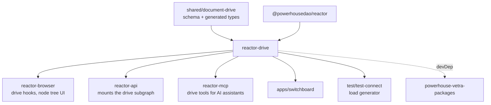

# `@powerhousedao/reactor-drive`

`packages/reactor-drive` · published · v6.2.3-dev.9

---

## Purpose

The drive layer on top of the reactor. A *drive* is the folder-tree container that
organises documents: it has nodes (folders and file references), it can be shared
and synced, and it is what a user actually browses in Connect.

Package description: *"handles document drive operations, sync, and storage
backends."*

Where `reactor` knows about documents and operations, `reactor-drive` knows about
the **tree** — parents, children, names, collisions, and how a node view is
projected from the drive document's operation history.

---

## Functionality

Single export (`.` → `index.ts` → `src/index.ts`). Six concerns:

| Directory / file | Role |
|---|---|
| `src/module.ts`, `src/reducer.ts`, `src/actions.ts`, `src/types.ts` | The DocumentDrive document model wiring — its `DocumentModelModule`, reducers and action creators. (The model's schema and generated types live in `@powerhousedao/shared/document-drive`.) |
| `src/client/reactor-drive-client.ts` | `IDriveClient`-shaped, drive-oriented API over the reactor: create/move/rename/delete nodes, resolve paths |
| `src/read-model/drive-node-view.ts` | The node read model — the queryable projection of the drive tree, with `interfaces.ts` describing its contract |
| `src/processors/node-processor.ts` + `utils/collisions.ts` | The processor that keeps the node view in step with incoming operations, including **name-collision resolution** |
| `src/subgraph/` (`schema.ts`, `resolvers.ts`, `index.ts`) | The GraphQL subgraph for drives, mounted by `reactor-api` |
| `src/schema/tables.ts`, `src/schema/migrations/`, `src/migration/migrate-legacy-state.ts` | Its own storage tables and migrations, plus a migration from the legacy drive-state representation |

The `migration/migrate-legacy-state.ts` file is worth knowing about: drives predate
the current reactor, and this is the path that upgrades old state.

---

## Test infrastructure

- **Runner:** Vitest, `vitest --run`. Also `pnpm bench` (`vitest bench --run`).
- **Scale:** 21 test files, 7 primary suites under `test/`.
- **`static-x.json` / `static-x-baseline.json`** are present — this package
  participates in the repo's static comment-lint checks with a recorded baseline.

| Suite | What it pins down |
|---|---|
| `test/drive-node-view.test.ts` | The read-model projection |
| `test/node-processor.test.ts` | Operation → node-view processing |
| `test/collisions.test.ts` | Name-collision behaviour when two nodes claim the same name |
| `test/reactor-drive-client.test.ts` | Client API, mocked dependencies |
| `test/reactor-drive-client.integration.test.ts` | Same client against a **real** reactor |
| `test/subgraph.test.ts` | GraphQL resolvers |
| `test/migrate-legacy-state.test.ts` | The legacy-state upgrade path |

The unit/integration split follows the same convention as `packages/reactor`
(`*.test.ts` vs `*.integration.test.ts`), and the integration test standing up a
real reactor is why this package inherits the PGlite boot cost.

---

## How it is used

Depends on: `@powerhousedao/reactor`, `@powerhousedao/shared`, `document-model`.

| Consumer | How it uses it |
|---|---|
| `reactor-browser` | Drive hooks (`drives.ts`, `drive-by-id.ts`, `child-nodes.ts`, `node-path.ts`, `items-in-selected-drive.ts`, …) are built on the drive client and node view |
| `reactor-api` | Mounts `src/subgraph` as part of the federated supergraph |
| `reactor-mcp` | Exposes drive management as MCP tools |
| `apps/switchboard` | Serves drives; drive storage tables are part of its migration set |
| `test/test-connect` | Drives the sync-load scenario against real drives |
| `powerhouse-vetra-packages` | devDependency — its generic drive explorer editor is built against it |

Note the split of the DocumentDrive model across two packages: the **schema and
generated types** live in `@powerhousedao/shared/document-drive` (so `shared` stays
dependency-free), while the **runtime behaviour** — reducers, client, read model,
processor, subgraph — lives here.
