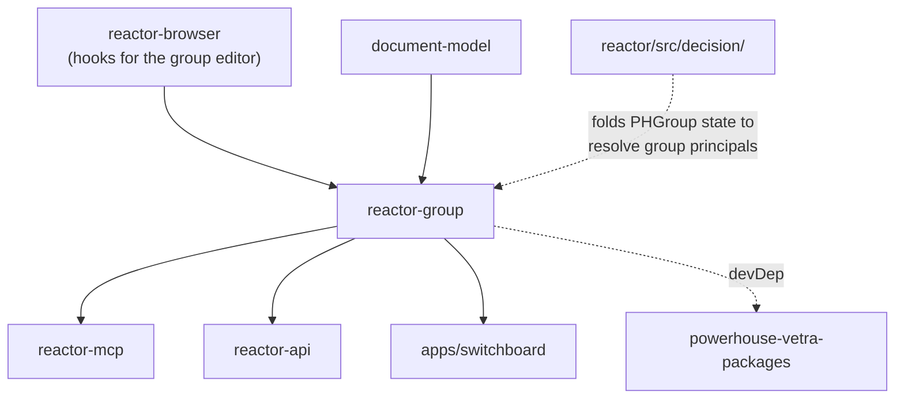

# `@powerhousedao/reactor-group`

`packages/reactor-group` · published · v6.2.3-dev.9

---

## Purpose

Ships the **`PHGroup` document model** (`powerhouse/reactor-group`) — a platform
document type whose state is a list of member addresses.

Package description: *"Platform document model for groups of member addresses,
referenced by `{ group }` principals in the auth scope."*

It exists because of the auth scope design (`docs/specs/auth-scope.md`). Grants in a
document's `auth` scope apply to **principals**, and one kind of principal is
`{ group: string }` — a `PHGroup` document id. To decide whether an action is
allowed, the reactor must fold that group document's membership. So group
membership is itself an event-sourced document, synced and replayed like any other.

---

## Functionality

This is a **document-model package**, not a library — the same shape a user's own
Vetra package has.

```
document-models/
  document-models.ts        # registry of models this package exports
  upgrade-manifests.ts
  reactor-group/
    reactor-group.json      # the model definition
    index.ts
    upgrades/               # index.ts, upgrade-manifest.ts, versions.ts
    v1/
      schema.graphql        # the GraphQL schema for group state
      module.ts             # the DocumentModelModule
      actions.ts, gen/      # generated action creators and types
      src/                  # reducers
      hooks.ts              # React hooks for the group editor
      utils.ts
      tests/
```

Exports: `.` (`documentModels`, `upgradeManifests`, plus everything from
`document-models/index.js`), `./document-models` and `./document-models/*`.

`powerhouse.manifest.json` declares exactly one document model,
`powerhouse/reactor-group`, and no editors, apps, processors or subgraphs.

Because the model is versioned (`v1/` under `upgrades/versions.ts`), it also
demonstrates the platform's document-model upgrade mechanism.

### The invariant that shapes it

From the auth-scope spec:

> On a `PHGroup` document, `INITIALIZE_AUTH` and `SET_GRANT` reject any grant whose
> principal is `{ group }`. That is, **a group's auth scope cannot reference other
> groups.**

The auth reducer checks the document's own type, so the check is deterministic on
every replica. This prevents reference cycles and keeps group-reference following
non-recursive — which is what lets the decision model's `groups` projection stay one
layer deep.

---

## Test infrastructure

- **Runner:** Vitest, `vitest --run`. Also `pnpm generate` → `ph-cli generate`,
  which regenerates `gen/` from `schema.graphql`.
- **Scale:** 4 test files, split across two locations:

| Location | File | Covers |
|---|---|---|
| `document-models/reactor-group/v1/tests/` | `document-model.test.ts` | The model definition itself — generated by `ph-cli generate` scaffolding |
| | `group.test.ts` | Group-specific behaviour |
| `test/` | `reducers.test.ts` | The reducers in isolation |
| | `reactor-group.integration.test.ts` | The model running inside a **real reactor** (hence the `@powerhousedao/reactor` devDependency) |

The split is deliberate: the `document-models/**/tests/` files are the
codegen-scaffolded suites that every Vetra document-model package gets, and `test/`
holds the hand-written ones. When you generate a new document model with `ph-cli`,
you get the first shape.

`static-x.json` / `static-x-baseline.json` are present — the package participates in
the repo's static comment checks.

---

## How it is used

Depends on: `@powerhousedao/reactor-browser`, `@powerhousedao/shared`,
`document-model`. Dev: `@powerhousedao/reactor`.



**The dependency on `reactor-browser` is the surprising one** and is called out in
the dependency map: because `reactor-group` ships editor hooks (`v1/hooks.ts`), it
depends on the React client package. And because `reactor-api` depends on
`reactor-group`, the **server-side GraphQL package transitively pulls in
`reactor-browser`**. If you are tracking down why a server build drags in React,
this is the path.

| Consumer | Why |
|---|---|
| `reactor-api` | Registers the model so the server can fold group documents during auth decisions |
| `apps/switchboard` | Same, at the app level |
| `reactor-mcp` | Exposes group management as MCP tools |
| `powerhouse-vetra-packages` | devDependency — bundles it for the browser |

### Related reading

- `docs/specs/auth-scope.md` — the design. Sections on Groups, Groups and
  Synchronization, and the decision model's `groups` projection.
- `packages/reactor/src/decision/` — where `{ group }` principals are actually
  evaluated, including `group-reevaluation-trigger.ts` in `src/core/` and the
  `017_create_group_references` storage migration.
