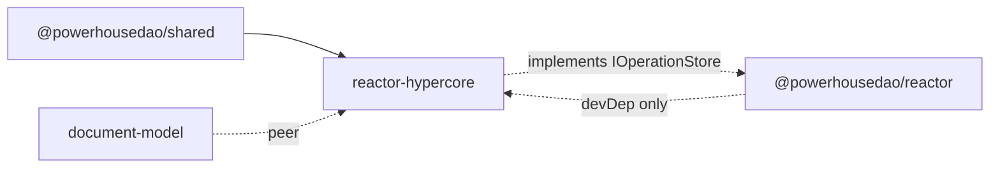

# `@powerhousedao/reactor-hypercore`

`packages/reactor-hypercore` · published · v6.2.3-dev.9

---

## Purpose

An alternative `IOperationStore` implementation backed by
[Hypercore](https://docs.pears.com/) / Hyperbee — the append-only log and B-tree from
the Holepunch stack.

Package description: *"Hypercore-backed IOperationStore for the Powerhouse Reactor."*

This is the package that demonstrates the reactor's storage layer is genuinely
pluggable. The default wiring is PGlite + Kysely; this swaps in a peer-to-peer,
append-only log without the reactor knowing.

---

## Functionality

Small and focused — six source files plus vendored type declarations.

| File | Role |
|---|---|
| `src/hypercore-operation-store.ts` | `HypercoreOperationStore` — the `IOperationStore` implementation |
| `src/hypercore-atomic-transaction.ts` | `HypercoreAtomicTransaction` — atomic multi-write semantics over Hyperbee batches |
| `src/storage-manager.ts` | `StorageManager` — corestore lifecycle |
| `src/key-encoding.ts` | The key grammar, and the reason this package is interesting |
| `src/types.ts` | `StoredOperation`, `HypercoreStoreOptions` |
| `src/vendor/corestore.d.ts`, `hyperbee.d.ts` | Hand-written type declarations for the untyped upstream packages |

### Key encoding

The whole design rests on encoding operation coordinates into sortable Hyperbee keys.
The exported surface tells the story:

```
operationKey / operationPrefix / parseOperationKey
ordinalKey    / ordinalPrefix
duplicateKey
headKey       / headPrefix
pad
ORDINAL_COUNTER_KEY
RANGE_UPPER_BOUND
```

`pad` produces fixed-width numeric segments so lexicographic key order matches
numeric index order — which is what lets range scans satisfy the reactor's
`getSince` contract (operations sorted by index ascending). `ORDINAL_COUNTER_KEY`
and `duplicateKey` handle ordinal allocation and duplicate suppression, the two
things the Kysely store gets from SQL.

---

## Test infrastructure

- **Runner:** Vitest, `vitest run --silent=false` (plus `test:watch`).
- **Config:** `include: ["test/**/*.test.ts"]`, `globals: true`. No raised timeouts
  — there is no PGlite here.
- **Scale:** 2 test files, in two directories:

| Directory | Covers |
|---|---|
| `test/key-encoding/` | The key grammar — encode/parse round-trips, ordering, padding, prefix boundaries |
| `test/operation-store/` | The `IOperationStore` contract against a real Hypercore/Hyperbee |

Note the coverage shape: the key encoding gets its own suite because everything else
depends on its ordering guarantees being exactly right.

---

## How it is used



| Edge | Kind |
|---|---|
| `@powerhousedao/shared` | runtime dependency |
| `document-model` | **peer** dependency (also a devDependency for tests) |
| `@powerhousedao/reactor` | **devDependency only** |

The dependency shape is the point. `reactor-hypercore` needs the reactor's
interfaces to compile and test against, but the host application — not this package
— supplies the reactor at runtime. Nothing in the repo depends on it in production
today: it is an implementation the reactor can be pointed at, and `pnpm test:ci`
includes it in the filter list so it stays honest against interface changes.

If you change `IOperationStore`, `IAtomicTransaction` or the `getSince` ordering
contract in `packages/reactor`, this is the package that will break — and it is
meant to, because it is the second implementation that proves the interface is an
interface.
