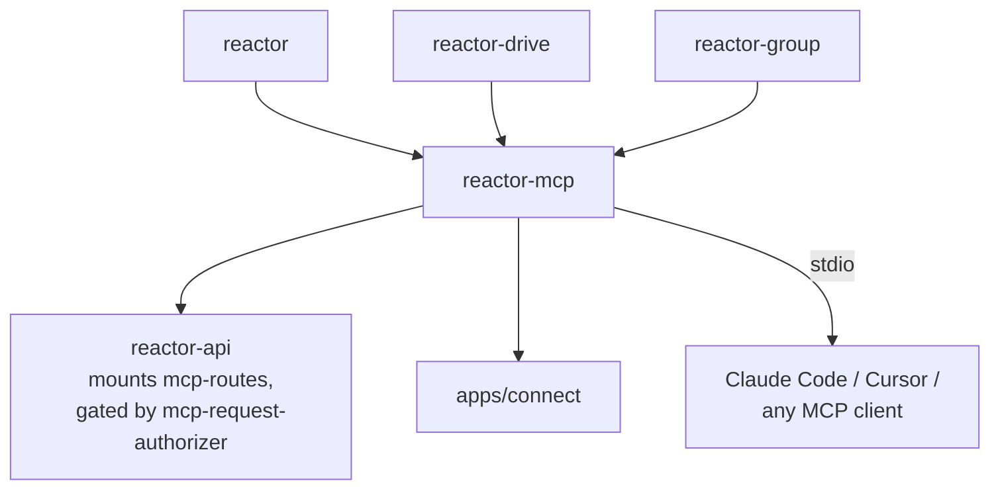

# `@powerhousedao/reactor-mcp`

`packages/reactor-mcp` · published · v6.2.3-dev.9 · binary: `reactor-mcp`

---

## Purpose

A [Model Context Protocol](https://modelcontextprotocol.io) server that exposes the
reactor to AI coding assistants.

Package description: *"exposes document model operations and drive management to AI
coding assistants via the Model Context Protocol."*

It is how Claude Code, Cursor and similar tools create documents, dispatch actions
and manage drives in a running reactor — rather than by writing code that calls the
client.

---

## Functionality

### The tools

`src/tools/reactor.ts` registers the tool set (Zod-validated inputs):

| Group | Tools |
|---|---|
| Documents | `createDocument`, `getDocument`, `getDocuments`, `deleteDocument` |
| Actions | `addActions` |
| Drives | `getDrives`, `addDrive`, `getDrive`, `deleteDrive`, `addRemoteDrive` |
| Models | `getDocumentModels`, `getDocumentModelSchema` |

### The instructions block

`src/server.ts` exports `ReactorMcpInstructions`, a long prompt shipped as the
server's `description`. It teaches the assistant the five concepts — Document Model,
Document, Drive, Action, Operation — and encodes the operational advice that matters:

- To create a document *inside* a drive, pass `driveId` to `createDocument`; that is
  atomic. Use `addActions` with `ADD_FILE` only to add an **existing** document to a
  drive.
- Batch actions: minimise `addActions` calls by sending several actions at once.
- Default to the drive with slug `vetra` when one exists.

This prompt is a real part of the package's behaviour, not documentation — changing
it changes how assistants drive the reactor.

### Server shape

`createServer({ client: IReactorClient, syncManager?: ISyncManager })` returns an
`McpServer` with `tools`, `resources` (subscribable, `listChanged`) and `prompts`
capabilities. The reactor client is injected, so the same server code serves an
in-process reactor or a remote one.

### Entry points

| File / export | Role |
|---|---|
| `src/cli.ts` → bin `reactor-mcp` | Standalone process |
| `src/stdio/` (`index.ts`, `loader.ts`) | stdio transport — how editors launch it |
| `src/mcp-routes.ts` | HTTP routes, mounted by `reactor-api` |
| `src/feature-flags.ts`, `src/logger.ts` | Flags and logging |
| export `./tools` | The tool definitions, importable separately |
| `agents/document-model-creator.md` | A shipped agent definition for document-model authoring |

---

## Test infrastructure

- **Runner:** Vitest, `vitest --run` (`test:run`, `test:watch`, and `bench` also
  defined).
- **Scale:** 2 test files — the lightest of the reactor family.

| File | Covers |
|---|---|
| `test/reactor.test.ts` | The tool implementations against a reactor client |
| `test/setup-mcp-server.test.ts` | Server construction and capability registration |

This is thin coverage relative to the surface area. The tools' real-world behaviour
is exercised indirectly: `apps/connect` and `reactor-api` mount the server, and the
Vetra e2e harness drives flows that go through it.

---

## How it is used

Depends on: `@powerhousedao/reactor`, `reactor-drive`, `reactor-group`, `shared`,
`document-model`.

| Consumer | How |
|---|---|
| `reactor-api` | Mounts `src/mcp-routes.ts` on the HTTP server; `src/services/mcp-request-authorizer.ts` decides who may call which tool |
| `apps/connect` | Bundles it so a local Connect instance can act as an MCP server for an assistant |
| An editor directly | `reactor-mcp` over stdio, via `src/stdio/` |

Because it depends on `reactor-drive` and `reactor-group`, an MCP session gets drive
management and group membership without extra wiring.

### Note on the dependency chain

`reactor-api` → `reactor-mcp` → `reactor-group` → `reactor-browser`. This is one of
the two paths by which the server-side GraphQL package ends up depending on the
React client package.
