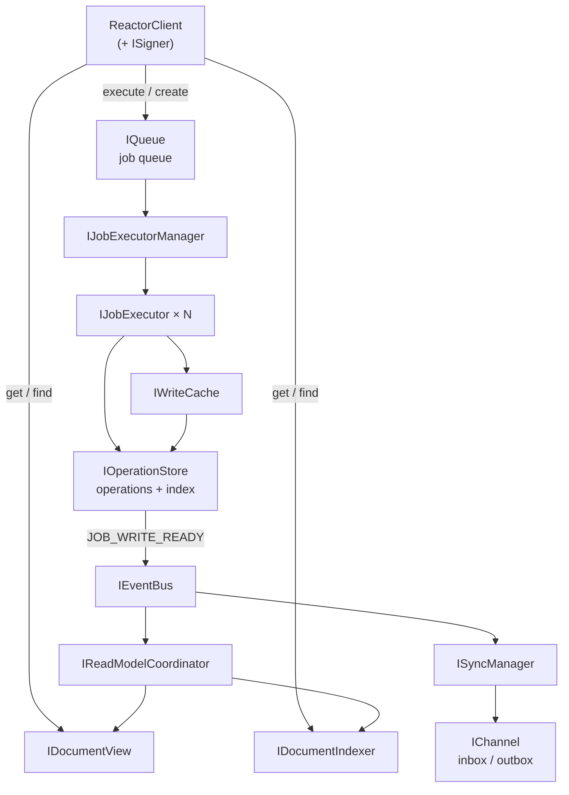
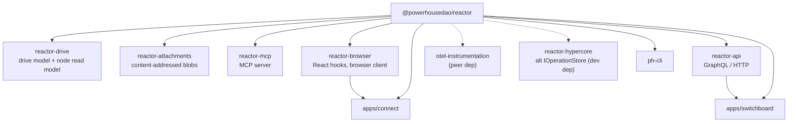

# `@powerhousedao/reactor`

`packages/reactor` · published · v6.2.3-dev.9

The engine. The largest and most heavily tested package in the repo: 20 source
subsystems, **507 test files**, and a purpose-built benchmark harness with its own
CLI and web UI.

---

## Purpose

An event-sourced document management system for `PHDocument`s. It:

1. Stores documents as sequences of immutable operations
2. Processes all mutations through an async job queue for ordering and retry
3. Maintains read models for efficient querying
4. Synchronises operations between distributed instances

Its own description: *"stores documents, resolves conflicts, and reprocesses
operation histories. Supports local, cloud, and decentralized storage backends."*

**Key principles** (from `docs/ARCHITECTURE.md`):

- **Event sourcing** — state is derived from operations, never mutated directly.
- **Async processing** — every mutation goes through the queue.
- **Read-after-write consistency** — `ConsistencyToken`s coordinate reads with
  prior writes.
- **Pluggable storage** — interfaces allow different backends.

---

## Architecture

### Core concepts

| Concept | Definition |
|---|---|
| **PHDocument** | Header (id, type, slug, branch) plus state. Modified only through Actions that produce Operations. |
| **Operation** | Immutable record of a state change, stored sequentially per document/scope/branch with an index. Carries `action`, `id`, `skip`, `timestampUtcMs`, `hash`, optional `resultingState`. |
| **Job** | A unit of queue work — either a mutation (actions to apply) or a load (operations arriving from sync). States: `PENDING → RUNNING → WRITE_READY → READ_READY`, or `FAILED`. |
| **Scope** | Operations are partitioned by scope (`global`, `local`, `document`, …) with independent histories on the same document. |
| **Branch** | Draft/published workflows; operations are isolated per branch. |
| **ConsistencyToken** | Captures operation coordinates so a read can block until a prior write is visible. |

### The three paths

**Write:** `reactor.execute(docId, branch, actions)` → Job enqueued in `IQueue` →
`IJobExecutorManager` dispatches to an `IJobExecutor` → executor loads state via
`IWriteCache` (backed by `IOperationStore`) → actions reduced to Operations →
Operations written atomically → `IEventBus` emits `JOB_WRITE_READY` → job becomes
`WRITE_READY`, then `READ_READY` after indexing.

**Read:** `reactor.get(id)` / `reactor.find(search)` with an optional
`ConsistencyToken` → `IDocumentView.waitForConsistency()` blocks if the token's
coordinates are not yet indexed → snapshot returned from `IDocumentView`.

**Sync:** `ISyncManager` listens for `JOB_WRITE_READY` → operations matching remote
filters go to `IChannel.outbox` → remote operations arrive in `IChannel.inbox` →
inbox items are loaded via `reactor.load()` as sync jobs → cursors track progress
per remote.

---

## Functionality — the 20 subsystems in `src/`

| Directory | What lives there |
|---|---|
| `core/` | `reactor.ts`, `reactor-builder.ts`, `reactor-client-builder.ts`, `feature-flags.ts`, `model-sources.ts`, `create-default-database.ts`, `group-reevaluation-trigger.ts`, `drive-container-types.ts` |
| `client/` | `reactor-client.ts`, `drive-client.ts`, `cursor.ts` — the public `IReactorClient` / `IDriveClient` surface |
| `queue/` | `queue.ts`, `job-execution-handle.ts`, interfaces. Execution is **serialised per document**, even across scopes and branches |
| `executor/` | `simple-job-executor.ts` and `simple-job-executor-manager.ts`; the worker-pool variants (`worker-pool-job-executor-manager.ts`, `worker-pool-router.ts`, `worker/`); `document-action-handler.ts`, `execution-scope.ts`, `job-result-handler.ts`, `signature-verifier.ts`, `deferred-jobs.ts` |
| `storage/` | `kysely/` (`store.ts`, `document-indexer.ts`, `keyframe-store.ts`, `pagination.ts`, `sync-cursor-storage.ts`, `sync-remote-storage.ts`, `sync-dead-letter-storage.ts`), `migrations/` (19 numbered migrations + `migrator.ts`), `txn.ts`, `pool-instrumentation.ts` |
| `cache/` | `kysely-write-cache.ts`, `kysely-operation-index.ts`, `document-meta-cache.ts`, `collection-membership-cache.ts`, plus `buffer/`, `lru/`, `write/` |
| `read-models/` | `base-read-model.ts`, `coordinator.ts`, `document-view.ts` |
| `events/` | `event-bus.ts` — sequential emit, aggregates subscriber errors |
| `sync/` | `sync-manager.ts`, `sync-builder.ts`, `mailbox.ts`, `buffered-mailbox.ts`, `batch-aggregator.ts`, `sync-operation.ts`, `sync-status-tracker.ts`, `sync-awaiter.ts`, `channels/`, plus a local `design.md` |
| `decision/` | The auth scope evaluator: `auth-decision-model.ts`, `document-decision-model.ts`, `build-decision-model.ts`, `evaluation.ts`, `read-gate.ts`, `sync-scope-gate.ts`, `stream-order.ts`, `merged-order.ts`, `walk.ts` |
| `projection/` | Hybrid projection worker: `hybrid-projection-coordinator.ts`, `projection-shard-manager.ts`, `projection-worker/`, `transport.ts`, `protocol.ts` |
| `registry/` | Document-model registry: `document-model-resolver.ts`, `implementation.ts` |
| `processors/` | `processor-manager.ts`, `host-module.ts` |
| `subs/` | React subscription manager, subscription-notification read model, error handlers |
| `job-tracker/` | `in-memory-job-tracker.ts` |
| `admin/` | Operational sweeps: `document-integrity-service.ts`, `document-version-sweep.ts`, `stream-order-sweep.ts`, `run-stream-order-check.ts` |
| `attachments/`, `signer/`, `actions/`, `shared/`, `utils/` | Attachment ref types; `passthrough-signer.ts`; the document action creators; awaiters, consistency tracker, errors, factories; `reshuffle.ts` |

### Invariants that bite (from `CLAUDE.md`)

- `IDocumentView` requires `resultingState` in `OperationContext` and **never
  rebuilds documents from operations**.
- Operation scope and branch live in `OperationContext`, **not on the Operation**.
- `IEventBus.emit()` is sequential and aggregates subscriber errors.
- Operation `ordinal` values come from `IOperationIndex`, **not** the operation store.
- `IOperationStore.getSince` always returns operations sorted by index ascending
  (`ORDER BY index ASC`). Code doing `.at(-1)` to find the latest index relies on
  this — do not break it.
- `IWriteCache` stores **only the last operation per scope**. `UNDO`, `REDO`,
  `PRUNE` and `NOOP+skip` need full history, so the executor invalidates the cache
  for those action types first. `NOOP+skip` arises during sync reshuffling in
  `executeLoadJob`.
- Two different `SearchFilter` types exist: `IReactor.find` uses the one in
  `src/shared/types.ts` (type, parentId, ids, slugs); storage read models use the
  one in `src/storage/interfaces.ts` (documentType, identifiers, includeDeleted).
- ESM import paths carry `.js` extensions.

---

## Test infrastructure

The most elaborate in the repo. Three layers: tests, benchmarks, and a benchmark
findings workflow.

### 1. Tests

- **Runner:** Vitest. `pnpm test` → `vitest run --coverage --printConsoleTrace=true --silent=false`.
- **Scale:** 507 test files under `test/`.
- **Include:** `test/**/*.test.ts`; `globals: true`; `#` aliased to `./src/`.
- **Timeouts:** `hookTimeout: 120_000`, `testTimeout: 30_000`. The config explains
  why: PGlite WASM cold boot plus 19 migrations in `beforeEach`, per test, under
  coverage instrumentation.
- **`maxWorkers: 4`.**
- **Coverage:** v8 provider; text/html/json; excludes `test/**`, types, interfaces,
  index files, migrations, builders, factories, passthroughs, logging.

**Naming convention** (`test/CLAUDE.md`), and it is enforced by directory layout:

- `<component>/unit.test.ts` — single component, mocked dependencies.
- `<component>/integration.test.ts` — same component, **real** dependencies.
- Components with no dependencies get unit tests only.
- The top-level `test/integration/` folder holds reactor-level tests spanning
  multiple subsystems.

Test directories mirror `src/` almost exactly: `admin`, `awaiter`, `builder`,
`cache` (with `buffer`, `lru`, `operation-index`, `write`), `client`, `core`,
`decision`, `events`, `executor` (with `worker`, `worker-pool-manager`,
`worker-pool-router`, `reshuffle`, `signature-verifier`, …), `integration` (incl.
`worker-pool`), `job-tracker`, `processors`, `projection`, `queue`, `read-models`,
`registry`, `shared`, `storage` (incl. `keyframe`, `operation`, `sync-cursor`,
`sync-dead-letter`, `sync-remote`), `subscription`, `sync` (incl. `channels`,
`mailbox`, `batch-aggregator`, `sync-manager`, `sync-status-tracker`), `util`.

There is also `tests.json` — a natural-language index of test intent, one entry per
test with `text` and `metadata` (test name, file, suite). It exists so tools can
search tests semantically.

### 2. Benchmarks

`bench/` is a separate harness with its own scripts:

| Script | Runs |
|---|---|
| `pnpm bench` | all `*.bench.ts` via Vitest |
| `bench:auth` / `bench:auth:record` / `bench:auth:compare` | `bench/auth-scope.bench.ts` |
| `bench:events:record` | `bench/event-bus.bench.ts` |
| `bench:queue:record`, `bench:queue-only:record` | `bench/queue-perf.bench.ts`, `bench/queue-only.bench.ts` |
| `bench:cache:record` | `bench/write-cache.bench.ts` |
| `bench:sync`, `bench:sync:record`, `bench:sync:smoke` | `bench/two-reactor-sync.ts` — a real two-reactor sync scenario, not a microbenchmark |
| `bench:record` | `bench/records/run-record-all.ts` — records every benchmark |
| `bench:ui` | `node bench/ui/serve.mjs` — a local web UI that charts recorded results |

Results land in `bench/results/*.json`; durable records append to
**`bench/BENCHMARKS.jsonl`** via `bench/records/` (`jsonl-store.ts`,
`benchmark-schema.ts`, `machine-environment.ts`).

### 3. The benchmark findings loop

`bench/TASKS.jsonl` holds findings (`DEFECT`, `GAP`, `HARNESS`) anchored to both a
record and a line of code, with a status of `UNVERIFIED` / `VERIFIED` / `REFUTED`.
`bench:records`, `bench:records:verify` and `bench:fix` (`bench/fix/`) drive it.
This repo ships matching agents (`bench-analyst`, `bench-verifier`, `bench-fixer`,
`bench-runner`) and slash commands (`/bench-loop`, `/bench-record`, `/bench-fix`).

### 4. Other operational entry points

- `pnpm migrate` / `migrate:status` — `src/storage/migrations/run-migrations.ts`
- `pnpm preflight:auth` — `src/admin/run-stream-order-check.ts`
- `docker:up` / `docker:down` — `packages/reactor/docker-compose.yml`
- `static-x.json` enables comment linting (`ts/comments/long`, `ts/comments/llm-tells`)
  on changed lines

### 5. CI

`.github/workflows/check-pr-reactor.yml` runs the reactor suite separately. The root
`pnpm test:reactor` and `pnpm simulate-ci-workflow-reactor` mirror it locally.

---

## How it is used

Depends on: `@powerhousedao/shared`, `document-model`. Dev: `@powerhousedao/pglite-fs`.

Notably, `reactor` itself depends on almost nothing — the extensions depend on *it*.

- **`reactor-api`** wraps it in GraphQL — one auto-generated subgraph per document
  model plus a core reactor subgraph.
- **`reactor-browser`** runs the *same* reactor in a browser over PGlite/IndexedDB
  and exposes it through React hooks; Connect can run it in a Web Worker.
- **`reactor-drive`** supplies the DocumentDrive model, its node read model and its
  subgraph; **`reactor-attachments`** decouples large binaries from the action
  pipeline; **`reactor-group`** supplies the group principal model. All three are
  pulled into `reactor-api`.
- **`reactor-hypercore`** is an alternative `IOperationStore` implementation backed
  by Hypercore — it depends on `reactor` only as a devDependency, proving the store
  interface is genuinely pluggable.
- **`opentelemetry-instrumentation-reactor`** takes the `ReactorModule` produced by
  `ReactorBuilder` and subscribes to its event bus; it is a **peer** dependency, so
  the host supplies the reactor instance.

### Reading order for a newcomer

1. `packages/reactor/CLAUDE.md` — concepts, data flow, invariants (short).
2. `packages/reactor/docs/ARCHITECTURE.md` — the long version with Mermaid diagrams.
3. `src/core/reactor-builder.ts` — how the default wiring is assembled.
4. `test/integration/` — the end-to-end behaviour, in executable form.
