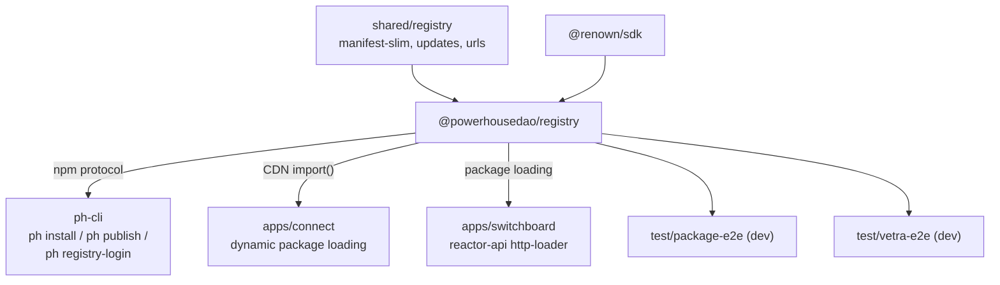

# `@powerhousedao/registry`

`packages/registry` · published · v6.2.3-dev.9 · binary: `ph-registry`

---

## Purpose

The Powerhouse package registry: an npm registry **and** a CDN for package bundles.

Package description: *"resolves and manages document model package dependencies
within the Powerhouse ecosystem."* Its README is more precise: built on
[Verdaccio](https://verdaccio.org/), serving ESM bundles for dynamic `import()` in
browsers and Node.

Why both roles: Connect loads Vetra packages **at runtime in the browser** via
`import()`. That needs a CDN with the right caching semantics, not just an npm
tarball endpoint. This package is both, backed by one storage layer.

---

## Functionality

### Package discovery API

| Endpoint | Returns |
|---|---|
| `GET /packages` | All discovered packages; supports `?documentType=powerhouse/package` |
| `GET /packages/by-document-type?type=<documentType>` | Package names containing that document type |
| `GET /packages/<packageName>` | One package's info (scoped names supported) |

This is how Connect answers "which packages provide an editor for this document
type?" without downloading everything.

### CDN — `GET /-/cdn/<packageName>/<filePath>`

On first request it fetches and extracts the tarball from Verdaccio, looking for
files in the package root, then `cdn/`, `dist/cdn/`, `dist/`.

**Upstream fallback.** If the package is not published locally, Verdaccio
transparently proxies metadata and tarballs from the configured uplink (`--uplink`,
default `https://registry.npmjs.org/`). The CDN extracts the upstream tarball into
`cdn-cache/<pkg>/<version>/` exactly as for local packages, so later requests are
local. The same applies to `@powerhousedao/*`: local copy preferred, upstream as
fallback.

**Caching, keyed on request shape:**

| Request shape | `Cache-Control` |
|---|---|
| Version-pinned (`<pkg>@1.2.3/...`) | `public, max-age=31536000, immutable` |
| Moving (dist-tag like `@dev` / `@latest`, or untagged) | `public, max-age=60, must-revalidate` |

A version-derived weak `ETag` is sent; a matching `If-None-Match` returns `304`.
When **upstream metadata lookup fails** (as opposed to a genuine not-found), the
endpoint serves the latest cached version if present, otherwise `503` — deliberately
not a cacheable `404`. That detail matters: a cached 404 would poison clients
through an upstream blip.

### Publish notifications

| Channel | Detail |
|---|---|
| **SSE** — `GET /-/events` | Persistent connection; `connected` on open, `publish` on every package publish |
| **Webhooks** | `src/notifications/webhook.ts`, managed by `NotificationManager` |

Implementation: `src/notifications/` (`manager.ts`, `sse.ts`, `webhook.ts`).

### Auth

`src/auth/`: `registry-auth-plugin.ts` (a Verdaccio auth plugin),
`renown-verifier.ts` (verifies Renown credentials), `auth-store.ts` / `pg-store.ts`
(in-memory and Postgres-backed stores), `store-handoff.ts`.

So publishing is gated by a Renown identity rather than an npm token.

### Other pieces

`src/cdn.ts` (`CdnCache`, `parsePackageSpec`), `src/packages.ts` (`scanPackages`,
`loadPackage`, `findPackagesByDocumentType`), `src/middleware.ts`
(`createPowerhouseRouter`, `createPublishHook`), `src/verdaccio-config.ts`
(`buildVerdaccioConfig`), `src/semver.ts`, `src/warmup.ts`, `src/run.ts`.

### CLI

`cli.ts` uses `cmd-ts`; options include `--port`, `--storage-dir`, `--uplink`, and a
CDN cache directory. `pnpm start` runs the built binary, `pnpm dev` runs it via bun.
A `Dockerfile` is included. `postbuild` runs `bun run ./copy-dirs.ts` to copy
`static/`.

---

## Test infrastructure

- **Runner:** Vitest. `include: ["tests/**/*.test.ts"]`, `globals: true`,
  `testTimeout: 30000` (it starts real servers).
- **Scale:** 11 test files in `tests/`, with `fixtures/` and a `pack.ts` helper.

| File | Covers |
|---|---|
| `e2e.test.ts` | Full publish → resolve → CDN-fetch flow |
| `serve.test.ts` | The HTTP surface |
| `pack.test.ts` (+ `pack.ts`) | Tarball packing used by the other suites |
| `uplink.test.ts` | Upstream proxying and the failure semantics above |
| `warmup.test.ts` | Cache warming |
| `verdaccio-config.test.ts` | Generated Verdaccio config |
| `registry-auth-plugin.test.ts`, `registry-auth-integration.test.ts` | The auth plugin, unit and integrated |
| `renown-verifier.test.ts` | Credential verification |
| `pg-store.test.ts`, `store-handoff.test.ts` | The Postgres-backed auth store and handoff |

### Beyond the package

`test/package-e2e` is the harness that proves the whole loop: it stands the registry
up in Docker (`services:up` → `docker/docker-compose.yml`), publishes a generated
package to it, installs it into a fresh project, and drives the result with
Playwright. `test/vetra-e2e` ships its own `verdaccio.config.yaml` for the same
reason. Root script: `pnpm test:e2e:package`.

`docs/LOCAL-REGISTRY-SETUP.md` covers running one locally.

---

## How it is used

Depends on: `@powerhousedao/shared`, `@renown/sdk`.

| Consumer | How |
|---|---|
| `clis/ph-cli` | `ph install`, `ph publish`, `ph unpublish`, `ph registry-login` speak to it as an npm registry |
| `apps/connect` | `src/package-discovery.ts` / `package-manager.ts` query `/packages` and `import()` from `/-/cdn/`; `reactor-browser/src/registry/` is the client |
| `reactor-api` | `src/packages/http-loader.ts` loads packages over HTTP on the server side |
| `@powerhousedao/shared` | Holds the shared vocabulary (`registry/manifest-slim.ts`, `updates.ts`, `urls.ts`) so clients and server agree |

Nothing depends on it at *runtime* except the e2e harnesses — it is a service, not a
library, and the coupling to the rest of the repo is over HTTP.
