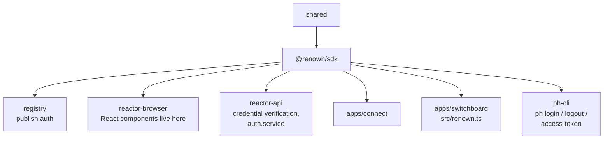

# `@renown/sdk`

`packages/renown` · published · v6.2.3-dev.9

Note the name: the directory is `renown`, the package is **`@renown/sdk`** — the
only package in the repo outside the `@powerhousedao` scope.

---

## Purpose

Identity for the platform. Wallet-based authentication, verifiable credentials,
session management and the cryptographic operations that sign document actions.

Package description: *"wallet-based authentication and user identity management for
Powerhouse React applications."* The README is narrower and more accurate for the
SDK itself: *"handles credential verification, session management, and cryptographic
operations."*

---

## Functionality

### `RenownBuilder`

```ts
const renown = await new RenownBuilder("my-app")
  .withBaseUrl("https://www.renown.id")
  .build();
```

Builder methods: `withBaseUrl`, `withStorage`, `withEventEmitter`, `withCrypto`,
`withKeyPairStorage`, `withProfileFetcher`, `withChainId`.

### The chain-id rule — the thing that catches people

From the README, emphasised there too:

> **The chain id is part of the user's identity.**

The issuer DID is `did:pkh:eip155:<chainId>:<address>`, so **the same wallet on a
different chain is a different user**. Consequences:

- `signIn` rejects a wallet session whose chain differs from the configured one.
- The bearer token is scoped to that chain.
- If you pass a pre-built crypto via `withCrypto()`, give it the same chain
  (`RenownCryptoBuilder().withChainId(...)`); the builder warns when they disagree.
- Keep the wallet adapters' `chains` in step, so the wallet UI prompts a network
  switch instead of the user hitting a rejection at the end of the flow.

### Layout

| Directory / file | Role |
|---|---|
| `src/renown-builder.ts`, `src/index.ts` | The builder and entry |
| `src/credential.ts`, `src/local-credential-verifier.ts` | Verifiable credentials — issue and verify |
| `src/session.ts`, `src/login.node.ts`, `src/profile.ts`, `src/discovery.ts` | Session lifecycle, Node login flow, profile enrichment, service discovery |
| `src/crypto/` | `renown-crypto.ts` + builder, `signer.ts`, and three key stores: `browser-key-storage.ts`, `node-key-storage.ts`, `memory-key-storage.ts` |
| `src/storage/` | `storage.browser.ts` / `storage.node.ts` / `common.ts` — platform-split persistence |
| `src/event/` | `event.browser.ts` / `event.node.ts` / `memory.ts` — platform-split event emitters |
| `src/wallet/` | `controller.ts` plus three adapters: `rainbow/` (RainbowKit), `privy/`, `mock/` |
| `src/switchboard.ts` | Talking to a Switchboard as an authenticated identity |
| `src/init.browser.ts`, `src/init.node.ts`, `src/node.ts` | Environment-specific initialisation |

Exports: `.`, `./node`, `./crypto`, `./wallet`, `./wallet/rainbow`,
`./wallet/rainbow/factory`, `./wallet/privy`, `./wallet/privy/factory`,
`./wallet/mock`, `./wallet/mock/factory`.

The `mock` wallet adapter being a first-class export matters — it is how every other
package's tests sign things without a real wallet.

### React components live elsewhere

`COMPONENTS.md` opens by saying so: React components and hooks for Renown
authentication are provided by **`@powerhousedao/reactor-browser`**, not by
`@renown/sdk`. Look for `<Renown>` and `useRenownInit` there
(`packages/reactor-browser/src/renown/`, `hooks/renown.ts`).

---

## Test infrastructure

- **Runner:** Vitest. Config is minimal: `include: ["test/**/*.test.ts"]`.
- **Scale:** 16 test files.

| Location | Suites |
|---|---|
| `test/` | `renown`, `auth`, `signin`, `credential`, `local-credential-verifier`, `action-signer`, `discovery`, `switchboard`, `login.node`, `storage.node` |
| `test/crypto/` | `signer` |
| `test/wallet/` | `rainbow-config`, `privy-client-config`, `privy-core`, `privy-theme`, `light-entries` |

The `.node.test.ts` files (`login.node`, `storage.node`) mark the Node-only paths, a
convention shared with `reactor-browser`.

`test/tmp/` exists for transient key/credential material written during runs.

### Beyond the package

- `packages/reactor-api/test/renown-credential-verifier.test.ts` and
  `resolve-renown-config.test.ts` cover the server-side verification.
- `packages/registry/tests/renown-verifier.test.ts` covers registry publish auth.
- `test/switchboard/src/renown-self-auth.test.ts` plus the `renown-self/` and
  `renown-self-nopkg/` fixture directories cover self-authentication against a live
  Switchboard.
- `packages/reactor-browser/test/renown/` covers the browser sign-in flow — and is
  why that package's Vitest timeout is 30 s (P-256 keypair generation on top of a
  reactor boot).

---

## How it is used

Depends on: `@powerhousedao/shared` only.



| Consumer | How |
|---|---|
| `reactor-api` | `services/renown-credential-verifier.ts`, `renown-config.ts`, `auth.service.ts` — verifies the identity on every request |
| `reactor-browser` | Hosts the React surface and the in-page sign-in |
| `apps/switchboard` | `src/renown.ts` — server identity configuration |
| `apps/connect` | Signs in the user; signed actions carry the identity into operations |
| `clis/ph-cli` | `login`, `logout`, `access-token`, `registry-login` |
| `packages/registry` | Gates publishing on a Renown credential rather than an npm token |

### Where identity meets documents

Signing is not incidental. Operations carry signatures
(`packages/reactor/src/executor/signature-verifier.ts`,
`shared/document-model/signature-transport.ts`), and the auth scope's principals are
DIDs derived from wallet addresses. The chain-id rule above is therefore a
*document-level* concern: the same wallet on a different chain produces a different
principal, and grants written for one will not match the other.

Credential files are gitignored (`.renown.json`, `.keypair.json`).
