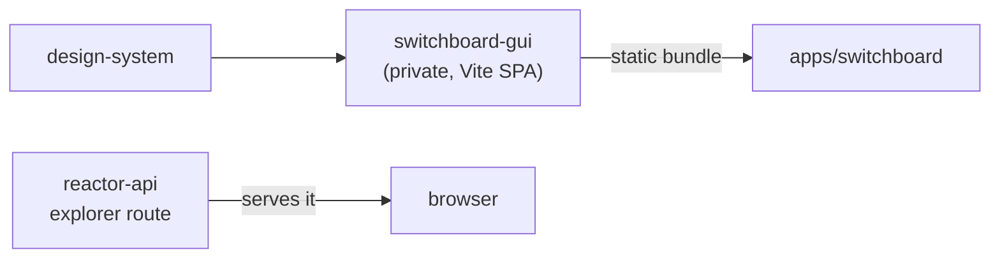

# `@powerhousedao/switchboard-gui`

`packages/switchboard-gui` · **private** · v6.2.3-dev.9

---

## Purpose

The browser UI that Switchboard serves — a GraphQL explorer with wallet
authentication, rather than a bare Apollo/GraphiQL playground.

It is marked `private: true`, so it is never published to npm. It is built as a
static bundle and served by the Switchboard server.

---

## Functionality

A small Vite + React SPA.

```
src/
  main.tsx, app.tsx, index.css
  app/
    home.tsx        # landing
    graphql.tsx     # the explorer page
    graphql/        # explorer internals
    user.tsx        # signed-in user view
  components/
    graphql/        # explorer components
    header/
    text/
    tokens/         # access-token management UI
    favicon.ico
  hooks/
    useAuth.ts      # session state
    useWallet.ts    # wallet connection
  assets/
```

The three things it adds over a stock playground:

1. **Wallet sign-in** (`useWallet`, `useAuth`) — so queries run as an authenticated
   identity rather than anonymously.
2. **Access-token management** (`components/tokens`) — issue and revoke the tokens
   that `ph-cli access-token` and external clients use.
3. **A curated explorer** over the federated supergraph, styled with the Powerhouse
   design system.

Scripts: `dev` (`vite`), `build` (`vite build`), `preview`, `tsc`, `lint`. Note it
uses **Vite directly**, not tsdown like the library packages — it produces an app
bundle, not a library.

The `exports` field is an array rather than a map (numeric keys appear when read as
an object), so it is not consumed as a normal package entry point; the artefact is
the built `dist/`.

---

## Test infrastructure

**There is none.** No `vitest.config.ts`, no `test` script, zero test files. It is
also absent from the root `pnpm test:ci` filter list.

Coverage comes from elsewhere:

- `packages/reactor-api/test/explorer-route.test.ts` and `playground.test.ts` cover
  the **server side** — that the explorer route is mounted and serves.
- `test/switchboard/src/explorer-prefill.test.ts` exercises the explorer's prefill
  behaviour against a running Switchboard.
- Its components come from `@powerhousedao/design-system`, which has snapshot tests
  and 93 Storybook stories.

So the pieces are tested above and below it, but the app itself is validated by
running it.

---

## How it is used

Depends on: `@powerhousedao/design-system` — its **only** workspace dependency.



Nothing in the workspace declares a `workspace:*` dependency on it — it is a leaf.
The connection is at build/serve time: the bundle is served from the Switchboard
process, at the route `reactor-api` registers via `getRoute(path, handler)` for
`/explorer`.

Relationship to `apps/connect`: both are browser apps built on `design-system`, but
they are different products. Connect is the document editor and runs a full reactor
in the browser. `switchboard-gui` is a thin admin/exploration surface over a running
server and runs no reactor at all — which is why it depends on `design-system` alone
and not on `reactor-browser`.
