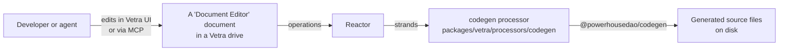
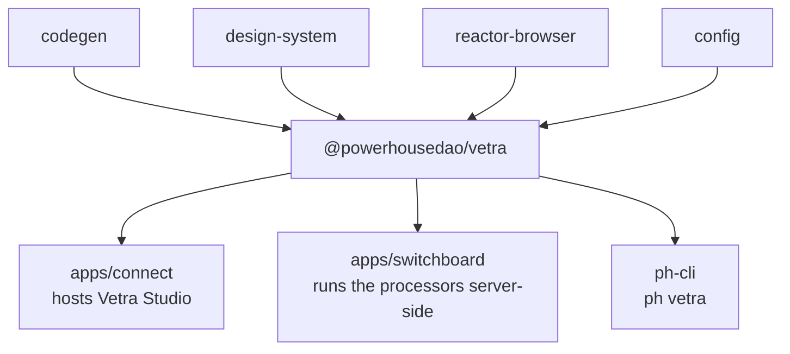

# `@powerhousedao/vetra`

`packages/vetra` · published · v6.2.3-dev.9

---

## Purpose

Vetra is the builder platform: you build a Powerhouse package **by editing
documents**, not by editing files.

Package description: *"the agent-first builder platform for the Powerhouse
ecosystem. Spec-driven and AI-native development of open-source, decentralized
back-ends."*

The mechanism is the interesting part. A document model, an editor, a processor, a
subgraph and an app are each represented as a **document type**. You edit one of
those documents in the Vetra UI; a reactor **processor** observes the operation and
runs codegen, writing real source files to disk. The document is the spec, the
filesystem is the output.



---

## Functionality

`powerhouse.manifest.json` is the clearest statement of what the package is: it is
itself a Vetra package, declaring five document models, five editors, one app and
two processors.

### Five document models (`document-models/`)

| Id | Name | Represents |
|---|---|---|
| `powerhouse/package` | Vetra Package | The package itself — name, publisher, what it contains |
| `powerhouse/document-editor` | Document Editor | An editor to be generated |
| `powerhouse/subgraph` | Subgraph Module | A GraphQL subgraph to be generated |
| `powerhouse/processor` | Processor Module | A processor to be generated |
| `powerhouse/app` | App Module | A drive-app to be generated |

Each follows the standard layout: `<model>/v1/{schema.graphql, module.ts, actions.ts, gen/, src/, tests/}` plus `upgrades/`.

### Five editors + one app (`editors/`)

`vetra-package`, `document-editor`, `processor-editor`, `subgraph-editor`,
`app-editor`, and the **`vetra-drive-app`** (`DriveExplorer.tsx`, `components/`,
`icons/`, `config.ts`, `document-types.ts`) — the drive UI you actually work in.

Shared editor code lives in `editors/components/` and `editors/hooks/`
(`useVetraDocument`, `useAvailableDocumentTypes`, `useDebounce`).

### Two processors (`processors/`)

| Processor | Role |
|---|---|
| `codegen/` | The engine of the platform. `processor.ts`, `document-handlers/`, `interactive-manager.ts`, `factory.ts`, `utils.ts`, `logger.ts`. Turns document changes into generated files. `interactive-manager.ts` handles prompting when generation needs a decision |
| `vetra-read-model/` | A relational read model over Vetra documents (`schema.ts`, `migrations.ts`) so the UI can query package contents efficiently |

`processors/connect.ts` and `processors/switchboard.ts` are the host-specific
registration entry points — the same processors run in the browser (Connect) and on
the server (Switchboard).

### `codegen/` — the spec API

`spec.ts`, `spec-api.ts`, `specs.ts`, `extract.ts`, `generate-from-document.ts`.
Exported as `./codegen` and `./codegen/spec`. This is the bridge from a Vetra
document to a `@powerhousedao/codegen` invocation.

### Exports

`.`, `./document-models`, `./document-models/*`, `./editors`, `./editors/*`,
`./processors`, `./codegen`, `./codegen/spec`, `./manifest`, `./style.css`,
`./package.json`.

---

## Test infrastructure

- **Runner:** Vitest with React. Config: `@vitejs/plugin-react` + `vite-tsconfig-paths`,
  `environment: "happy-dom"`, `globals: true`, `setupFiles: ["./setupTests.ts"]`,
  `passWithNoTests: true`.
- **Include globs span the whole package**, not a `test/` directory:

```
test/**/*.test.ts      test/**/*.test.tsx
document-models/**/*.test.ts
editors/**/*.test.tsx
processors/**/*.test.ts
subgraphs/**/*.test.ts
```

- **Scale:** 17 test files.

| Location | Suites |
|---|---|
| `document-models/<model>/v1/tests/` | One per model: `app-module`, `document-editor`, `processor-module`, `subgraph-module`, `vetra-package`. These are the codegen-scaffolded suites |
| `editors/<editor>/` | One per editor: `app-editor`, `document-editor`, `processor-editor`, `subgraph-editor`, `vetra-package` |
| `processors/codegen/__tests__/` | The codegen processor — the highest-value tests here |

- **Targeted scripts:** `test:document-models`, `test:editors`, `test:processors`
  run the three groups separately.
- `processors/codegen/todo.phdm.zip` is a checked-in document-model fixture the
  processor tests generate from.

### Beyond the package

Vetra's real behaviour is covered by **`test/vetra-e2e`** (`pnpm test:e2e:vetra`), a
Playwright harness that boots the whole studio and drives it through a browser — 13
test files, plus a worker-mode variant (`test:e2e:vetra:worker`, `PH_REACTOR_WORKER=1`)
and repro configs. That is where "edit a document, get a file" is actually verified.

### Operational scripts

`generate`, `reactor`, `service`, `migrate` all delegate to `ph-cli`;
`service-startup` / `service-unstartup` shell into `ph-cli`'s scripts.

---

## How it is used

Depends on: `codegen`, `config`, `design-system`, `reactor-browser`, `shared`,
`document-model`. Dev: `builder-tools`.



| Consumer | How |
|---|---|
| `apps/connect` | Hosts Vetra Studio — the drive app and editors run inside Connect |
| `apps/switchboard` | Registers the Vetra document models and runs the processors on the server |
| `clis/ph-cli` | `ph vetra` boots the studio; `ph generate` shares the codegen path |

### The relationship to `codegen` and `ph-cli`

Three routes to the same generator:

| Route | Trigger | Path |
|---|---|---|
| CLI | `ph generate document-model` | `ph-cli` → `codegen` |
| Vetra UI | editing a document | `vetra` codegen processor → `codegen` |
| Agent | an MCP tool call | `reactor-mcp` → reactor → `vetra` processor → `codegen` |

The third is what "agent-first" means in the package description: an assistant
manipulates documents through MCP, and code appears.

### Relationship to `powerhouse-vetra-packages`

`vetra` ships the *builder* models (package, editor, processor, subgraph, app).
`powerhouse-vetra-packages` ships the *base* models — the `document-model` document
type itself and a generic drive explorer. Connect loads both.
