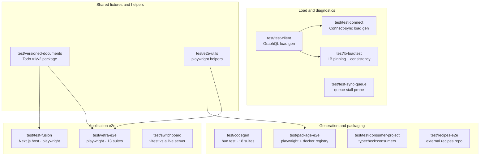

# `test/*` — the harness tree

Thirteen workspace projects under `test/`. None of them ship product code; they
exercise it. They are grouped here because they share a purpose, but each has its
own page.

---

## The map

---

## Root scripts

| Script | Runs |
|---|---|
| `pnpm test:codegen` | `test/codegen` |
| `pnpm test:e2e:package` | `test/package-e2e` |
| `pnpm test:e2e:vetra` | `test/vetra-e2e` |
| `pnpm test:e2e:vetra:worker` | same, with `PH_REACTOR_WORKER=1` |
| `pnpm test:e2e:recipes` | `test/recipes-e2e` |
| `pnpm test:e2e:switchboard` | `test/switchboard` |
| `pnpm test:integration` | `test/test-connect` integration + `reactor-api`'s hub-spoke test |
| `pnpm typecheck:consumers` | `tsc --build test/test-consumer-project` |
| `pnpm test:ci` | includes `@powerhousedao/load-test-connect` and `@powerhousedao/versioned-documents` |

Only `load-test-connect` and `versioned-documents` are in the default `test:ci`
filter list. Everything else is opted into deliberately, because it needs Docker, a
browser, a live server, or all three.

---

## What each one is for

| Project | Private | Runner | One line |
|---|---|---|---|
| [`codegen`](codegen.md) | no | **bun test** | Generates whole projects with `ph generate`, then typechecks and builds them |
| [`package-e2e`](package-e2e.md) | yes | Playwright + Docker | The full loop: scaffold → generate → publish → install → drive in Connect → verify in Switchboard |
| [`vetra-e2e`](vetra-e2e.md) | no | Playwright | The Vetra studio end to end, including worker mode and multi-tab |
| [`recipes-e2e`](recipes-e2e.md) | yes | tsx script | Runs the external `powerhouse/recipes` repo against *this* checkout |
| [`switchboard`](switchboard.md) | yes | Vitest | Client behaviour against a **running** Switchboard |
| [`test-fusion`](test-fusion.md) | yes | Next.js + Playwright | A plain webapp using `RemoteDocumentController` |
| [`test-client`](test-client.md) | yes | tsx CLI | GraphQL load generator with named scenarios |
| [`test-connect`](test-connect.md) | yes | tsx CLI | Simulates Connect sync under load; includes Python analysis models |
| [`lb-loadtest`](lb-loadtest.md) | yes | tsx CLI | Load-shaped **correctness** test for `apps/switchboard-lb` |
| [`test-sync-queue`](test-sync-queue.md) | yes | tsx CLI | Manual sync poller and queue-stall diagnostic |
| [`versioned-documents`](versioned-documents.md) | no | Vitest | A real Vetra package with a Todo model at v1 and v2 — the upgrade fixture |
| [`test-consumer-project`](test-consumer-project.md) | no | tsc | A simulated consumer project; proves published types compile |
| [`e2e-utils`](e2e-utils.md) | no | — | Shared Playwright helpers |

Plus one directory that is **not** a workspace package:

| Directory | What it is |
|---|---|
| [`test/ph-lora`](ph-lora.md) | An agent that audits the academy documentation against the code. Strategy doc, a code↔docs mapping, two scripts, ten gap reports. Its CI trigger is currently disabled |

---

## Three patterns worth noticing

**1. The fixture packages are real packages.** `test/versioned-documents` and
`test/test-consumer-project` are not mocks — they have `powerhouse.config.json`,
`powerhouse.manifest.json`, generated document models, editors and subgraphs, and
they build with `ph-cli`. That is what makes them useful: if a published API changes
shape, they stop compiling.

**2. Load generators are layered.** `test-client` is the base GraphQL load
generator; `test-connect` and `lb-loadtest` both build on it for different targets
(a reactor's sync path, and the load balancer's pinning invariant).

**3. The e2e harnesses stand up real infrastructure.** Docker registries
(`package-e2e`), Verdaccio (`vetra-e2e`), three Switchboard backends plus Prometheus
and Grafana (`lb-loadtest`). They are slow and they are the only place several
behaviours are covered at all.
