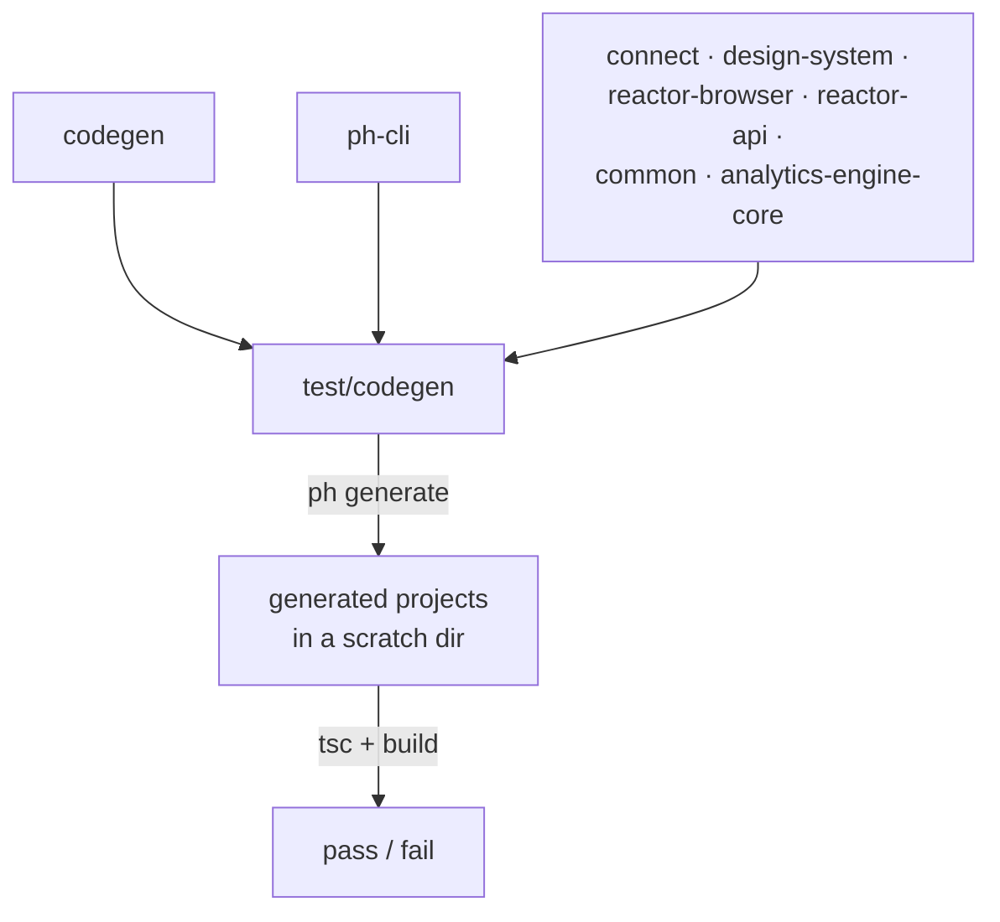

# `test-codegen`

`test/codegen` · published (unscoped, `test-codegen`) · v5.1.0-dev.26

---

## Purpose

The real test suite for `@powerhousedao/codegen`. It generates whole Powerhouse
projects with `ph generate`, then typechecks and builds them — so the assertion is
not "the generator produced this string" but "the generated project compiles and
works against the actual published surface of eleven packages".

This is why `packages/codegen` itself has only four colocated tests.

---

## Functionality

### The setup

```ts
// test/codegen/setup.ts
import { beforeAll } from "bun:test";
import { generateTestProjects } from "./generate-test-projects.js";

beforeAll(async () => { await generateTestProjects(); });
```

`generate-test-projects.ts` (and its `-script.ts` CLI wrapper, exposed as
`pnpm generate-test-projects`) scaffolds the projects every suite runs against.

### Fixture data (`data/`)

| Directory | Purpose |
|---|---|
| `document-models/` | Base model fixtures |
| `spec-version-1`, `spec-version-1-with-more-operations` | v1 specs |
| `spec-version-2`, `spec-version-2-with-required-field`, `spec-version-2-with-state-changes` | v2 variants |
| `spec-version-3`, `spec-version-3-with-state-changes` | v3 variants |

The naming shows what this harness is really for: **migration correctness**. Adding
an operation, adding a required field, or changing state between spec versions each
has to produce a working upgrade.

### The suites (`tests/`, 18 files)

| Group | Files |
|---|---|
| Generation | `generate-doc-model.test.ts`, `generate-doc-model-e2e.test.ts`, `generate-editor.test.ts`, `generate-processor.test.ts`, `generate-subgraph.test.ts`, `generate-app.test.ts`, `generate-all.test.ts`, `generate-manifest.test.ts` |
| Project scaffolding | `build-package-json.test.ts`, `build-powerhouse-config.test.ts`, `project-index.test.ts`, `source-files.test.ts`, `ci-templates.test.ts` |
| Migration | `migrate.test.ts`, `upgrade-migration-stub.test.ts` |
| Internals | `ReducerGenerator.test.ts`, `processor-filter.test.ts`, `datetime-mock-override.test.ts` |

---

## Test infrastructure

**It uses bun, not Vitest** — the only such harness in the repo:

```json
"test":           "bun test --timeout 1000000 --preload ./setup.ts ./tests/*.test.ts",
"test:nogenerate": "bun test --timeout 1000000 ./tests/*.test.ts"
```

Two things to note:

- **`--timeout 1000000`** (about 16 minutes per test). Each suite may run `ph generate`,
  install dependencies and run `tsc`.
- **`test:nogenerate`** skips the `--preload ./setup.ts` step, reusing already
  generated projects. Use it when iterating — regeneration dominates the runtime.

Root script: `pnpm test:codegen`. CI: `.github/workflows/codegen-tests.yml` runs it
as a separate job.

---

## How it is used

Depends on: `analytics-engine-core`, `codegen`, `common`, `config`, **`connect`**,
`design-system`, `ph-cli`, `reactor`, `reactor-api`, `reactor-browser`, `shared`,
`document-model` — twelve workspace packages, all as runtime dependencies.



The dependency list *is* the contract. A generated project imports from all of these
at once, so this harness fails when any of them changes shape in a way the templates
do not follow — which is exactly the failure mode the templates are prone to.

Related harnesses: [`package-e2e`](package-e2e.md) takes the generated package
further (publish, install, run in a browser);
[`test-consumer-project`](test-consumer-project.md) is the cheap always-on version
(`pnpm typecheck:consumers`).
