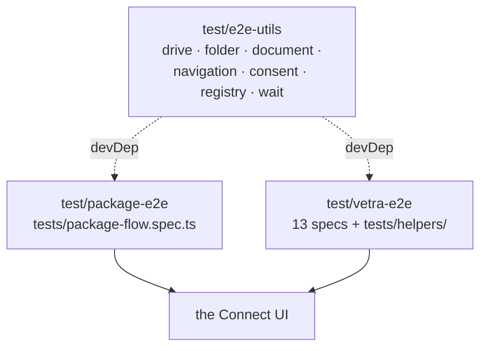

# `@powerhousedao/e2e-utils`

`test/e2e-utils` · published · v1.0.0

---

## Purpose

Shared Playwright helpers for the browser-driving harnesses. It encodes "how you do
X in the Connect UI" once, so `package-e2e` and `vetra-e2e` do not each carry their
own version of it.

It contains no tests of its own — it is a library that tests import.

---

## Functionality

Exports: `.`, `./helpers`, `./helpers/*`, `./types`.

### `src/helpers/`

| Helper | Covers |
|---|---|
| `drive.ts` | Creating and opening drives, local and remote |
| `folder.ts` | Folder operations |
| `document.ts` | Creating, opening and editing documents |
| `navigation.ts` | Moving around the app |
| `cookie-consent.ts` | Dismissing the consent banner — needed before nearly anything else |
| `registry.ts` | Registry interactions |
| `code.ts` | Code-related assertions |
| `wait.ts` | Waiting primitives |

### `src/types/document.ts`

Shared types for the helpers.

### What the helpers actually encode

`createLocalDrive` is representative:

```ts
export async function createLocalDrive(page: Page, driveName: string) {
  await page.goto("/");
  await page.locator(".skeleton-loader").waitFor({ state: "hidden", timeout: 30000 });
  await handleCookieConsent(page);
  const createDriveButton = page.getByText("Create New Drive");
  …
}
```

Three pieces of hard-won knowledge in six lines: wait for `.skeleton-loader` to
disappear (Connect's boot is asynchronous — packages load, PGlite starts, the
reactor initialises), **30 s** is the realistic budget for that, and consent must be
handled before interacting.

That is the value of the package. Every helper carries JSDoc with a usage example.

---

## Test infrastructure

**It has none.** No Vitest config, no test files, no `test` script. Scripts are
`build` (tsdown), `tsc` and `lint`.

It is verified transitively: if a helper breaks, the harnesses that import it fail.
It is in the root `pnpm build` filter list (last group, alongside the load-test
packages), so it always compiles in CI.

---

## How it is used

**No workspace dependencies.** Only `@playwright/test`.



Both consumers declare it as a **devDependency**.

`test/vetra-e2e` layers its own `tests/helpers/` on top for studio-specific flows;
`test/test-fusion` does **not** use it, because it drives a Next.js app rather than
Connect.

### Practical note

When a UI change in `apps/connect` or `@powerhousedao/design-system` breaks the e2e
suites, this is usually the right place to fix it — one selector update here, rather
than the same edit in two harnesses. Conversely, a change to a helper's timeout or
selector affects both suites at once, so check both before changing one.
