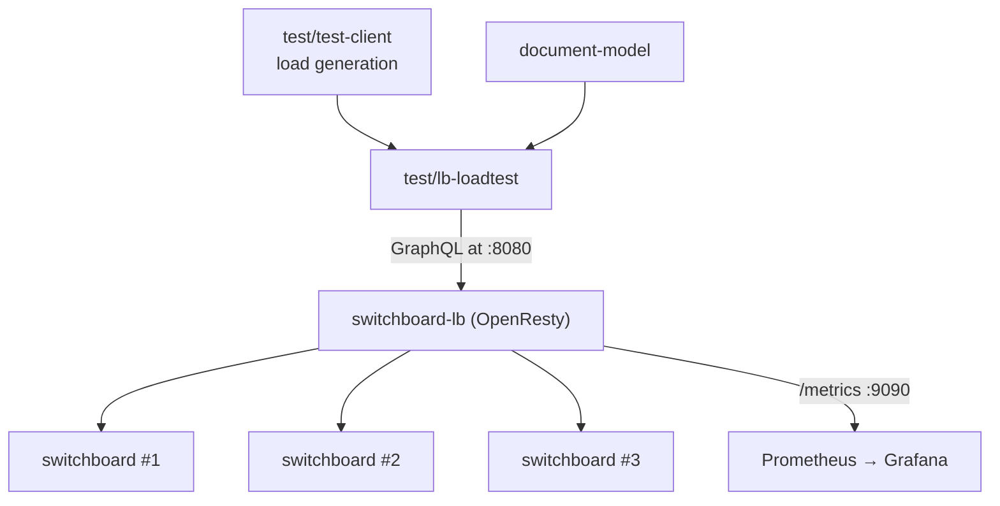

# `@powerhousedao/lb-loadtest`

`test/lb-loadtest` · **private** · v0.0.1

---

## Purpose

*"Real-backend pinning + consistency harness for `switchboard-lb`."*

Its README is careful about the distinction:

> Drives a configurable mix of `createDocument` / `mutateDocument` /
> `document(identifier:)` calls through the LB at a target rate and concurrency for a
> fixed duration, asserts per-doc backend pinning + write/read consistency on **every
> response**, aggregates failures by category, and reports `PASS` / `FAIL`.
>
> This is **not a throughput benchmark** — it is a load-shaped **correctness test**.
> Failures are bucketed and counted, not bailed on.

The invariant under test is the one [`switchboard-lb`](../apps/switchboard-lb.md)
exists to hold: a given drive always reaches the same backend.

---

## Functionality

A single-file runner — `src/run.ts`, invoked as `pnpm verify`.

### The stack it needs

```bash
docker compose -f apps/switchboard-lb/docker-compose.yml \
               -f apps/switchboard-lb/docker-compose.real.yml \
               --profile observability up --build
```

Three Switchboard backends (pinned to `6.0.0-dev.202`, the first published image
exposing the in-repo reactor schema), each with its own PGlite volume, behind the
LB. The `observability` profile adds Prometheus (scraping `lb:9090` every 5 s) and
Grafana with the pre-provisioned `switchboard-lb` dashboard.

| Service | URL |
|---|---|
| LB GraphQL | `http://127.0.0.1:8080/graphql` |
| LB health | `http://127.0.0.1:8080/health` |
| Grafana | `http://127.0.0.1:3001/` (anonymous admin) |
| Prometheus | `http://127.0.0.1:9091/` |

Tear down with `… down -v`.

### The run

`pnpm --filter @powerhousedao/lb-loadtest verify [-- <flags>]`

1. Waits for `/health` to return 200.
2. Runs a **one-shot schema preflight** asserting `createDocument`,
   `mutateDocument` and `document(identifier:)` exist — so a stale backend image
   fails fast rather than producing confusing consistency errors.
3. Starts `--concurrency` workers emitting operations sampled from the workload mix
   until the duration deadline.

> `pnpm` swallows the first `--`; that is why every flag list starts with a literal `--`.

### Scenarios from the README

| Scenario | Exercises |
|---|---|
| Smoke (default) | 60 s × c50, 10/30/60 mix, no rate cap |
| 10 s sanity | Quick stack-health check |
| Sustained heavy | 5 min @ 1000 ops/s capped — pinning under sustained fan-out |
| Read-heavy (5/15/80) | Read-dominant; document pool grows slowly |
| Write-heavy (20/60/20) | **Per-doc reactor serialisation under contention** |
| Pure creates | Pool-growth path only; per-create LB hashing |
| Rate-capped baseline | 200 ops/s, for cross-run comparison |
| Long burn | 30 min @ 500 ops/s — leak hunt, GC pressure, slow drift |
| Bigger mutate batches | 10 `SET_MODEL_NAME` actions per `mutate` call |

### Key flags

| Flag | Default | Note |
|---|---|---|
| `--url` | `http://localhost:8080/graphql` | Also derives `--health-url` |
| `--duration-sec` | `60` | **Sole termination control** — workers drain at the deadline |
| `--concurrency` | `50` | Parallel async workers |
| `--rate-rps` | unset | Global cap via a slot-based pacer shared across workers |
| `--actions` | `1` | Actions per `mutateDocument` |
| `--create-weight` / `--mutate-weight` / `--read-weight` | `10` / `30` / `60` | Normalised internally; at least one must be `> 0` |
| `--request-timeout-ms` | `30000` | Per-fetch `AbortController`; timeouts record as `<type>.transport` |
| `--timeout-ms` | `60000` | `/health` readiness wait |
| `--skip-schema-preflight` | off | Only against a known-good stack |
| `--progress-interval-ms` | `5000` | Cadence of `[t=…]` progress lines |

---

## Test infrastructure

It *is* test infrastructure. No Vitest config, no test files, no `test` script —
only `verify` (`tsx src/run.ts`). Not in any root test script; run it deliberately
against the Docker stack.

Its verdict is a single `PASS` / `FAIL` plus a failure breakdown by category, which
is what makes it usable as a gate for LB changes.

---

## How it is used

Depends on: `@powerhousedao/load-test-client`, `document-model`.



It is the **only** workspace package that targets `apps/switchboard-lb`, which is
itself outside the pnpm workspace. Since LB changes are invisible to `pnpm build`,
`tsc --build` and `pnpm test:ci`, this harness plus the LB's own busted specs are
the entire safety net for that component.

Sibling harnesses: [`test-client`](test-client.md) (the load primitives it builds
on) and [`test-connect`](test-connect.md) (the same load-shaped-correctness idea
applied to Connect's sync path).
