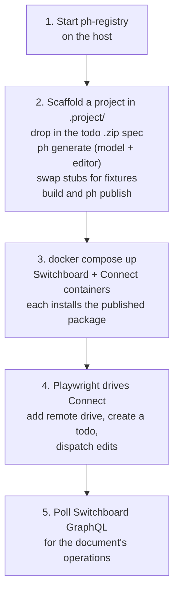
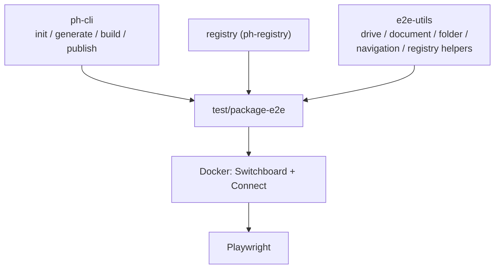

# `test-package-e2e`

`test/package-e2e` · **private** · v0.0.0

The widest test in the repo: it exercises the whole product loop, from an empty
directory to a document editing in a browser and its operations visible on a server.

---

## Purpose

*"End-to-end test for the Powerhouse package creation flow with a remote Switchboard
backend."*

---

## Functionality — the flow

From its README, five steps:

Step 2's stub-swapping matters: `ph generate` emits reducer and editor *stubs*, and
the harness replaces them with the real implementations from `fixtures/editor.tsx`
and `fixtures/todo.json`. That mirrors what a developer actually does.

### Layout

| Path | Contents |
|---|---|
| `scripts/run.ts` | The orchestrator — `pnpm test` |
| `scripts/publish-package.ts`, `publish-workspace.ts`, `scripts/lib/` | Publishing to the local registry |
| `docker/docker-compose.yml`, `Dockerfile`, `nginx.conf`, `connect-entrypoint.sh` | The Switchboard + Connect stack. The entrypoint is where `PH_CONNECT_CONFIG_JSON` is deep-merged into Connect's dist config |
| `tests/package-flow.spec.ts`, `tests/lib/` | The Playwright spec |
| `fixtures/editor.tsx`, `todo.json` | Real implementations swapped in |
| `playwright.config.ts` | Playwright setup |

---

## Test infrastructure

### Scripts

| Script | Does |
|---|---|
| `pnpm test` | `tsx scripts/run.ts` — the whole orchestrated flow |
| `pnpm playwright` | Just the browser spec, against an already-running stack |
| `pnpm services:up` / `:down` / `:logs` | The Docker stack (`--build`, `-v` on down) |
| `pnpm publish-package` | Publish step alone |

Root script: **`pnpm test:e2e:package`**. CI: `.github/workflows/e2e-tests.yml`.

### Requirements

Docker, a free port for the registry, and Playwright browsers. Slow by construction —
it builds images and installs packages.

### Artefacts

`pnpm-publish-summary.json` is written per run by `pnpm publish --report-summary`
and is gitignored, as are `playwright-report/` and `test-results/`.

---

## What it uniquely covers

Several things are tested *only* here:

- **A published package actually installs.** Not a workspace link — a real tarball
  from a real registry, resolved by a real package manager inside a container.
- **Connect loads a package it has never seen**, by `import()` from the registry CDN.
- **The Docker entrypoint config merge** — `PH_CONNECT_CONFIG_JSON` reaching the SPA
  as dist `powerhouse.config.json` (see `apps/connect/RUNTIME-CONFIG.md`).
- **Operations propagate from a browser edit to a server's GraphQL API**, end to end
  through the sync path.

---

## How it is used

Dev dependencies: `@powerhousedao/e2e-utils`, `@powerhousedao/ph-cli`,
`@powerhousedao/registry`.

It depends on only three packages directly, but it transitively exercises nearly
everything — the containers install the published artefacts of the whole stack.

Nothing depends on it. It is a terminal verification.

Related: [`codegen`](codegen.md) covers generation and compilation;
[`vetra-e2e`](vetra-e2e.md) covers the same territory through the Vetra studio UI
rather than through publish/install.
