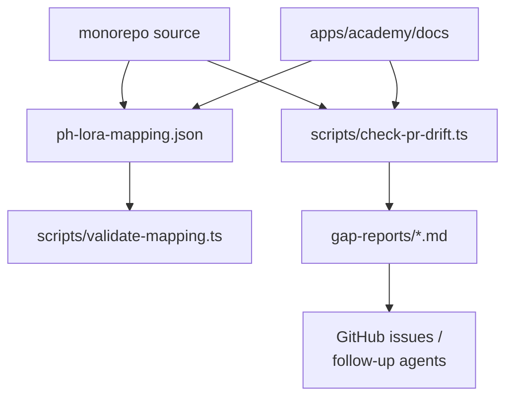

# `test/ph-lora`

**Not a workspace package.** No `package.json`, so it does not appear in the
dependency graph, `pnpm build` or `pnpm test:ci`. It is a strategy document, a
mapping file, two scripts and a set of gap reports.

---

## Purpose

ph-lora is an **agent** whose job is keeping the monorepo code and the academy
documentation in sync.

From `initial-strategy.md`:

> ph-lora is the agent responsible for keeping the Powerhouse monorepo code in sync
> with the academy documentation. It flags gaps and inconsistencies between what the
> code does and what the docs say, then triggers follow-up agents or opens GitHub
> issues for out-of-sync items.
>
> **Token efficiency is a core constraint** — ph-lora must function on smaller/local
> models where possible. This shapes every architectural decision.

It addresses the gap identified in [`apps/academy`](../apps/academy.md): the docs
site is fully decoupled from the code graph, so nothing in CI forces documentation
to follow a code change.

---

## Scope — and what is deferred

The ADR gives ph-lora three responsibilities. The strategy document is explicit that
only one is currently covered:

| Responsibility | Status |
|---|---|
| **Doc Auditor** | Covered by the current strategy |
| **System Mapper** (reads the monorepo, builds a knowledge graph) | Deferred — it feeds a knowledge-vault relationship that is an unresolved blocking question |
| **Test Runner / Generator** (Playwright for the Connect UI, direct API/GraphQL for Reactor and Switchboard) | Deferred to a later phase. Full E2E execution belongs to a separate agent, `ph-uat` |

A `--depth` flag maps to a tiered checking strategy, with `--depth smoke` and
`--depth full` reserved for the deferred test-runner scope.

---

## Contents

| Path | Contents |
|---|---|
| `initial-strategy.md` | The planning output: decisions, what was built, design principles |
| `ph-lora-mapping.json` | The code ↔ documentation mapping |
| `scripts/validate-mapping.ts` | Validates that mapping |
| `scripts/check-pr-drift.ts` | Classifies documentation drift introduced by a PR |
| `gap-reports/` | Ten captured reports, one per academy area |

The gap reports name the areas audited so far: `get-started`,
`build-document-model-creation`, `build-work-with-data`, `reference-cli`,
`reference-reactor`, `reference-document-models`, `reference-editors-ui`,
`reference-processors`, `reference-graphql-data`, `reference-authorization`.

---

## Test infrastructure

There is no test runner here — the directory *is* a checking tool.

### CI

`.github/workflows/ph-lora-tier2.yml` — "ph-lora Tier 2 — doc drift classifier".

**The automatic trigger is currently disabled.** The workflow file carries a
commented-out `pull_request` trigger with the note:

> Trigger disabled pending team sign-off — enable by restoring the pull_request
> trigger below.

Today it runs only via `workflow_dispatch`, taking `base_sha`, `head_sha` and
`pr_number` inputs. So drift classification is opt-in and manual until that sign-off
happens.

---

## How it relates to the repo

No `workspace:*` edges in either direction. Its relationships are with
[`apps/academy`](../apps/academy.md) (the documentation it audits) and with the two
mechanisms that already guard the docs from the other side:
`apps/academy/scripts/check-doc-snippets.ts` and
[`test/recipes-e2e`](recipes-e2e.md).
