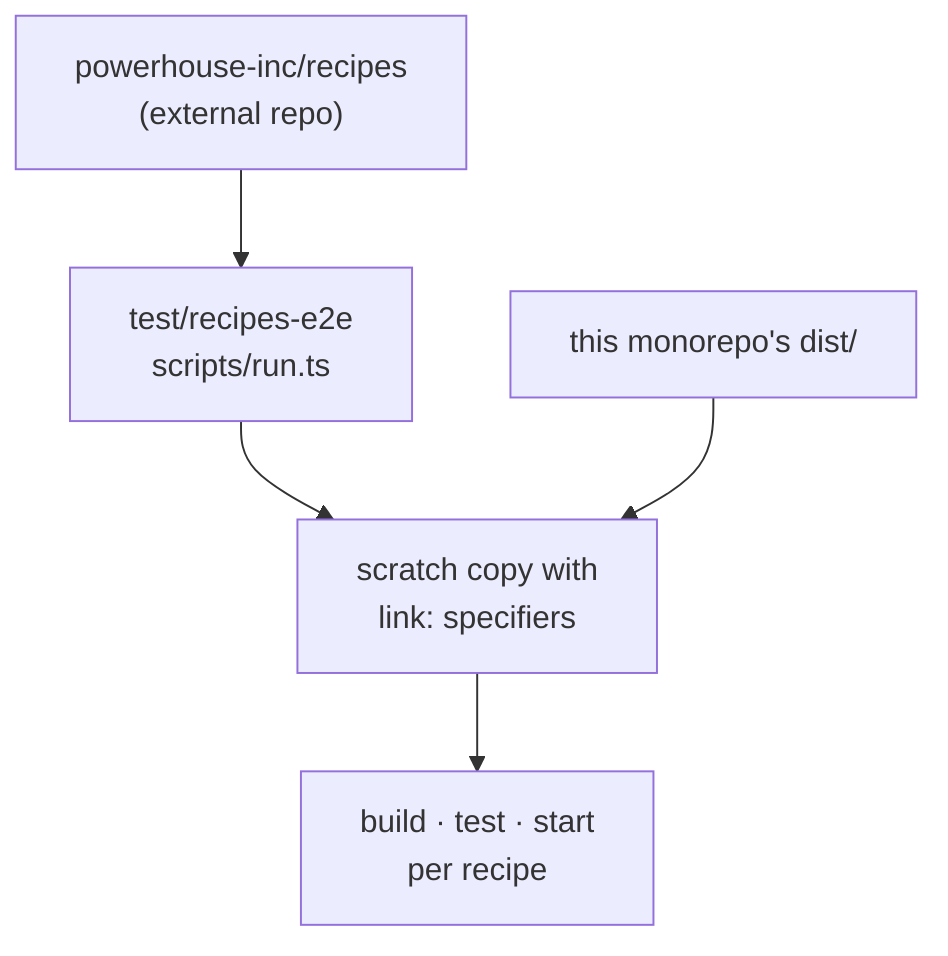

# `test-recipes-e2e`

`test/recipes-e2e` · **private** · v0.0.0

---

## Purpose

Runs every recipe in the external
[`powerhouse-inc/recipes`](https://github.com/powerhouse-inc/recipes) repo **against
the packages in this checkout**, so an API change here surfaces as a failing recipe
rather than as a bug report weeks later.

Its README states the problem precisely:

> The recipes repo is a separate pnpm workspace. It resolves `@powerhousedao/*`,
> `document-model` and `@renown/sdk` from npm through a `catalog:` block pinned to a
> published dev version. On its own, `pnpm -r test` in that repo tells you nothing
> about local code.

---

## Functionality

`scripts/run.ts` (with `scripts/lib/`):

1. Mirrors the recipes tree into a scratch directory.
2. Rewrites the `@powerhousedao/*`, `document-model` and `@renown/sdk` specifiers to
   **`link:` paths** pointing at this monorepo's package directories.
3. Installs.
4. Runs each recipe's `build`, `test` and `start` scripts with a per-script timeout.

Prerequisite: `pnpm build` first — linked packages resolve through `dist/`.

### What each script signal means

| Script | Catches |
|---|---|
| `build` (`tsc`) | Type-level breakage |
| `test` | Behavioural regressions in what each recipe unit-tests |
| `start` | **The broadest signal** — runs the demo end to end, exercising reactor wiring the unit tests usually stub out |

### What it does *not* catch

> **It does not catch packaging regressions.** `link:` is a symlink, so a file
> missing from a package's `files` allowlist is still visible through it.

For that, use [`package-e2e`](package-e2e.md), which publishes real tarballs.

---

## Test infrastructure

### Running it

```bash
pnpm build
pnpm test:e2e:recipes     # → pnpm --filter=test-recipes-e2e run recipes
```

**The entry point is named `recipes`, not `test`** — deliberately, so that
`pnpm -r run test` and `nx affected --target=test` cannot sweep it up. Only the
explicit CI job and a deliberate run execute it.

### CI

The `recipes-e2e-tests` job in `.github/workflows/e2e-tests.yml` runs the full suite
on every PR to `main` and on push. It checks out `powerhouse-inc/recipes` (public, no
token) into `recipes-checkout/`, points `RECIPES_DIR` at it, and raises the
per-script timeout to 600 s. A failure notifies Discord alongside the Vetra and
Package E2E jobs.

### A documented tradeoff

The job tracks the recipes repo's **default branch**, not a pinned ref, because the
drift it catches runs in both directions. The cost: a push to the recipes repo can
turn this repo's CI red with no change here. The README records the escape hatch —
pin `ref:` on the recipes checkout and bump it deliberately if that becomes
disruptive.

### Why it exists — the history in the README

The runner's first sweep found **33 of 52 scripts failing**, from two root causes
that had been on `main` for roughly three weeks unnoticed:

- `ReactorBuilder.withDocumentModels` renamed to `withDocumentModelSources`
  (`61e778a5c`)
- `sync-health-monitor` broken against four sync-surface changes

Both were fixed in the recipes repo (`6622677`, `556920e`), and the suite has been
green since. That is the clearest argument for this harness: nothing else in CI was
watching the public API from the outside.

---

## How it is used

**No `workspace:*` dependencies at all.** It reaches the packages by rewriting
specifiers to `link:` paths at runtime, not by declaring them — which is what lets
it link an arbitrary external workspace.



Scripts: `recipes` (the run), plus `tsc` and `lint`.

Its counterpart inside the repo is `apps/academy`, which *documents* the recipes
(`scripts/generate-recipe-docs.ts`). Between them: academy publishes the recipe,
this harness proves it still runs.
