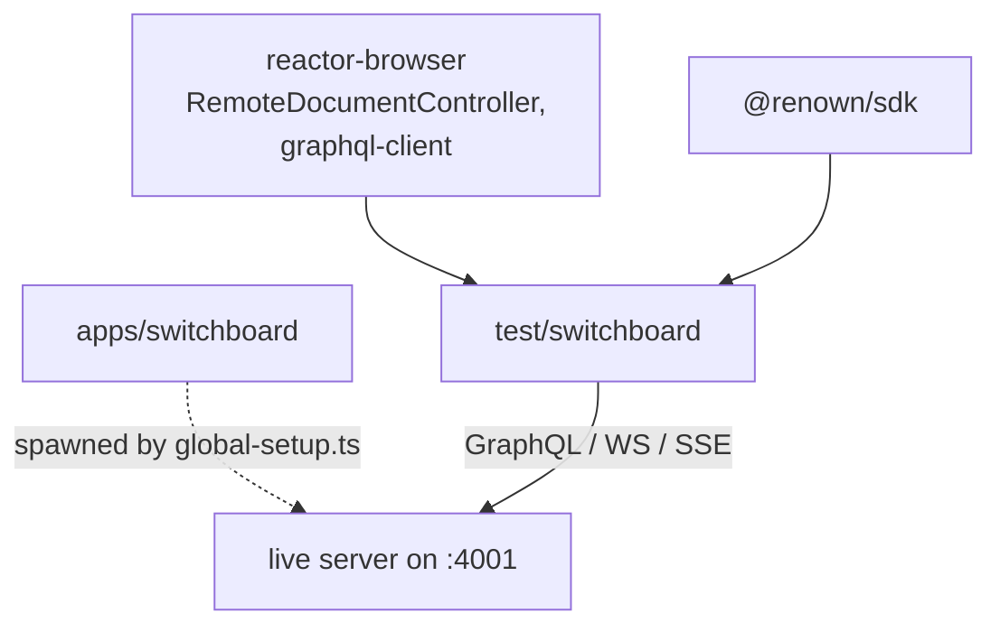

# `@powerhousedao/test-switchboard`

`test/switchboard` · **private** · v1.0.0

---

## Purpose

*"E2E tests for `RemoteDocumentController` against a running switchboard."*

Vitest suites that talk to a **live Switchboard process** over its real GraphQL,
SSE and WebSocket endpoints — no mocks, no in-process reactor. It is the test that
catches "the client and the server disagree about the wire format".

---

## Functionality

### The suites (`src/`, 6 files — note: tests live in `src/`, not `test/`)

| File | Covers |
|---|---|
| `remote-controller.test.ts` | `RemoteDocumentController` from `reactor-browser` — push/pull, batch and streaming modes, conflict strategies |
| `remote-drive.test.ts` | Remote drive operations |
| `graphql-reactor-client.test.ts` | The `IReactorBrowserClient` GraphQL implementation (ADR 0002) |
| `subscriptions.test.ts` | GraphQL subscriptions over WebSocket |
| `renown-self-auth.test.ts` | Self-authentication with a Renown identity |
| `explorer-prefill.test.ts` | The `switchboard-gui` explorer's query prefill |

`src/push-todo-model.ts` is a helper that registers a Todo model on the running
server.

### Fixtures

`renown-self/` and `renown-self-nopkg/` — two identity fixture directories, the
second without a package, so the auth path is covered both ways.

---

## Test infrastructure

### `global-setup.ts` — it starts the server

The distinctive part. The setup file spawns a Switchboard as a **child process**,
then polls until it answers:

```ts
const SWITCHBOARD_URL = process.env.SWITCHBOARD_URL ?? "http://localhost:4001/graphql";

async function waitForReady(url, timeoutMs = 30_000) {
  // POST { query: "{ __typename }" } every 500 ms until res.ok,
  // else throw `Switchboard not ready after ${timeoutMs}ms`
}
```

Implications:

- **`SWITCHBOARD_URL` can point at an existing server** — useful for debugging
  against a staging instance instead of a fresh local one.
- The 30 s readiness budget is a real boot (migrations, package installation), not a
  health-check formality.
- State directories are removed (`existsSync` / `rmSync`) so runs start clean.

### Running it

```bash
pnpm test:e2e:switchboard      # → pnpm --filter=@powerhousedao/test-switchboard run test
```

Vitest, `vitest --run`. **Not** in the root `pnpm test:ci` filter list — it needs a
server.

---

## How it is used

Dev dependencies only: `reactor`, `reactor-api`, `reactor-browser`, `shared`,
**`@powerhousedao/switchboard`**, `@renown/sdk`, `document-model`.



Everything is a devDependency because the package produces nothing — it only runs.

### Where it sits relative to the other sync tests

| Test | Vantage point |
|---|---|
| `packages/reactor-api/test/connect-switchboard-sync.test.ts` | Server side, in process |
| `packages/reactor-browser/test/remote-controller/` | Client side, mocked transport |
| **`test/switchboard`** | **Both sides, over a real network hop** |
| `test/test-connect` | The same pairing, under sustained load |
| `test/test-sync-queue` | Diagnostic probe when sync stalls |

If a change passes the first two and fails here, the disagreement is in the
transport or the schema, not in either side's logic.
