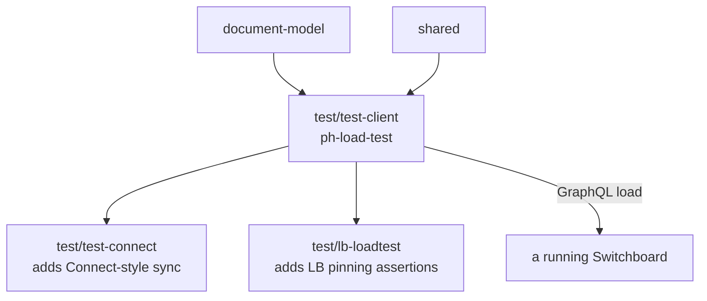

# `@powerhousedao/load-test-client`

`test/test-client` · **private** · v1.0.0 · binary: `ph-load-test`

---

## Purpose

*"Load testing CLI for Powerhouse Switchboard Reactor."*

The base load generator: it drives GraphQL traffic at a Switchboard at a configured
rate, collects metrics, and reports. `test-connect` and `lb-loadtest` both build on
it for their own targets.

---

## Functionality

| Directory | Contents |
|---|---|
| `src/cli.ts` | The `ph-load-test` binary — a single client |
| `src/orchestrator.ts` | Runs several clients concurrently |
| `src/client/graphql-client.ts`, `queries.ts` | The GraphQL transport and the query/mutation documents |
| `src/operations/generator.ts`, `document-model-ops.ts`, `document-drive-ops.ts` | Synthesises realistic operations against documents and drives |
| `src/scheduler/scheduler.ts` | Rate control — spacing document creation and mutation intervals |
| `src/metrics/collector.ts`, `reporter.ts` | Measurement and output |

### The scenarios

The package's value is in its named scenarios, which encode the load shapes worth
testing:

| Script | Shape |
|---|---|
| `scenario-1` | 60 s, new document every 10 s, mutation every 5 s — gentle baseline |
| `scenario-2` | 120 s, document every 5 s, mutation every 2 s — sustained |
| `scenario-stress` | 300 s, document every 3 s, mutation every 0.5 s |
| `scenario-single` | 60 s, **one** document, mutation every 2 s — maximum contention on a single document's queue |
| `scenario-query` | 60 s in query mode — read load rather than write |
| `scenario-spam` | 60 s, mutation every 0.5 s against a fixed document id |
| `scenario-concurrent` | 3 clients via `orchestrator.ts`, 60 s, mutation every 2 s |

All default to `http://localhost:4001/graphql` — the port `ph reactor` binds.

`scenario-single` and `scenario-spam` are the interesting ones: the reactor
serialises jobs per document, so hammering one document is the direct way to
exercise queue depth, the write cache and reshuffling.

---

## Test infrastructure

This package **is** test infrastructure; it has no tests of its own.

- A `vitest.config.ts` and a `test` script (`vitest --run`) exist, but there are
  **zero test files**.
- Build: `tsdown`. Dev: `tsx src/cli.ts`.
- It is **not** in the root `pnpm test:ci` filter list (unlike its dependent
  `load-test-connect`, which is).

It is run by hand, against a Switchboard you started yourself.

---

## How it is used

Depends on: `document-model`, `@powerhousedao/shared`. A deliberately thin footprint
— it speaks GraphQL over the wire and does not import the reactor.

| Dependent | What it adds |
|---|---|
| [`test-connect`](test-connect.md) | Runs a real reactor and syncs like Connect does, rather than issuing raw GraphQL |
| [`lb-loadtest`](lb-loadtest.md) | Points the load at `apps/switchboard-lb` and asserts per-document backend pinning and read/write consistency on every response |

That layering is the thing to understand: this package answers *"how fast"*, and its
two dependents answer *"still correct under that load"*.

Related reading: `packages/reactor/bench/` has the in-process benchmark harness for
the same subsystems (queue, write cache, event bus, two-reactor sync) without a
network hop.
