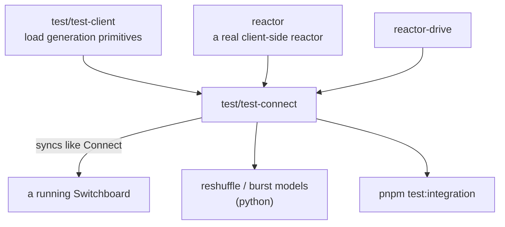

# `@powerhousedao/load-test-connect`

`test/test-connect` · **private** · v1.0.0 · binary: `ph-load-test-connect`

The most analytically interesting harness in the repo — it ships a mathematical
model of a reactor failure mode alongside the code that reproduces it.

---

## Purpose

*"Load testing CLI that simulates Connect sync to a Switchboard."*

Unlike [`test-client`](test-client.md), which issues raw GraphQL, this stands up a
**real reactor** and syncs the way Connect does. It therefore exercises the sync
manager, channels, mailboxes, the queue and reshuffling — the parts that only
misbehave under concurrency.

---

## Functionality

| File | Role |
|---|---|
| `src/cli.ts` | The `ph-load-test-connect` binary |
| `src/orchestrator.ts` | Multi-client scenarios |
| `src/reactor-setup.ts` | Builds the client-side reactor |
| `src/scheduler.ts` | Rate control |
| `src/run-integration.ts` | The integration entry point (`pnpm test:integration`) |
| `src/analyze-logs.ts` | Post-run log analysis |
| `run-experiments.sh`, `run-burst-experiments.sh` | Experiment sweeps |

### Scenarios

| Script | Shape |
|---|---|
| `scenario:sync` | The baseline sync scenario |
| `scenario:sync:stress` | 5 clients, 120 s, mutation every 200 ms |

### The reshuffle growth model

`src/README.md` documents a positive feedback loop in the sync system that produces
"Excessive reshuffle" errors under concurrent load:

> When multiple clients push operations concurrently, each incoming batch must be
> reshuffled against all operations that arrived since its timestamp. This creates a
> feedback loop:
>
> ```
> push latency → stale timestamps → wider conflict window → larger reshuffle
>     → more processing time → more latency → …
> ```
>
> Once the server falls behind, the queue grows, which increases batch age, which
> increases conflict count, which increases processing time — unbounded growth until
> the conflict count exceeds `S_max = 1000` and the job fails.

The harness ships the analysis to go with it:

| File | Role |
|---|---|
| `src/reshuffle-model.py` | The analytical model, plotted with numpy/matplotlib |
| `src/burst-model.py` | The burst-capacity model |
| `src/parse-experiments.py` | Turns experiment logs into `experiments.json` |

Workflow from the README:

```bash
python3 -m venv .venv && .venv/bin/pip install numpy matplotlib
.venv/bin/python3 src/reshuffle-model.py            # analytical plots
bash run-experiments.sh                             # ~4 min of real data
.venv/bin/python3 src/parse-experiments.py
.venv/bin/python3 src/reshuffle-model.py --experimental experiments.json
```

Checked-in results: `reshuffle_timeseries.png`, `reshuffle_heatmap.png`,
`reshuffle_critical_x.png`, `reshuffle_queue_explosion.png`,
`reshuffle_experimental.png`, `burst_timeseries.png`, `burst_heatmap.png`,
`burst_queue_dynamics.png`, `burst_capacity_heatmap.png`,
`burst_duration_sensitivity.png`, plus `experiments.json`.

This is the only place in the repo where a performance failure mode is modelled
analytically and then validated empirically. If you are touching
`packages/reactor/src/utils/reshuffle.ts`, `src/sync/batch-aggregator.ts` or the
queue, read `src/README.md` first.

---

## Test infrastructure

- A `vitest.config.ts` and a `test` script exist; there are **zero test files**.
- The real entry is `pnpm test:integration` → `tsx src/run-integration.ts`, wired
  into the **root** `pnpm test:integration`:

```
pnpm --filter=@powerhousedao/load-test-connect run test:integration
  && pnpm --filter=@powerhousedao/reactor-api run test:integration
```

- It **is** in the root `pnpm test:ci` filter list (its vacuous `test` script passes),
  and in the root `pnpm build` filter list.
- `pnpm analyze` runs `src/analyze-logs.ts` over a completed run.

---

## How it is used

Depends on: `@powerhousedao/reactor`, `@powerhousedao/reactor-drive`,
**`@powerhousedao/load-test-client`**, `document-model`, `@powerhousedao/shared`.



It depends on `reactor` directly — that is the difference from `test-client`. The
client-side reactor is real, so the failure modes it provokes are the ones a real
Connect would hit.

Related: [`lb-loadtest`](lb-loadtest.md) applies the same idea to the load balancer;
[`test-sync-queue`](test-sync-queue.md) is the diagnostic to reach for when a sync
actually stalls in the field.
