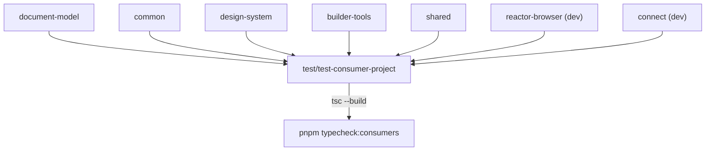

# `test-consumer-project`

`test/test-consumer-project` · published (unscoped) · v1.0.0

---

## Purpose

A minimal, empty-but-complete Powerhouse project that exists to answer one question
on every CI run: **does a consumer project still typecheck against the packages in
this repo?**

It is the cheap always-on complement to the heavyweight harnesses. Where
`test/codegen` generates projects and builds them (minutes, bun, scratch dirs) and
`test/package-e2e` publishes and installs them (Docker, Playwright), this one is a
single `tsc --build` that runs in seconds.

Root script:

```bash
pnpm typecheck:consumers      # → tsc --build test/test-consumer-project
```

It is part of `pnpm simulate-ci-workflow`.

---

## Functionality

A scaffolded project with the standard directory contract, mostly empty:

```
document-models/  document-models.ts, index.ts
editors/          editors.ts, index.ts
processors/       index.ts
subgraphs/        index.ts
powerhouse.config.json
powerhouse.manifest.json
index.html, main.tsx, style.css, index.ts
vite.config.ts, tsconfig.json
```

### `powerhouse.config.json`

```json
{
  "documentModelsDir": "./document-models",
  "editorsDir": "./editors",
  "processorsDir": "./processors",
  "subgraphsDir": "./subgraphs",
  "studio":  { "port": 5556 },
  "reactor": { "port": 5557, "storage": "memory" },
  "packages": [],
  "packageRegistryUrl": "http://localhost:8080"
}
```

Non-default ports (5556/5557) so it never collides with a real dev environment, and
`storage: "memory"` so nothing persists.

### `tsconfig.json` — the interesting part

It reproduces the **path aliases a real project relies on**:

```json
"paths": {
  "document-models":   ["./document-models/index.ts"],
  "document-models/*": ["./document-models/*/index.ts"],
  "editors":           ["./editors/index.ts"],
  "editors/*":         ["./editors/*/index.ts"],
  "processors":        ["./processors/index.ts"],
  "processors/*":      ["./processors/*/index.ts"],
  "subgraphs":         ["./subgraphs/index.ts"]
}
```

plus `module: "nodenext"`, `verbatimModuleSyntax`, `isolatedModules`,
`moduleDetection: "force"`, `strict: true`, `jsx: "react-jsx"`. Those are strict
settings on purpose: a package that exports types sloppily (a missing `type`
modifier, an unresolvable subpath, a CJS/ESM mismatch) fails here even though it
compiles under looser settings inside the monorepo.

### Scripts

`build`, `connect:build`, `connect:preview` — all `ph-cli`, so the project can also
be built and previewed like a real one.

---

## Test infrastructure

**There is no test runner.** No Vitest config, no test files, no `test` script.

**`tsc` is the test.** The verification is `pnpm typecheck:consumers`, which runs
`tsc --build` over this project with the strict settings above.

What that catches:

- A package whose `exports` map has a subpath that does not resolve.
- Types that only work because of a loose setting inside the monorepo.
- A missing `type` modifier under `verbatimModuleSyntax`.
- A broken `.d.ts` emit — e.g. the TS6305 cascade `powerhouse-vetra-packages`'
  `build.ts` guards against.

---

## How it is used

Depends on: `document-model`, `@powerhousedao/common`,
`@powerhousedao/design-system`, `@powerhousedao/shared`,
`@powerhousedao/builder-tools`. Dev: `@powerhousedao/connect`,
`@powerhousedao/config`, `@powerhousedao/ph-cli`, `@powerhousedao/reactor-browser`.



Those nine packages are exactly the set a real user project imports from. Nothing
depends on this project.

### The three layers of consumer verification

| Layer | Cost | Catches |
|---|---|---|
| **`test-consumer-project`** (`pnpm typecheck:consumers`) | seconds | Type and module-resolution breakage |
| [`test/codegen`](codegen.md) (`pnpm test:codegen`) | minutes | Generated code that does not compile or build |
| [`test/package-e2e`](package-e2e.md) (`pnpm test:e2e:package`) | many minutes | Packaging breakage — missing files in `files`, registry/install failures, runtime loading |

Run the first constantly, the second when touching codegen, the third before a
release.
