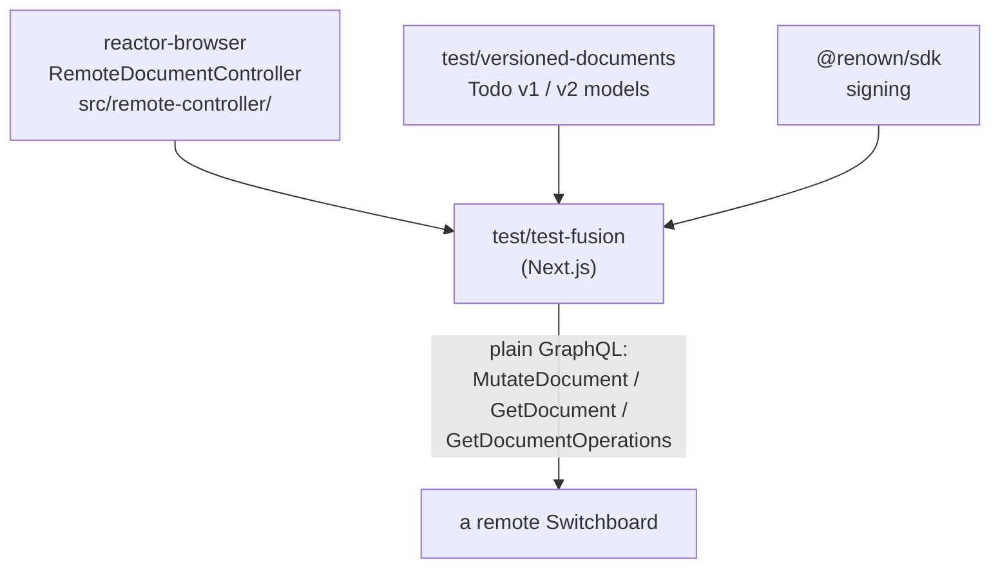

# `test-fusion`

`test/test-fusion` · **private** · v0.1.0

---

## Purpose

A **Next.js** app inside the monorepo. Two jobs:

1. A manual testing and experimentation surface — the README calls it *"used for
   manual testing/experiments"*.
2. The Playwright harness for the **`RemoteDocumentController` path** — a plain
   webapp that talks to a remote Switchboard over GraphQL **without booting a full
   reactor**.

That second job matters because ADR 0002
(`docs/adr/0002-reactor-browser-client-interface.md`) describes exactly this as one
of `reactor-browser`'s two historical client paths — *"a plain webapp uses it when it
only wants to talk to a remote Switchboard and does not want to boot the full
reactor. `vetra.to` uses it for its document models."* `test-fusion` is where that
path is covered.

It is the only Next.js project in the repo; everything else is Vite, Docusaurus or
Node.

---

## Functionality

| Path | Contents |
|---|---|
| `src/app/` | Next.js App Router pages |
| `src/components/` | UI |
| `src/lib/` | Client wiring |
| `src/proxy.ts` | Proxying to the backend |
| `next.config.ts`, `postcss.config.mjs`, `eslint.config.mjs` | Next.js setup |
| `e2e/` | The Playwright specs |
| `AGENTS.md` | Agent notes |

Scripts: `dev` (`next dev`), `build` (`next build`), `start` (`next start`), `lint`.

---

## Test infrastructure

### The specs (`e2e/`, 6 files)

| Spec | Covers |
|---|---|
| `document-flow.spec.ts` | Create/read/edit a document through `RemoteDocumentController` |
| `signed-document-flow.spec.ts` | The same with signing — actions carrying a Renown identity |
| `document-models.spec.ts` | Model registration and discovery |
| `realtime.spec.ts` | Live updates — subscriptions reaching a non-reactor client |
| `subgraph.spec.ts` | Querying a document-model subgraph directly |
| `renown-login.spec.ts` | Wallet sign-in from a plain webapp |

### The run

```json
"test:e2e": "pnpm --filter @powerhousedao/versioned-documents build
          && pnpm --filter @powerhousedao/versioned-documents tsc
          && pnpm --filter @powerhousedao/reactor-browser build
          && playwright test",
"test:e2e:ui": "pnpm --filter @powerhousedao/reactor-browser build && playwright test --ui"
```

Note the script **builds its dependencies first**: `versioned-documents` (build and
typecheck) and `reactor-browser`. It runs against `dist/`, not source — which is
deliberate, since the point is to behave like an external consumer.

Not wired into any root test script. Run it deliberately:

```bash
pnpm --filter test-fusion test:e2e
```

---

## How it is used

Depends on: `@powerhousedao/reactor-browser`,
**`@powerhousedao/versioned-documents`**, `@renown/sdk`, `document-model`.



Notice what is **absent**: no `@powerhousedao/reactor`, no `reactor-api`, no
`design-system`, no `connect`. That absence is the test. If `RemoteDocumentController`
ever needed the full reactor to work, this package would stop building.

### Where it sits among the client tests

| Test | Client path |
|---|---|
| `test/vetra-e2e` | Full reactor in Connect (including worker mode) |
| `test/switchboard` | All three paths, against a live server, via Vitest |
| **`test/test-fusion`** | **`RemoteDocumentController` only, from a real browser, in a non-Powerhouse app shell** |
| `packages/reactor-browser/test/remote-controller/` | The same controller, unit-level |

Read `packages/reactor-browser/src/remote-controller/README.md` for the modes
(batch, streaming), the conflict strategies (reject, rebase, custom merge) and the
signing behaviour these specs exercise.
