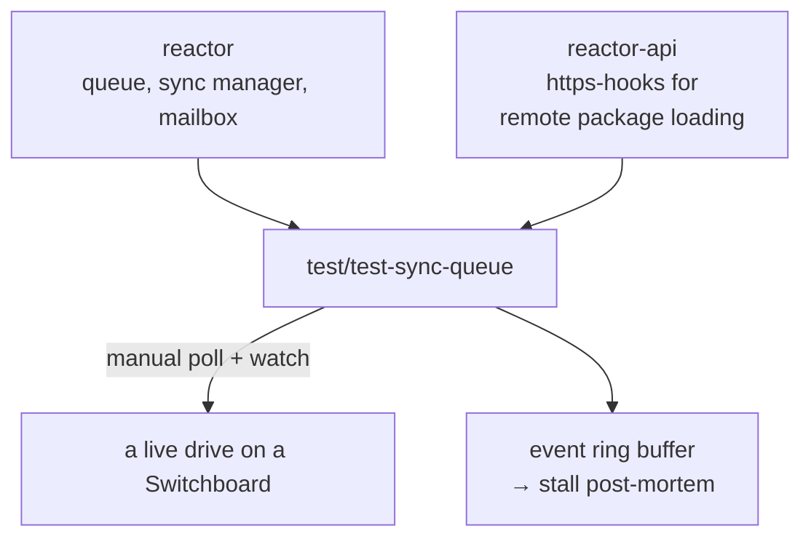

# `@powerhousedao/test-sync-queue`

`test/test-sync-queue` · **private** · v1.0.0 · binary: `ph-test-sync-queue`

---

## Purpose

*"Manual sync poller / inbox + queue stall diagnostic for Powerhouse Reactor drives."*

A diagnostic tool, not a test. When a drive stops syncing — operations sitting in
the inbox, jobs not draining — this is what you point at it to find out where the
pipeline is stuck.

Its own CLI description: *"Manually drive sync polling against a Powerhouse drive and
watch inbox/queue for stalls."*

---

## Functionality

| File | Role |
|---|---|
| `src/cli.ts` | The `ph-test-sync-queue` binary, built with `commander` |
| `src/sync-driver.ts` | Drives sync polling manually, instead of waiting for the interval timer |
| `src/state-watcher.ts` | Watches inbox and queue state for stalls |
| `src/event-ring.ts` | A ring buffer of recent reactor events — so when a stall is detected you have the history that led to it |
| `src/types.ts` | `WatcherConfig` and friends |

### CLI options

| Option | Meaning |
|---|---|
| `--url` | The drive URL |
| `--branch` | Branch to sync |
| `--registry` | Package registry (default `https://registry.dev.vetra.io/`) |
| `--drain-quiet-ms` | How long with no activity counts as drained |
| `--stall-timeout-ms` | How long with no progress counts as a stall |
| `--max-polls` | Poll ceiling |
| `--jwt-env` | Env var holding the auth token |
| `--ring-buffer-size` | Events retained for post-mortem |
| `--verbose` | Verbose output |

### The notable import

```ts
import { httpsHooksPath } from "@powerhousedao/reactor-api/https-hooks";
import { register } from "node:module";
```

It registers Node module hooks from `reactor-api` before loading anything else —
that is how remote Vetra packages are resolved over HTTPS at runtime, the same
mechanism a Switchboard uses. Without it the tool could not load the document models
the drive needs.

`test-sync-queue.log` in the package root is a captured run.

---

## Test infrastructure

None — no Vitest config, no test files, no `test` script. Scripts are `build`
(tsdown), `dev` (`tsx src/cli.ts`) and `lint`.

It is not referenced by any root test script. It is reached for deliberately,
usually while investigating a reported stall.

---

## How it is used

Depends on: `document-model`, `@powerhousedao/reactor`,
**`@powerhousedao/reactor-api`**, `@powerhousedao/shared`.



### Where it fits among the sync tools

| Tool | Use when |
|---|---|
| `packages/reactor/test/sync/` | You are changing sync code and want unit/integration coverage |
| `packages/reactor/bench/two-reactor-sync.ts` | You want a repeatable two-reactor sync benchmark |
| [`test/switchboard`](switchboard.md) | You want correctness against a live server |
| [`test/test-connect`](test-connect.md) | You want to provoke reshuffle growth under load |
| **`test/test-sync-queue`** | **Something is already stuck and you need to see why** |

The subsystems it observes live in `packages/reactor/src/sync/` (`sync-manager.ts`,
`mailbox.ts`, `buffered-mailbox.ts`, `sync-status-tracker.ts`, `channels/`) and
`packages/reactor/src/queue/`. Reading `packages/reactor/src/sync/design.md`
alongside a captured run is the fastest way to interpret its output.
