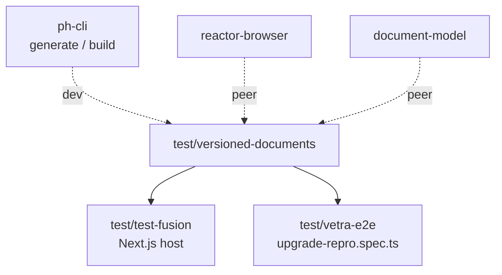

# `@powerhousedao/versioned-documents`

`test/versioned-documents` · published · v5.1.0-dev.26

---

## Purpose

A **real Vetra package** whose whole reason to exist is a Todo document model that
lives at **two versions at once** — v1 and v2, with an upgrade path between them.

It is the fixture the platform's document-model versioning story is tested against:
by `test/vetra-e2e`'s `upgrade-repro.spec.ts`, by `test/test-fusion`, and by
anything that needs "a document type that has changed shape".

Although it lives under `test/`, it is **published** and it is in the root
`pnpm test:ci` and `pnpm build` filter lists.

---

## Functionality

It is structured exactly like a user's package, because it must behave like one.

```
document-models/todo/
  todo.json
  index.ts
  upgrades/
    versions.ts          # the version registry
    upgrade-manifest.ts  # how v1 documents become v2
    v2.ts
    index.ts
  v1/
    schema.graphql, module.ts, actions.ts, gen/, src/, hooks.ts, utils.ts, tests/
  v2/
    schema.graphql, module.ts, actions.ts, gen/, src/, hooks.ts, utils.ts, tests/
editors/todo-editor/
processors/            # connect.ts, switchboard.ts, factory.ts
subgraphs/
powerhouse.config.json, powerhouse.manifest.json
index.html, main.tsx, style.css
Dockerfile, docker/
```

The two version directories are **complete, parallel implementations** — each with
its own schema, module, generated action creators, reducers, hooks and tests.
`upgrades/upgrade-manifest.ts` is the migration between them.

### Creating the fixture

```json
"create:todo": "tsx scripts/create-versioned-todo.ts && ph-cli generate document-model --document ./scripts/versioned-todo.zip"
```

The fixture is generated from a `.zip` document-model spec through the real
`ph-cli generate` path, not hand-written — so it stays representative of what the
generator emits.

### Exports

`.`, `./document-models`, `./document-models/*`, `./editors`, `./editors/*`,
`./subgraphs`, `./processors`, `./manifest`, `./style.css` — the standard Vetra
package export map.

### Peer dependencies

`@powerhousedao/reactor-browser` and `document-model` are declared as **peers**
(with a long devDependency list alongside). That is the shape a real published user
package has, and it is part of what this fixture proves.

---

## Test infrastructure

- **Runner:** Vitest with `@vitejs/plugin-react` and `vite-tsconfig-paths`,
  `globals: true`.
- **Scale:** 9 test files, split across the two versions:

| Location | Covers |
|---|---|
| `document-models/todo/v1/tests/` and `v1/src/tests/` | The v1 model and its reducers |
| `document-models/todo/v2/tests/` and `v2/src/tests/` | The v2 model and its reducers |

- **Targeted scripts:** `test:document-models`, `test:editors`, `test:processors`.
- **It is in the root `pnpm test:ci` filter list** — so its suites run on every CI
  pass, and its build runs in `simulate-ci-workflow`
  (`pnpm --filter=@powerhousedao/versioned-documents --no-bail run build`).
- All of `build`, `generate`, `connect`, `reactor`, `service`, `migrate`, `vetra`
  delegate to `ph-cli`, the same as a user project.

`AGENTS.md` carries the standard "Powerhouse Document Models Assistant" prompt, and
a `docker/` directory plus `Dockerfile` allow running it in a container.

---

## How it is used



| Consumer | Why |
|---|---|
| [`test-fusion`](test-fusion.md) | A plain Next.js webapp using `RemoteDocumentController` against these models — its `test:e2e` script builds this package first |
| [`vetra-e2e`](vetra-e2e.md) | Drives a v1 → v2 upgrade through the Vetra studio UI |

Its dev dependency list — `analytics-engine-core`, `connect`, `design-system`,
`ph-cli`, `reactor`, `reactor-api`, `reactor-browser`, `shared`, `document-model` —
means it also functions as a **compilation canary**: if a published surface changes
shape, this package stops building, and it builds on every CI run.

Related fixtures: [`test-consumer-project`](test-consumer-project.md) is the cheaper
typecheck-only equivalent; `packages/reactor-group` and `packages/vetra` are
production packages with the same internal shape.
