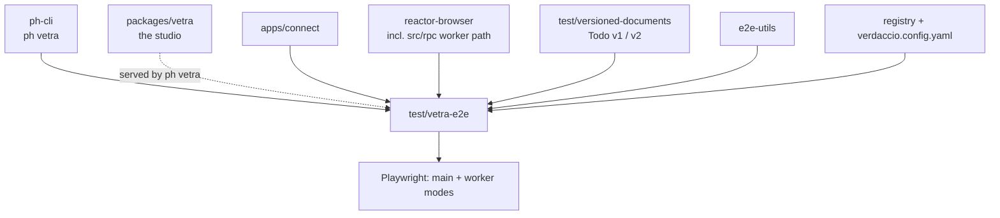

# `test-package-vetra`

`test/vetra-e2e` · published (unscoped, `test-package-vetra`) · v1.0.0

---

## Purpose

Playwright coverage of the **Vetra studio** — the local development environment
`ph vetra` starts (Vetra Studio, a local Connect, plus a local Switchboard with
`reactor-mcp`).

It is also a real Vetra package in its own right: it has `powerhouse.config.json`,
`powerhouse.manifest.json`, `document-models/`, `editors/`, `processors/`,
`subgraphs/` and an `index.html`. The tests run against a studio serving *this*
package, so the harness is simultaneously the fixture.

---

## Functionality

### The suites (`tests/`, 13 specs)

| Spec | Covers |
|---|---|
| `hello-world.spec.ts` | Smoke |
| `vetra-drive.spec.ts` | The Vetra drive app |
| `document-creation.spec.ts` | Creating documents through the UI |
| `todo-document.spec.ts` | Editing a generated model |
| `add-drive-app-order.spec.ts` | Drive-app ordering |
| `generic-drive-hidden-vetra-documents.spec.ts` | That Vetra's own documents stay hidden in the generic explorer |
| `hmr-no-reload.spec.ts` | Hot module replacement without a full page reload — the inner-loop guarantee |
| `reactor-worker-mode.spec.ts` | Reactor running in a Web Worker |
| `reactor-worker-multi-tab.spec.ts` | Two tabs sharing one worker-hosted reactor |
| `renown-login.spec.ts` | Wallet sign-in |
| `runtime-config-preview.spec.ts`, `runtime-config-read.spec.ts` | Connect's runtime `powerhouse.config.json` |
| `upgrade-repro.spec.ts` | A document-model upgrade reproduction |
| `tests/helpers/` | Local helpers on top of `@powerhousedao/e2e-utils` |

The two worker specs and the multi-tab one are the sharpest tests of
`reactor-browser`'s `src/rpc/` layer anywhere in the repo.

### Layout

| Path | Contents |
|---|---|
| `document-models/`, `editors/`, `processors/`, `subgraphs/` | The package's own modules |
| `global-setup.ts`, `global-teardown.ts` | Studio lifecycle around the run |
| `start-vetra.sh`, `reset-env.sh` | Starting the studio; clearing state |
| `verdaccio.config.yaml` | A local registry for package resolution |
| `e2e-fixtures/` | Fixture data |
| `mcr.config.ts` | Coverage reporting config (monocart) |
| `CLAUDE.md` | Notes, including a full "Powerhouse Document Models Assistant" prompt with MCP usage rules |

---

## Test infrastructure

### Three Playwright configs

| Config | Purpose |
|---|---|
| `playwright.config.ts` | The main suite |
| `playwright.repro.config.ts` | Reproduction runs |
| `playwright.repro-external.config.ts` | Reproductions against an external target |

### Scripts

```json
"test":           "rimraf .ph && playwright test",
"test:ui":        "rimraf .ph && playwright test --ui",
"test:worker":    "rimraf .ph && PH_REACTOR_WORKER=1 playwright test",
"test:worker:ui": "rimraf .ph && PH_REACTOR_WORKER=1 playwright test --ui"
```

Two details:

- **`rimraf .ph` before every run.** `.ph` holds local project state; a stale one
  makes results meaningless. The harness deletes it rather than trying to reconcile.
- **`PH_REACTOR_WORKER=1`** reruns the *entire* suite with the reactor in a Web
  Worker. Both modes must pass. Root scripts: `pnpm test:e2e:vetra` and
  `pnpm test:e2e:vetra:worker`.

Note `test:worker` uses the POSIX `VAR=value cmd` prefix directly, so that script
needs a POSIX shell (unlike the rest of the repo, which uses `cross-env` — see the
comment in `pnpm-workspace.yaml`'s catalog).

CI: `.github/workflows/e2e-tests.yml`.

### Other scripts

`generate`, `connect`, `reactor`, `vetra`, `service`, `build` all delegate to
`ph-cli` — it behaves like a user's project, which is the point.

---

## How it is used

Dependencies: `document-model`, `@powerhousedao/connect`,
`@powerhousedao/reactor-browser`, `@powerhousedao/design-system`,
**`@powerhousedao/versioned-documents`**. Dev: `ph-cli`, `e2e-utils`, `registry`.



The dependency on [`versioned-documents`](versioned-documents.md) is what makes
`upgrade-repro.spec.ts` possible — it supplies a Todo model existing at both v1 and
v2, so an upgrade can be driven through the UI.

Nothing depends on this package.

Related: [`package-e2e`](package-e2e.md) covers the publish/install path;
this one covers the develop-in-the-studio path.
