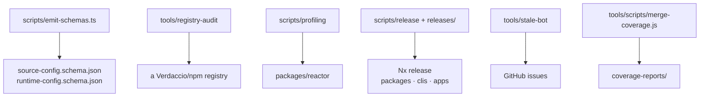

# Tooling — `tools/*` and `scripts/*`

Repo maintenance, not product. Three of these are workspace packages
(`scripts/dark-mode`, `scripts/profiling`, `scripts/release`); the rest are plain
directories invoked through root scripts.

---

## `tools/registry-audit`

**Root scripts:** `audit:download`, `audit:extract`, `audit:analyze`,
`audit:typecheck`, `audit:load`, `audit:create-query`

> A phased pipeline of small, explicit tools that audit every package published to a
> Verdaccio/npm registry. Each phase is independently runnable and idempotent, and
> threads state through a single `manifest.json`.

The design point from its README: the tools are **generic** — what to look for is
supplied as data (rules, patterns, override targets), not baked in. The first use
case was finding which published document models referenced the legacy attachment
system removed in `163a5f6f1`, but the pipeline works for any future change.

State lives under the gitignored repo-root `.cache/registry-audit/`:

```
.cache/registry-audit/
  manifest.json     # threads the phases together
  report.json       # analyze.ts output
  tarballs/         # download.ts output
  extracted/        # extract.ts output
  typecheck/        # typecheck.ts scaffolds
```

Files: `download.ts`, `extract.ts`, `analyze.ts`, `typecheck.ts`, `load.ts`,
`load-worker.ts`, `create-query.ts`, `create-query-worker.ts`, `lib.ts`, `rules/`.

Reach for it before a breaking change: it answers "how many published packages will
this break, and which ones".

---

## `tools/stale-bot`

A standalone daily stale-issue sweeper for a GitHub repo. Its README is explicit
that it is *"not an OMP plugin — a plain Node folder that shells out to `gh`
(GitHub) and `omp -p` (a headless drafter agent)."*

What a sweep does:

| Action | Condition |
|---|---|
| **Stale** | An open, non-exempt issue quiet for ≥ `daysBeforeStale` days gets a summary comment plus the `Stale` label |
| **Close** | An already-stale issue quiet for a further ≥ `daysBeforeClose` days gets a final comment and is closed as `not_planned` |
| **Re-activate** | A staled issue with new non-bot activity since the label gets the label removed, silently |

The decision is mechanical — an engagement score of
`3×distinct users + 2×(comments + reactions) + weeks since update`, plus quiet
windows, per-sweep caps, exempt labels, and idempotent paired writes. Only the
*comment text* is drafted by the agent (`agents/stale-bot.md`).

Files: `run.mjs`, `config.json`, `harness/lib/`, `agents/stale-bot.md`.

---

## `tools/scripts`

Three loose scripts: `check-deps.sh`, `merge-coverage.js` (combines per-package
coverage into `coverage-reports/`), and `release.ts`.

---

## `scripts/` (repo root)

| Path | Purpose |
|---|---|
| `emit-schemas.ts` | **Generates the two committed JSON Schemas** — `packages/shared/clis/source-config.schema.json` and `packages/builder-tools/connect-utils/runtime-config.schema.json`. Both `CLAUDE.md` files warn never to hand-edit those. Run after changing a Connect config field |
| `install`, `install.ps1`, `install-binary.sh`, `install-binary.dev.sh`, `install-binary.staging.sh` | Installers for the `ph` binary across the dev/staging/prod channels |
| `new-worktree.sh` | Creates a git worktree set up for this repo |
| `simulate-fresh-git-clone.sh` | Verifies the repo builds from a clean clone — the local counterpart to `pnpm simulate-ci-workflow` |
| `dark-mode/` | Workspace package, see below |
| `profiling/` | Workspace package, see below |
| `release/` | Workspace package, see below |

---

## `scripts/dark-mode` (workspace package, private)

A one-off codemod for the design system's dark-mode migration, built on **ts-morph**.

`main.ts` orchestrates; `find-files-with-classes.ts`, `get-all-classes.ts` and
`count-classes.ts` survey; `mappings.ts` and `token-mappings.ts` hold the
light→dark class mapping; `add-classes.ts`, `remove-classes.ts`,
`replace-classes.ts` and `make-class-names.ts` apply it; `ts-morph.ts` is the AST
wrapper.

No workspace dependencies, no tests. The repo-root `all-classes.json` and
`packages/design-system/color-map.txt` are its data. Historical, but worth knowing
about if a similar sweep is ever needed.

---

## `scripts/profiling` (workspace package, named `scripts`)

**Depends on:** `@powerhousedao/opentelemetry-instrumentation-reactor`,
`@powerhousedao/pglite-fs`, `@powerhousedao/reactor`, `document-model`.

A local profiling rig for the reactor.

| File | Purpose |
|---|---|
| `reactor-direct.ts`, `run-reactor-direct.sh` | Drive a reactor directly, without a server |
| `docs-create.ts`, `docs-list.ts`, `docs-count.ts`, `docs-reset.ts` | Document workload generators |
| `pg-statement-diff.ts` | Compare Postgres statement stats between runs — finds query regressions |
| `pyroscope-analyse.ts`, `switchboard-pyroscope.sh` | Continuous profiling via Pyroscope |
| `docker-compose.yml`, `otel-collector-config.yaml`, `prometheus.yml` | The observability stack |
| `build-packages.sh` | Builds what the rig needs |

No tests. It is the manual complement to `packages/reactor/bench/`, which is the
repeatable, recorded benchmark harness.

---

## `scripts/release` (workspace package, `@powerhousedao/release-script`, private)

*"Interactive release helper for the Powerhouse monorepo. Walks devs through dev,
staging, and production releases."*

Root script: `pnpm release-wizard` → `tsx scripts/release/index.ts`.
Files: `index.ts`, `flows.ts`, `actions.ts`, `ui.ts`, `exec.ts`, `lib.ts`.

It sits alongside the non-interactive path:

```
pnpm run-release        # bun releases/patch-nx-publish.ts && bun releases/release.ts
pnpm run-release-safe   # --verbose --skip-publish --skip-changelog --skip-push
```

`releases/` at the repo root is excluded from the pnpm workspace
(`!releases` in `pnpm-workspace.yaml`). Nx handles versioning and changelogs —
`nx.json`'s `release` block covers `packages/*`, `packages/analytics-engine/*`,
`clis/*` and `apps/*`, with `conventionalCommits: true` and
`updateDependents: "auto"`.

The full process is documented in `RELEASE.md` (with `release-flow.png`) and
`RELEASE-NOTES.md`. The repo's branching strategy: `main` carries tag `dev`,
`Release/staging/v.x.x` carries `staging`, and production is `Release/production/v.x.x`
under `latest`/`prod`.

---

## Where the tooling meets the code


